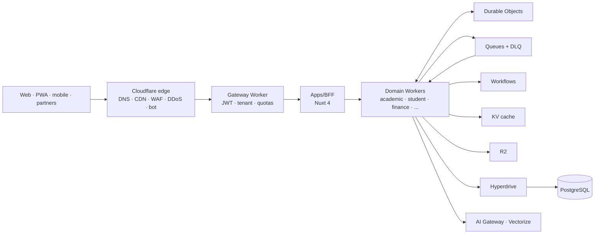

# Athena School Management Platform

A multi-tenant, API-first, event-driven school management platform for **every education level** —
creche and nursery, primary, secondary, TVET, college and university — designed for production scale
(1M daily active users, 100k peak concurrent sessions) on **Cloudflare**.

> **Current state:** planning baseline + Nuxt 4 prototype. The production architecture, database
> schemas, security model and delivery plan live in [`docs/`](docs/README.md). The existing Nuxt app
> is a prototype that will move to `apps/portal` in Phase 2.

## Start here

| Audience | Document |
|---|---|
| Everyone | [Documentation index](docs/README.md) · **[Navigation map](docs/NAVIGATION.md)** |
| Big picture | [Full context diagram](docs/01-architecture/full-context.md) |
| Product / scope | [Vision & scope](docs/00-product/vision-and-scope.md) · [Requirements](docs/00-product/requirements.md) |
| Architecture | [System architecture](docs/01-architecture/system-architecture.md) · [Service catalog](docs/01-architecture/service-catalog.md) |
| Cloudflare review | [Review of the supplied implementation plan](docs/01-architecture/cloudflare-platform-review.md) |
| Engineering | [Monorepo & tooling](docs/01-architecture/monorepo-and-tooling.md) · [DB conventions](docs/03-data/database-conventions.md) |
| Security | [Security architecture](docs/04-security/security-architecture.md) · [Identity & access](docs/04-security/identity-and-access.md) |
| Delivery | [SDLC plan](docs/06-sdlc/sdlc-plan.md) · [Roadmap, risks & cost](docs/09-roadmap/roadmap-risks-cost.md) |
| Decisions | [ADRs](docs/adr/README.md) |

## Target architecture in one view



- **Microservices in a monorepo** — independently deployed Nitro Workers, service bindings for sync,
  Queues for async, Workflows for long-running work, Durable Objects for coordination.
- **PostgreSQL is the source of truth** — schema per service, Hyperdrive, RLS + explicit tenant
  predicates.
- **Cloudflare-native** — WAF, Turnstile, API Shield, R2, Queues, Workflows, DO, Hyperdrive,
  Analytics Engine, Logpush, Images, Stream, AI Gateway.
- **Deliberate exceptions** — PostgreSQL, managed OIDC identity and money/messaging providers are
  outside Cloudflare, with documented reasons and exit paths.

## Repository today

```text
app/            Nuxt 4 prototype (pages, layouts)
server/         Prototype Nitro routes (health, admin placeholder)
shared/         Reserved for shared types/schemas
public/         Static assets
docs/           Production plan, architecture, schemas, security, SDLC
```

The target monorepo layout (`apps/*`, `services/*`, `packages/*`, `infra/*`, `tools/*`) is defined in
[docs/01-architecture/monorepo-and-tooling.md](docs/01-architecture/monorepo-and-tooling.md).

## Prototype development

```bash
pnpm install
pnpm dev          # http://localhost:3000
pnpm build
pnpm preview
```

## Non-negotiables

1. Tenant isolation in depth (token → gateway → service → SQL → RLS → storage).
2. Every write auditable; every financial/grading record immutable or versioned.
3. Every sync call has timeout/retry/circuit breaker; every consumer is idempotent.
4. No shared tables across services; integration via APIs/events only.
5. Security, privacy and accessibility are release gates.
6. Build for failure: notifications, reporting and AI can degrade without blocking enrolment,
   attendance or payments.

## Documentation governance

Docs are versioned with code and changed through pull requests. Every phase gate requires updated
docs, threat model, runbooks and API contracts. See [docs/README.md](docs/README.md) §2.
