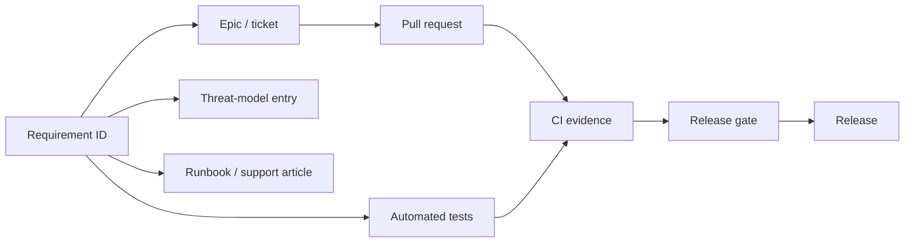

# Requirements

> **Status:** Accepted baseline · **Owner:** Product & Architecture · **Version:** 1.0
>
> Requirement IDs are permanent. They are referenced by tests, tickets, threat-model entries and
> release gates. `FR` = functional, `NFR` = non-functional. Priority uses MoSCoW.

## 1. Requirement conventions

- **Format:** `FR-<DOMAIN>-<NNN>`. Domains map to bounded contexts.
- **Acceptance:** every `MUST` requirement has at least one automated acceptance test (API or E2E)
  and, where security-relevant, a negative test.
- **Changes:** new requirements need a product owner approval; removing a `MUST` requires an ADR.
- **Traceability:** epic → requirement ID → test IDs → release. The traceability matrix is generated
  from test metadata in CI (see [Test strategy](../08-quality/test-strategy.md)).

Domains: `TEN` tenancy, `IAM` identity/access, `ACA` academic, `ADM` admissions, `STU` students,
`ENR` enrolment, `SCH` scheduling, `ATT` attendance, `ASM` assessment, `BIL` billing, `PAY` payments,
`LED` ledger, `HR` human resources, `PRL` payroll, `COM` communication, `NOT` notifications,
`DOC` documents, `LMS` learning, `LIB` library, `TRN` transport, `HOS` hostel, `INV` inventory,
`HLT` health, `ENG` engagement, `RPT` reporting, `INT` integration, `AUD` audit, `PLT` platform.

## 2. Functional requirements

### 2.1 Tenancy & platform (`TEN`, `PLT`)

| ID | Priority | Requirement |
|---|---|---|
| FR-TEN-001 | MUST | A platform operator can provision a tenant with region, isolation mode, plan and initial administrator in ≤ 10 minutes, idempotently. |
| FR-TEN-002 | MUST | A tenant can contain multiple institutions (campuses, schools, colleges) with their own timezone, currency, locale and branding. |
| FR-TEN-003 | MUST | All tenant data is isolated at the database, cache, object-storage and search layers; cross-tenant access is impossible through application APIs. |
| FR-TEN-004 | MUST | A tenant can map verified custom domains; TLS certificates are issued and renewed automatically. |
| FR-TEN-005 | MUST | Feature entitlements are enforced server-side per tenant and per institution. |
| FR-TEN-006 | SHOULD | Enterprise tenants can be placed in a dedicated database/cell without code changes. |
| FR-TEN-007 | MUST | A tenant can export a complete, documented data bundle (CSV/JSON + documents) and receive a deletion certificate after offboarding. |
| FR-PLT-001 | MUST | Every request carries a W3C `traceparent`; correlation is visible to support staff without exposing PII. |
| FR-PLT-002 | SHOULD | A status page reports per-region availability and active incidents. |

### 2.2 Identity & access (`IAM`)

| ID | Priority | Requirement |
|---|---|---|
| FR-IAM-001 | MUST | Users authenticate via OIDC Authorization Code + PKCE; browser tokens are never exposed to JavaScript. |
| FR-IAM-002 | MUST | Local password authentication is optional per tenant; federation via SAML 2.0/OIDC is supported. |
| FR-IAM-003 | MUST | MFA (TOTP, WebAuthn/passkeys) can be required per role, per tenant, or for sensitive actions (step-up). |
| FR-IAM-004 | MUST | SCIM 2.0 provisioning and de-provisioning is supported for users, groups and entitlements. |
| FR-IAM-005 | MUST | Authorization combines RBAC (roles), ABAC (attributes such as institution/section) and ReBAC (guardian-of, teacher-of-student). |
| FR-IAM-006 | MUST | Permissions are deny-by-default; every API route declares a permission and is tested for 401/403. |
| FR-IAM-007 | MUST | A user may hold different roles in different institutions within the same tenant. |
| FR-IAM-008 | MUST | Delegated administration allows a head teacher to manage staff roles within their institution only. |
| FR-IAM-009 | MUST | Sessions can be revoked tenant-wide, per user, or per device within 60 seconds. |
| FR-IAM-010 | MUST | Break-glass platform access requires ticket reference, MFA, time-bound elevation and full audit. |
| FR-IAM-011 | SHOULD | Guardians can be invited by phone/email and linked to a learner only after verification. |
| FR-IAM-012 | MUST | API clients use OAuth2 client credentials or scoped API keys with rotation and last-used metadata. |

### 2.3 Academic structure (`ACA`)

| ID | Priority | Requirement |
|---|---|---|
| FR-ACA-001 | MUST | Configure institution types from early years to tertiary; level definitions are data. |
| FR-ACA-002 | MUST | Configure academic years, terms/semesters, holidays and reporting periods, including overlapping and rolling intakes. |
| FR-ACA-003 | MUST | Define programmes, courses/subjects, credit values, prerequisites and curriculum versions. |
| FR-ACA-004 | MUST | Support class-teacher (primary), subject-teacher (secondary) and course-section (tertiary) delivery models concurrently. |
| FR-ACA-005 | MUST | Sections/classes have capacity, room, teacher assignments and schedule; conflicts are detected. |
| FR-ACA-006 | MUST | Curricula can be versioned and mapped to national, IB, Cambridge or custom frameworks. |
| FR-ACA-007 | MUST | Programme progression rules (credits, prerequisites, GPA thresholds) are configurable and auditable. |
| FR-ACA-008 | SHOULD | Support multi-campus sharing of courses and cross-registration. |

### 2.4 Admissions (`ADM`)

| ID | Priority | Requirement |
|---|---|---|
| FR-ADM-001 | MUST | Publish intake-specific application forms with configurable fields, documents and fees. |
| FR-ADM-002 | MUST | Applicants can save drafts, upload documents and track status without an account (magic link), then create one. |
| FR-ADM-003 | MUST | Staff review applications through configurable stages, with scoring, comments and segregation of duties. |
| FR-ADM-004 | MUST | Offers, waitlists and rejections use approved templates; offers have expiry and acceptance/deposit rules. |
| FR-ADM-005 | MUST | Duplicate applicants are detected (email, phone, document number) without leaking existing records. |
| FR-ADM-006 | MUST | Accepted applicants convert to students atomically, preserving the application as evidence. |
| FR-ADM-007 | SHOULD | Bulk import from CSV/OneRoster/Ed-Fi with validation, dry-run and error report. |

### 2.5 Student records & enrolment (`STU`, `ENR`)

| ID | Priority | Requirement |
|---|---|---|
| FR-STU-001 | MUST | Maintain a learner record with institution-scoped student number, status and lifecycle history. |
| FR-STU-002 | MUST | Record guardians, relationships, custody/contact permissions and authorised pick-up persons. |
| FR-STU-003 | MUST | Sensitive fields (health, special needs, identifiers) are restricted by role and encrypted at rest. |
| FR-STU-004 | MUST | A learner can progress across institutions/levels while retaining one global person identity. |
| FR-STU-005 | MUST | Support learner statuses: applicant, offered, enrolled, active, suspended, withdrawn, graduated, alumni, deceased. |
| FR-STU-006 | MUST | Maintain support plans/IEPs with review dates, accommodations and need-to-know access. |
| FR-ENR-001 | MUST | Enrol a learner into a programme/term/section with effective dates and audit trail. |
| FR-ENR-002 | MUST | Prevent over-capacity enrolment unless an authorised override is recorded with reason. |
| FR-ENR-003 | MUST | Transfers, withdrawals and mid-term changes preserve history (no destructive edits). |
| FR-ENR-004 | SHOULD | Bulk enrolment and class allocation from validated spreadsheets. |

### 2.6 Scheduling (`SCH`)

| ID | Priority | Requirement |
|---|---|---|
| FR-SCH-001 | MUST | Define periods, rooms, resources and teacher availability per institution. |
| FR-SCH-002 | MUST | Generate and manually adjust timetables with hard/soft constraints (no double-booking, room type, teacher load). |
| FR-SCH-003 | MUST | Detect and block conflicts at write time; surface soft-constraint warnings. |
| FR-SCH-004 | MUST | Publish timetable views per learner, teacher, room and institution. |
| FR-SCH-005 | SHOULD | Exam scheduling with seating capacity, invigilator allocation and clash detection. |

### 2.7 Attendance (`ATT`)

| ID | Priority | Requirement |
|---|---|---|
| FR-ATT-001 | MUST | Record daily and period attendance with present/absent/late/excused/sick codes. |
| FR-ATT-002 | MUST | Teachers can take attendance offline; records sync idempotently when connectivity returns. |
| FR-ATT-003 | MUST | Attendance corrections require reason and are audited; historical records are never hard-edited. |
| FR-ATT-004 | MUST | Configurable absence thresholds trigger guardian alerts and escalation workflows. |
| FR-ATT-005 | MUST | Staff attendance/clock-in supports manual, kiosk and biometric-device sources. |
| FR-ATT-006 | SHOULD | Late arrivals and early departures are tracked with minutes. |

### 2.8 Assessment & reporting (`ASM`)

| ID | Priority | Requirement |
|---|---|---|
| FR-ASM-001 | MUST | Configure grading schemes (letter, percentage, GPA 4.0/5.0/7.0, competency, descriptive) per level/programme. |
| FR-ASM-002 | MUST | Define assessments with type, weight, max score, rubric, due date and publication state. |
| FR-ASM-003 | MUST | Teachers enter marks individually or in bulk; imports are validated and reversible before publication. |
| FR-ASM-004 | MUST | Computed totals/GPA follow a versioned, testable formula configured per scheme. |
| FR-ASM-005 | MUST | Moderation and exam-board approval are workflow-controlled with segregation of duties. |
| FR-ASM-006 | MUST | Report cards and transcripts are generated as versioned PDFs from immutable snapshots. |
| FR-ASM-007 | MUST | Results are invisible to learners/guardians until published; publication is audited. |
| FR-ASM-008 | MUST | Transcripts can be reissued with a verifiable digital signature/QR. |
| FR-ASM-009 | SHOULD | Competency-based assessment supports outcome rubrics and evidence portfolios. |

### 2.9 Billing & payments (`BIL`, `PAY`)

| ID | Priority | Requirement |
|---|---|---|
| FR-BIL-001 | MUST | Configure fee schedules per institution, programme, level, term, residency and intake. |
| FR-BIL-002 | MUST | Support mandatory/optional items, instalments, sibling discounts, scholarships, waivers and late fees. |
| FR-BIL-003 | MUST | Generate invoices deterministically and idempotently; re-running never duplicates charges. |
| FR-BIL-004 | MUST | Invoices show a human-readable breakdown and outstanding balance. |
| FR-BIL-005 | MUST | Issue credit notes/adjustments with approval and reason; never mutate a paid invoice line silently. |
| FR-PAY-001 | MUST | Accept card, bank transfer and configured mobile-money payments via licensed PSPs; never store PAN. |
| FR-PAY-002 | MUST | Payment webhooks are signature-verified, replay-protected and idempotent. |
| FR-PAY-003 | MUST | Automatic allocation to invoices; unmatched payments enter a reconciliation queue. |
| FR-PAY-004 | MUST | Refunds require dual approval and are recorded against the original payment. |
| FR-PAY-005 | MUST | Daily PSP settlement reconciliation with exception reporting. |
| FR-PAY-006 | MUST | Guardians can pay without creating a password; receipts are issued immediately. |
| FR-PAY-007 | SHOULD | Support payment plans and scheduled autopay with consent. |
| FR-LED-001 | MUST | Every financial event posts a balanced double-entry journal; the ledger is append-only. |
| FR-LED-002 | MUST | Produce trial balance, income/expense, aged receivables and budget-vs-actual reports. |

### 2.10 HR & payroll (`HR`, `PRL`)

| ID | Priority | Requirement |
|---|---|---|
| FR-HR-001 | MUST | Maintain staff records, contracts, qualifications, certifications and document expiry alerts. |
| FR-HR-002 | MUST | Leave types, balances, requests and approvals are configurable per institution and role. |
| FR-HR-003 | MUST | Recruitment pipeline from vacancy to offer, with equal-opportunity data segregation. |
| FR-PRL-001 | MUST | Payroll runs are versioned, previewable, approved and locked; historical payslips are immutable. |
| FR-PRL-002 | MUST | Salary structures, allowances, deductions, loans and statutory contributions are configurable and effective-dated. |
| FR-PRL-003 | MUST | Payroll input changes are audited and reconciled to HR and finance. |
| FR-PRL-004 | MUST | Produce bank payment files and statutory returns in jurisdiction-specific formats. |
| FR-PRL-005 | SHOULD | Employee self-service for payslips, leave and personal data changes. |

### 2.11 Communication & notifications (`COM`, `NOT`)

| ID | Priority | Requirement |
|---|---|---|
| FR-COM-001 | MUST | Send announcements to audiences defined by institution, role, section, programme or custom list. |
| FR-COM-002 | MUST | Two-way guardian-teacher messaging with moderation, attachments and retention rules. |
| FR-COM-003 | MUST | Message templates support variables, localization and approval before bulk send. |
| FR-NOT-001 | MUST | Deliver via email, SMS, push and in-app with per-user preferences and quiet hours. |
| FR-NOT-002 | MUST | Delivery attempts, bounces and failures are tracked; retries are bounded with a DLQ. |
| FR-NOT-003 | MUST | Emergency broadcasts bypass quiet hours with explicit authorisation and audit. |
| FR-NOT-004 | MUST | Never include sensitive data in SMS/email bodies beyond what policy allows. |

### 2.12 Documents (`DOC`)

| ID | Priority | Requirement |
|---|---|---|
| FR-DOC-001 | MUST | Upload, virus-scan, version and soft-delete documents with per-tenant encryption keys. |
| FR-DOC-002 | MUST | Access is granted by permission and relationship, never by guessable URL; signed URLs expire ≤ 15 min. |
| FR-DOC-003 | MUST | Retain documents per policy and legal hold; deletions are logged and irreversible after grace period. |
| FR-DOC-004 | SHOULD | Generate PDFs (receipts, report cards, letters) server-side from versioned templates. |

### 2.13 Learning, library, transport, hostel, inventory, health (`LMS`…`HLT`)

| ID | Priority | Requirement |
|---|---|---|
| FR-LMS-001 | MUST | Courses contain modules, resources, assignments and quizzes; assignments support rubrics and feedback. |
| FR-LMS-002 | MUST | Submissions are timestamped, plagiarism-checkable via integration, and retained per policy. |
| FR-LIB-001 | MUST | Catalogue titles/copies, issue/return, reservations, fines and lost-item handling. |
| FR-TRN-001 | MUST | Manage routes, stops, vehicles, drivers, learner assignments and guardian visibility of trips. |
| FR-HOS-001 | MUST | Manage hostels, rooms, beds, allocations, roll-call and exeat/leave permissions. |
| FR-INV-001 | MUST | Track stock items, assets, locations, movements, reorder levels and maintenance. |
| FR-HLT-001 | MUST | Record clinic visits, medication administration and immunisations with strict need-to-know access and consent. |

### 2.14 Engagement (`ENG`)

| ID | Priority | Requirement |
|---|---|---|
| FR-ENG-001 | MUST | Record behaviour/merit incidents with confidentiality, sanctions and guardian communication. |
| FR-ENG-002 | MUST | Manage clubs, teams and activities with membership and schedules. |
| FR-ENG-003 | SHOULD | Alumni directory, events and donation campaigns with consent-based visibility. |

### 2.15 Reporting & integration (`RPT`, `INT`)

| ID | Priority | Requirement |
|---|---|---|
| FR-RPT-001 | MUST | Role-scoped dashboards for enrolment, attendance, finance, academic performance and staff. |
| FR-RPT-002 | MUST | Ad-hoc reports can be exported (CSV/XLSX/PDF) with row-level authorization and audit. |
| FR-RPT-003 | MUST | Cross-institution group analytics for authorised group administrators. |
| FR-RPT-004 | SHOULD | Scheduled report delivery with watermarking and expiring links. |
| FR-INT-001 | MUST | Public REST API with OpenAPI 3.1, versioning, idempotency and rate limits. |
| FR-INT-002 | MUST | Webhooks with HMAC signatures, retries, replay protection and delivery logs. |
| FR-INT-003 | MUST | Connectors for at least: payment providers, email/SMS, Google Workspace/Microsoft 365, accounting export, Moodle and biometric devices. |
| FR-INT-004 | MUST | Data import/export using CSV plus OneRoster/Ed-Fi adapters where applicable. |

### 2.16 Audit (`AUD`)

| ID | Priority | Requirement |
|---|---|---|
| FR-AUD-001 | MUST | Record security, administrative and financial events with actor, tenant, IP, user agent, target, before/after and trace ID. |
| FR-AUD-002 | MUST | Audit records are append-only, tamper-evident (hash chain) and retained ≥ 7 years. |
| FR-AUD-003 | MUST | Authorised auditors can search and export audit evidence without access to unrelated tenant data. |
| FR-AUD-004 | MUST | Break-glass and permission changes generate immediate security alerts. |

## 3. Non-functional requirements

Targets are measured at the gateway over a rolling 28 days unless stated otherwise.

### 3.1 Performance & scalability

| ID | Requirement | Target |
|---|---|---|
| NFR-PERF-001 | Read API latency (edge, excluding client network) | p95 ≤ 300 ms, p99 ≤ 800 ms |
| NFR-PERF-002 | Write API latency | p95 ≤ 800 ms, p99 ≤ 2 s |
| NFR-PERF-003 | Portal Largest Contentful Paint (3G Fast, mid-tier Android) | p75 ≤ 2.5 s |
| NFR-PERF-004 | Interactive response after navigation | p75 ≤ 200 ms |
| NFR-PERF-005 | Report card generation (500 learners) | ≤ 5 min, asynchronous with progress |
| NFR-PERF-006 | Payment webhook processing | p95 ≤ 2 s |
| NFR-PERF-007 | Notification fan-out (10k recipients) | ≤ 10 min |
| NFR-PERF-008 | Cache hit ratio for public/reference reads | ≥ 90% at edge |
| NFR-SCALE-001 | Daily active users (all tenants) | 1,000,000 |
| NFR-SCALE-002 | Peak concurrent sessions | 100,000 (design), 50,000 tested before GA |
| NFR-SCALE-003 | Sustained / burst API request rate | 10,000 RPS / 30,000 RPS |
| NFR-SCALE-004 | Tenants per cell | 2,000 shared / 1 dedicated |
| NFR-SCALE-005 | Learners per tenant | 250,000 |
| NFR-SCALE-006 | Horizontal scale | Stateless Workers; scale on RPS; DB scale via replicas and cells |
| NFR-SCALE-007 | Queue consumer throughput | ≥ 5,000 messages/s per service at peak |

### 3.2 Availability & resilience

| ID | Requirement | Target |
|---|---|---|
| NFR-AVL-001 | Core API monthly availability | 99.9% (43m 12s downtime) |
| NFR-AVL-002 | Payment capture availability | 99.95% |
| NFR-AVL-003 | Planned maintenance | Zero-downtime; no maintenance window for core |
| NFR-AVL-004 | Single AZ failure | No data loss; automatic recovery; SLO maintained |
| NFR-AVL-005 | Region failure (Tier-1 data) | RTO ≤ 1 h, RPO ≤ 5 min |
| NFR-AVL-006 | Graceful degradation | Attendance/marks capture works if notifications/reporting/AI are down |
| NFR-AVL-007 | Data durability | 99.999999999% object; PITR ≥ 35 days for databases |
| NFR-AVL-008 | Edge dependency failure | Static/public content served from cache; auth fails closed; writes queue locally where supported |
| NFR-AVL-009 | Cell isolation | A failing cell does not degrade another cell's SLO; tenant-to-cell map is authoritative |

### 3.3 Security

| ID | Requirement | Target |
|---|---|---|
| NFR-SEC-001 | Security standard | OWASP ASVS Level 3 for auth, payments, PII; Level 2 minimum elsewhere |
| NFR-SEC-002 | Encryption | TLS 1.3 in transit (1.2 minimum for legacy devices); AES-256 at rest; per-tenant DEKs |
| NFR-SEC-003 | Authentication | MFA available for all; mandatory for privileged roles; passkey support |
| NFR-SEC-004 | Session | Access token ≤ 10 min; refresh rotation; idle timeout 30 min (admin 15 min) |
| NFR-SEC-005 | Authorization | Deny-by-default; 100% of routes covered; automated negative tests |
| NFR-SEC-006 | Vulnerability remediation | Critical ≤ 7 days, High ≤ 30 days, Medium ≤ 90 days |
| NFR-SEC-007 | Secrets | No secrets in code/images; managed vault; rotation ≤ 90 days |
| NFR-SEC-008 | Supply chain | Signed images, SBOM, SLSA level 3 provenance, pinned dependencies |
| NFR-SEC-009 | Audit | 100% of privileged and financial actions; tamper-evident |
| NFR-SEC-010 | Penetration test | Before GA and annually; all critical/high remediated |

### 3.4 Privacy & compliance

| ID | Requirement | Target |
|---|---|---|
| NFR-PRI-001 | Lawful basis and consent | Captured per purpose; withdrawable; versioned policy text |
| NFR-PRI-002 | Data subject requests | Access/export ≤ 30 days; erasure where lawful ≤ 30 days |
| NFR-PRI-003 | Data minimisation | Documented purpose and retention for every PII field |
| NFR-PRI-004 | Child data | Guardian consent where required; age-appropriate notices; no behavioural advertising |
| NFR-PRI-005 | Retention | Configurable per record class; legal hold supported |
| NFR-PRI-006 | Breach notification | Detect ≤ 24 h, assess ≤ 72 h, regulator notification workflow |
| NFR-PRI-007 | Residency | Tenant data pinned to contracted region; backups in-region |
| NFR-PRI-008 | Compliance | SOC 2 Type I at GA, Type II within 12 months; ISO 27001 aligned |

### 3.5 Usability & accessibility

| ID | Requirement | Target |
|---|---|---|
| NFR-UX-001 | Accessibility | WCAG 2.2 AA on all user-facing surfaces; zero critical axe issues |
| NFR-UX-002 | Keyboard | All flows operable by keyboard; visible focus; no traps |
| NFR-UX-003 | Localization | ICU messages, RTL support, per-user locale, localized dates/numbers/currency |
| NFR-UX-004 | Mobile | Responsive 320px+; teacher attendance usable one-handed |
| NFR-UX-005 | Onboarding | New teacher completes first attendance in ≤ 10 minutes without training |
| NFR-UX-006 | Error handling | Plain-language errors with recovery action and support reference |

### 3.6 Operability & maintainability

| ID | Requirement | Target |
|---|---|---|
| NFR-OPS-001 | Deployment | Any service deployable independently in ≤ 15 min |
| NFR-OPS-002 | Rollback | ≤ 5 min to previous version; database changes backward-compatible |
| NFR-OPS-003 | Observability | 100% services emit traces, metrics, structured logs; RED/USE dashboards |
| NFR-OPS-004 | Alerting | Symptom-based, actionable, linked to runbook; < 5 pages/week/team |
| NFR-OPS-005 | Test coverage | ≥ 80% lines overall; ≥ 90% on money, auth and grading logic |
| NFR-OPS-006 | Documentation | Every service has README, OpenAPI, runbook and ownership metadata |
| NFR-OPS-007 | Portability | Domain/application code free of Cloudflare imports; adapters behind ports; documented exit paths |
| NFR-OPS-008 | Cost | Unit cost per active learner tracked monthly; 20% headroom at peak |

### 3.7 Cloudflare platform

| ID | Requirement | Target |
|---|---|---|
| NFR-CF-001 | Worker request CPU | ≤ 50 ms p95, ≤ 200 ms p99; long work offloaded |
| NFR-CF-002 | Worker memory | Stay < 50% of runtime limit at p99; stream large payloads |
| NFR-CF-003 | Queue delivery | At-least-once; consumers idempotent; DLQ for poison messages |
| NFR-CF-004 | Durable Object hot keys | No object > 100 req/s except deliberately sharded limits |
| NFR-CF-005 | KV usage | Cache only; TTL ≤ 60 s for auth-adjacent data; no authoritative state |
| NFR-CF-006 | R2 | Presigned URLs ≤ 15 min; object lock for audit; lifecycle enforced |
| NFR-CF-007 | Hyperdrive | Pool saturation < 70%; tenant context set per transaction |
| NFR-CF-008 | Workflows | Every step idempotent; retries bounded; operator-visible status |
| NFR-CF-009 | Edge security | WAF, DDoS, bot management and API Shield enabled in production |
| NFR-CF-010 | Data residency | Workers execution and DB/backups pinned to contracted region where required |

### 3.8 Data quality & integrity

| ID | Requirement | Target |
|---|---|---|
| NFR-DQ-001 | Referential integrity | Enforced within a service database; cross-service via events and reconciliation |
| NFR-DQ-002 | Idempotency | All write APIs accept `Idempotency-Key`; consumers deduplicate by event ID |
| NFR-DQ-003 | Concurrency | Optimistic concurrency (`version`/ETag) on mutable aggregates |
| NFR-DQ-004 | Financial integrity | Ledger debits = credits per journal; daily reconciliation report |
| NFR-DQ-005 | Time | UTC storage, IANA timezones for display and scheduling; no naive datetimes |
| NFR-DQ-006 | Backups | Restore tested monthly; integrity verified |

## 4. Example acceptance criteria

**FR-ATT-002 — offline attendance**

```gherkin
Given a teacher has an assigned section and an open attendance session
And the device loses connectivity
When the teacher marks 30 learners present, 2 absent and submits
Then the records are stored locally with a client-generated idempotency key
And the UI shows "saved offline — will sync"
When connectivity returns
Then the records sync exactly once
And the teacher sees confirmation with server timestamps
And a duplicate submission does not create duplicate records
And any conflict with a server-side correction is surfaced, never silently overwritten
```

**FR-PAY-003 — unmatched payment**

```gherkin
Given a verified PSP webhook for a successful payment with reference "PSP-123"
And no invoice reference is present
When the payment is recorded
Then it is placed in the reconciliation queue with amount, payer and PSP reference
And the guardian's account shows an unallocated credit
And finance staff are notified according to the configured rule
And no invoice is marked paid until an authorised user allocates the credit
```

## 5. Traceability & change control



- CI publishes a traceability report per release: requirement → tests → result.
- A `MUST` requirement without passing tests blocks the release unless a documented waiver is
  approved by the Product Owner and Security (for security requirements).
- Requirement changes are versioned in Git; the changelog is the document history.
