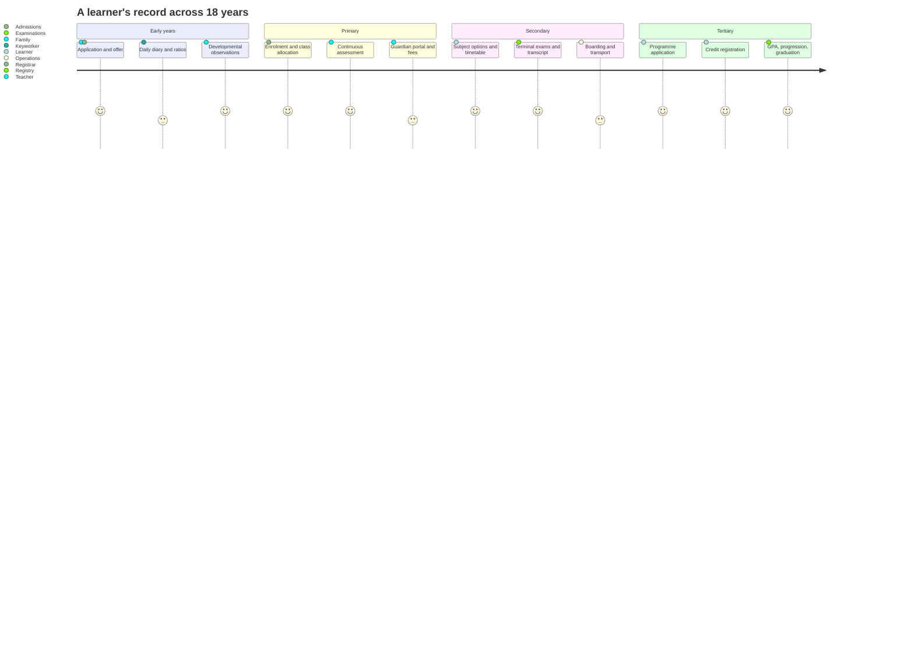

# Vision & Scope

> **Status:** Accepted · **Owner:** Product · **Version:** 1.0 · **Last reviewed:** 2026-11-10

## 1. Problem

Schools and education groups run on a patchwork of spreadsheets, WhatsApp groups, standalone
accounting packages and legacy SIS products. The consequences are predictable:

- **Duplicate and conflicting records** — the same child exists in the admissions sheet, the class
  register, the fee ledger and the bus list.
- **Revenue leakage** — unbilled fees, unmatched payments, scholarships applied inconsistently.
- **Compliance risk** — no reliable audit trail for grades, transcripts or financial adjustments.
- **Operational drag** — timetabling, report cards and payroll each consume weeks per term.
- **Poor family experience** — parents cannot see attendance, results or balances in one place.
- **No decision-grade data** — leadership cannot answer "which programme is profitable?" or
  "which cohort is at risk?" without a manual exercise.

Existing products tend to serve one level only (a K-12 SIS, a university ERP, a daycare app). Groups
that span creche → primary → secondary → tertiary are forced into multiple systems.

## 2. Vision

> **One trustworthy system of record for every learner, every shilling and every decision — from
> the first day of creche to the day a doctorate is conferred.**

Athena is a multi-tenant platform that models *education* rather than a particular school type. It
provides a stable core (people, academic structure, enrolment, money, assessment, communication)
and configurable edges (institution levels, calendars, curricula, grading, fees, workflows) so the
same product serves a nursery, a 2,000-pupil secondary school, a TVET institute and a university
consortium without forking the codebase.

### Product principles

| # | Principle | Consequence |
|---|---|---|
| P1 | **Configuration over customisation** | Institution types, terms, grading scales and fee rules are data. No code forks per customer. |
| P2 | **One learner record** | A learner can progress creche → university with one identity and a continuous record. |
| P3 | **Money must reconcile** | Every payment is allocated, every invoice is explainable, every adjustment is auditable. |
| P4 | **Teacher time is sacred** | Any repetitive task must take fewer clicks than the spreadsheet it replaces. |
| P5 | **Privacy by default** | Children's data is the highest classification; minimum collection, strict purpose limitation. |
| P6 | **Works on a weak network** | Portals remain usable on 3G and low-end Android; critical flows are offline-tolerant. |
| P7 | **Open by contract** | Everything a customer or partner needs is available through versioned APIs, events and webhooks. |
| P8 | **Accessible to everyone** | WCAG 2.2 AA is a release gate for all learner- and family-facing surfaces. |

## 3. Goals and non-goals

### Goals (18 months)

| ID | Goal | Measure |
|---|---|---|
| G1 | Replace spreadsheet-based administration for pilot institutions | ≥ 90% of pilot enrolment, attendance, billing and reporting performed in Athena |
| G2 | Single learner record across levels | 100% of progressing learners retain one `student_id` and transcript history |
| G3 | Financially trustworthy | ≥ 99.5% of payments auto-reconciled; zero unexplained ledger balances |
| G4 | Fast, reliable operations | p95 API < 300 ms read / 800 ms write; 99.9% monthly availability |
| G5 | Safe and compliant | No critical/high findings open at GA; SOC 2 Type I readiness; GDPR/UK GDPR compliance |
| G6 | Open ecosystem | Public API, webhooks and at least 10 certified integrations at GA |
| G7 | Sustainable delivery | Change failure rate < 15%, lead time < 1 day, MTTR < 30 min |

### Non-goals (v1)

- Building a full LMS to compete with Moodle/Canvas — we integrate and provide core coursework.
- Becoming a payment processor or holding customer funds — we integrate licensed PSPs.
- Full statutory tax filing in every jurisdiction — we produce filings/exports, not tax advice.
- Native desktop applications.
- Custom code branches per customer. Customer-specific behaviour must be configuration or an
  extension, otherwise it is a product decision.
- Hardware manufacturing (biometric devices, turnstiles, buses) — we integrate certified devices.

## 4. Who we serve

### 4.1 Institution types

The domain model must express all of these without schema changes. "Level" is data, not code.

| Type | Examples | Distinct needs |
|---|---|---|
| **Early years** | Creche, nursery, daycare, reception | Ratios, naps/meals, daily diaries, pick-up authorisation, allergy/medical, developmental observations |
| **Primary** | Grades 1–6 | Class-teacher model, continuous assessment, guardian communication, after-school care |
| **Secondary** | Grades 7–12, JHS/SHS | Subject teachers, option streams, terminal exams, transcripts, boarding, careers |
| **TVET / vocational** | Technical institutes, polytechnics | Competency-based training, workshop/placement hours, trade certification, industry assessors |
| **College / university** | Undergraduate, postgraduate, professional schools | Programmes, credit hours, GPA/CGPA, course registration, academic standing, research, grants |
| **Multi-academy trust / group** | Groups of schools, education districts | Cross-institution reporting, shared services, central finance, delegated administration |
| **Training provider** | Corporate academies, short courses | Cohorts, rolling intakes, certificates, corporate billing |

### 4.2 Personas

| Persona | Primary jobs | Key surfaces |
|---|---|---|
| **Prospective family** | Discover programmes, apply, upload documents, track offer | Public site, admissions portal |
| **Guardian / parent** | See attendance, results, balance; pay; communicate; authorise | Parent app/PWA |
| **Learner (minor)** | Timetable, assignments, resources, results | Student portal (age-appropriate) |
| **Learner (adult)** | Registration, transcripts, fees, research | Student portal |
| **Teacher** | Register, gradebook, lesson resources, communicate, interventions | Teacher workspace |
| **Head of department / principal** | Approve, monitor performance, handle escalations | Admin console |
| **Registrar / admissions officer** | Applications, offers, enrolment, records, transcripts | Admin console |
| **Bursar / finance officer** | Fee setup, invoicing, reconciliation, refunds, reports | Finance console |
| **HR / payroll officer** | Contracts, leave, payroll runs, statutory returns | HR console |
| **Operations staff** | Library, transport, hostel, inventory, health | Operations console |
| **IT administrator** | Users, roles, SSO, integrations, audit | Admin console |
| **Platform operator (Athena)** | Provision tenants, monitor, support (break-glass) | Control plane |
| **Auditor / accreditation body** | Read-only evidence, reports, audit trail | Auditor portal |
| **Partner developer** | Integrate via API/webhooks | Developer portal |

### 4.3 Journey: one learner, many levels

The same `person_id`/`student_id` persists; institution-specific identifiers (`student_number`)
are scoped to the institution, and enrolment records are additive. See
[Domain model](../02-domain/domain-model.md).

## 5. Capability map

```mermaid
flowchart TB
  subgraph Core["Core (MVP)"]
    A1[Tenancy & provisioning]
    A2[Identity & access]
    A3[Academic structure]
    A4[Admissions]
    A5[Student records]
    A6[Enrolment]
    A7[Attendance]
    A8[Assessment & reporting]
    A9[Billing & payments]
    A10[Notifications]
    A11[Documents]
    A12[Audit & reporting]
  end
  subgraph Expand["Expansion"]
    B1[Timetable & scheduling]
    B2[HR & payroll]
    B3[General ledger & procurement]
    B4[LMS & content]
    B5[Library]
    B6[Transport]
    B7[Boarding / hostel]
    B8[Health & wellbeing]
    B9[Behaviour & activities]
    B10[Alumni & fundraising]
    B11[Research & grants]
  end
  subgraph Differentiate["Differentiators"]
    C1[Cross-level learner record]
    C2[Configurable grading & curricula]
    C3[Financial reconciliation]
    C4[Offline-capable teacher tools]
    C5[Open API / webhooks / marketplace]
    C6[Group & district analytics]
    C7[AI-assisted admin with human approval]
  end
  Core --> Expand
  Expand --> Differentiate
```

### Feature scope by release

| Capability | MVP | GA | Post-GA |
|---|---|---|---|
| Tenancy, identity, RBAC/ABAC, audit | ✅ | ✅ | ✅ |
| Academic calendar, levels, programmes, courses | ✅ | ✅ | ✅ |
| Admissions + offers + document checklist | ✅ | ✅ | ✅ |
| Student records, guardians, enrolment | ✅ | ✅ | ✅ |
| Attendance (daily + period) | ✅ | ✅ | ✅ |
| Assessment, gradebook, report cards | ✅ | ✅ | ✅ |
| Fee schedules, invoices, online payments | ✅ | ✅ | ✅ |
| Email/SMS/in-app notifications | ✅ | ✅ | ✅ |
| Parent + student + teacher + admin portals | ✅ | ✅ | ✅ |
| Timetable & room scheduling | Partial | ✅ | ✅ |
| HR, leave, payroll | — | ✅ | ✅ |
| General ledger, procurement, budgets | — | ✅ | ✅ |
| LMS (assignments, resources, quizzes) | — | ✅ | ✅ |
| Library, transport, hostel, inventory | — | ✅ | ✅ |
| Alumni, fundraising, research | — | Partial | ✅ |
| Marketplace, custom fields, workflow designer | — | Partial | ✅ |
| AI copilots (timetable, interventions, drafting) | — | — | ✅ |

## 6. Success measures

| Category | Metric | Target at 12 months post-GA |
|---|---|---|
| Adoption | Weekly active staff / licensed staff | ≥ 70% |
| Adoption | Guardians active in last 30 days | ≥ 55% |
| Efficiency | Time to produce term report cards | ≤ 1 day (from ~2 weeks) |
| Efficiency | Invoice-to-cash cycle | ≤ 14 days median |
| Quality | Support tickets per 100 learners/month | ≤ 3 |
| Reliability | Availability (core APIs) | ≥ 99.9% |
| Reliability | Payment reconciliation rate | ≥ 99.5% |
| Security | Critical/high vulnerabilities open > 30 days | 0 |
| Satisfaction | Staff NPS | ≥ 30 |
| Satisfaction | Guardian CSAT | ≥ 4.2/5 |

## 7. Constraints and assumptions

| Type | Constraint / assumption | Impact |
|---|---|---|
| Regulatory | Learner data includes minors; GDPR/UK GDPR, local data-protection acts and FERPA-style rules apply | Privacy-by-design, DPIA, parental consent, retention rules |
| Regulatory | Financial records must be auditable for 7+ years in most jurisdictions | Immutable ledger, WORM audit archive |
| Market | Customers have intermittent connectivity and low-end devices | PWA, offline queues, small bundles |
| Market | Schools expect local payment methods (mobile money, bank transfer, cards) | Pluggable PSP adapters |
| Commercial | Multi-tenant SaaS with enterprise dedicated-deployment option | RLS default + "cell" isolation |
| Operational | Small platform team initially | Managed services, golden paths, automation over bespoke ops |
| Contractual | Data residency may be required per country | Region-pinned cells, per-tenant KMS keys |
| Scale | 1,000,000 daily active users; 100,000 peak concurrent sessions; 10,000 RPS sustained | Edge-first Workers, read replicas, caching, cell sharding; confirm load model in Phase 1 |
| Platform | Cloudflare Workers, Durable Objects, KV, R2, Queues, Workflows, Hyperdrive, Analytics Engine | Cloudflare-native services; PostgreSQL and identity are reviewed exceptions |
| Timeline | 18 months to GA with a team of ~20 | Phased service delivery (ADR-0009) |
| Existing | Current repo is a Nuxt prototype | Migrate to `apps/portal` in Phase 2 |

## 8. What "done" means for v1

A multi-campus institution can, without spreadsheets:

1. Configure its academic year, levels, programmes, courses and grading schemes.
2. Receive applications, issue offers, accept deposits and enrol learners.
3. Allocate learners to classes/sections and produce a timetable.
4. Take daily and period attendance, including offline, and notify guardians of absence.
5. Record assessments, compute grades/GPA, moderate and publish report cards/transcripts.
6. Configure fees, invoice families, collect payments online and reconcile them automatically.
7. Manage staff records, leave and a payroll run with statutory exports.
8. Communicate by email/SMS/in-app with templated, auditable messages.
9. Give every persona a role-appropriate portal with SSO/MFA.
10. Export all data, prove who changed what, and integrate via API/webhooks.
