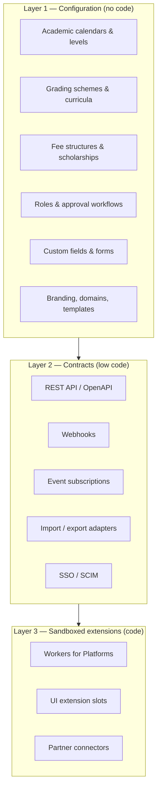
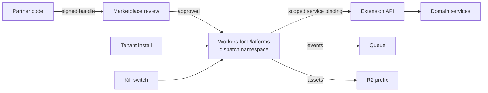
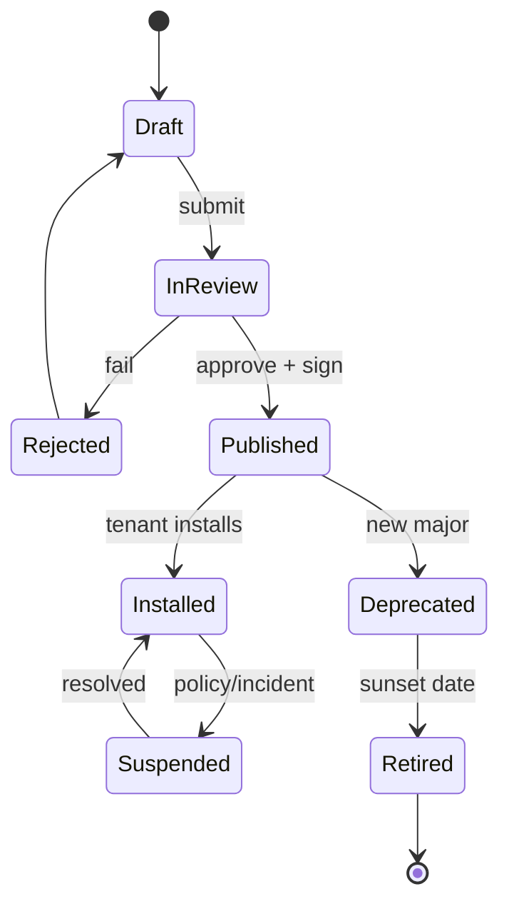

# Extensibility & Integration Model

> **Status:** Accepted · **Owner:** Architecture & Product · **Version:** 1.0
>
> Customers and partners must be able to extend Athena **without forking it, without database access
> and without weakening tenant isolation**. Extensibility is a set of versioned contracts, not a
> plugin free-for-all.

## 1. Extension layers



**Rule:** if a requirement can be met at Layer 1, it must not become code. If it can be met at
Layer 2, it must not become a sandboxed extension.

## 2. Configuration as the first extension mechanism

| Domain | Configurable | Stored as |
|---|---|---|
| Academic structure | Institution types, levels, terms, promotion rules | Versioned rows, not enums |
| Curriculum | Framework, outcomes, credit rules | Versioned curriculum |
| Grading | Schemes, bands, GPA formulas, competency rubrics | Versioned scheme + tested formula |
| Fees | Items, cohorts, instalments, discounts, late fees | Effective-dated schedules |
| Workflows | Approval chains, thresholds, escalation | Versioned state machine |
| Forms | Admissions, consent, surveys | JSON schema + validation |
| Communication | Templates, languages, sender identities | Versioned templates |
| Branding | Logo, colours, typography, domain | Tenant theme |
| Permissions | Roles composed from a fixed permission catalog | Role bundles + assignments |

Configuration is validated on write, versioned on publish, and auditable. Published versions are
immutable; changes create a new version and can be rolled back.

## 3. Custom fields

Schools always need "one more field". Adding columns per customer is not viable.

```sql
create table platform.custom_field_definition (
  id              uuid primary key,
  tenant_id       uuid not null,
  entity_type     text not null,              -- student, staff, course, invoice...
  field_key       text not null,
  label           jsonb not null,             -- localized labels
  data_type       text not null,              -- text, number, date, boolean, select, multi_select
  options         jsonb,
  required        boolean not null default false,
  searchable      boolean not null default false,
  pii_class       text not null default 'internal',
  validation      jsonb,
  version         integer not null default 1,
  created_at      timestamptz not null default now(),
  unique (tenant_id, entity_type, field_key)
);

create table platform.custom_field_value (
  tenant_id       uuid not null,
  definition_id   uuid not null,
  entity_id       uuid not null,
  value           jsonb,
  updated_at      timestamptz not null default now(),
  primary key (tenant_id, definition_id, entity_id)
);
```

Rules:

- Values are validated against the definition's JSON schema.
- Searchable fields get a generated/derived index; non-searchable fields are not indexed.
- PII classification flows into exports, audit and retention.
- Deleting a definition is soft (deprecate); values are retained or purged per policy.
- Custom fields never participate in core financial or grading invariants unless promoted to a core
  feature through product review.

## 4. Workflow configuration

Tenant-defined approvals use a **declarative state machine**, not arbitrary code.

```json
{
  "key": "invoice.adjustment",
  "version": 3,
  "states": ["draft", "submitted", "reviewed", "approved", "rejected"],
  "transitions": [
    { "from": "draft", "to": "submitted", "by": "billing:write" },
    { "from": "submitted", "to": "reviewed", "by": "billing:approve", "when": "amount < 1000" },
    { "from": "submitted", "to": "approved", "by": "finance:director", "when": "amount >= 1000" }
  ],
  "sla": { "submitted": "PT48H" },
  "escalation": { "after": "PT48H", "to": "finance:director" }
}
```

- Validated against a schema; cycles and unreachable states rejected.
- Simulated against sample data before publish.
- Runtime uses the published version; in-flight instances keep their version.
- All transitions are audited with actor, reason and version.

## 5. Public API and webhooks

- REST/JSON, OpenAPI 3.1, versioned `/v1`.
- OAuth2 client credentials and scoped API keys; per-client rate limits.
- Idempotency keys on all writes; ETags for concurrency.
- Webhooks with HMAC signatures, retries, replay protection and delivery logs.
- Developer portal: docs, sandbox tenant, API keys, event catalog, changelog.
- Deprecation policy: minimum 12 months for public APIs; `Sunset` and `Deprecation` headers.

See [API & event contracts](../05-api/api-and-event-contracts.md).

## 6. Sandboxed extensions (Workers for Platforms)

When configuration and webhooks are insufficient, partners can deploy code into an isolated
dispatch namespace.



### Extension contract

| Capability | Mechanism | Constraint |
|---|---|---|
| Read data | Scoped API via service binding | Only permissions granted at install; tenant-filtered |
| React to events | Queue subscription | At-least-once; idempotent; no PII beyond granted scope |
| Store state | Extension KV/DO/R2 namespace | Quota per tenant; no core DB access |
| Call external APIs | Outbound Worker with allowlist | Egress logged; no arbitrary internal network |
| UI | Sandboxed iframe / UI slots | CSP, no parent DOM access, postMessage only |
| Secrets | Secrets Store scoped to extension | Rotation, no logging |
| Billing | Metered usage events | Per-tenant quotas |

### Security requirements

- Code review + automated scanning before marketplace publication.
- Signed bundles (Sigstore/cosign) and immutable versions.
- No access to the core database, other tenants' namespaces, or platform secrets.
- Resource limits: CPU, memory, subrequests, storage, queue rate.
- Egress allowlist; block link-local/private ranges; log outbound destinations.
- Kill switch per extension, per tenant, globally.
- Incident process: revoke, notify affected tenants, roll back.
- Data processing agreement required for extensions that touch learner data.

**Default:** Workers for Platforms is a **post-GA** capability. Until then, extensions are webhooks +
API + configuration only. This avoids opening a large security surface before the core is stable.

## 7. Feature flags and entitlements

| Concept | Meaning | Enforcement |
|---|---|---|
| **Plan entitlement** | What the tenant bought | Server-side in every service; gateway hints only |
| **Feature flag** | Gradual rollout / kill switch | Evaluated server-side per tenant/user |
| **Quota** | Numeric limit | Gateway + service |
| **Experiment** | A/B test | Explicit consent, no impact on legal/financial behaviour |

Rules:

- Flags never grant permissions; they only enable already-authorized capabilities.
- Every flag has an owner, default, expiry and cleanup ticket.
- A flag cannot be used to hide a security control.
- Entitlement changes emit an event and are audited.
- Cloudflare Flagship is used where available; otherwise a tenant config service backed by KV/DO.

## 8. White-label and multi-brand

- Tenant theme: logo, colours, typography, favicon, email header, login illustration.
- Custom domain via Cloudflare for SaaS; TLS automated.
- Sender identities per institution with SPF/DKIM/DMARC verification.
- Localized legal pages and consent text, versioned.
- No code changes per brand; a theme is data validated against a schema.
- Accessibility is not optional: themes that fail contrast are rejected.

## 9. Integration adapters

| Category | Adapters | Direction |
|---|---|---|
| Payments | Stripe, local card/bank/mobile-money PSPs | Out + webhooks |
| Email | Transactional provider | Out |
| SMS | Local aggregators | Out |
| Push | Web Push / FCM | Out |
| Identity | OIDC/SAML IdP, SCIM | In/out |
| Productivity | Google Workspace, Microsoft 365 | Out/in |
| LMS | Moodle, Canvas (LTI/OneRoster) | In/out |
| Accounting | Xero, QuickBooks, local packages | Out |
| Government | EMIS/statutory returns | Out |
| Devices | Biometric, turnstiles, cameras via Tunnel | In |
| Analytics | Warehouse export | Out |
| AI | Model providers via AI Gateway | Out |

Adapter rules:

- One adapter interface per category; vendor-specific code isolated in `integration-service`.
- Credentials in Secrets Store, never in tenant config or logs.
- Every call has timeout, retry, circuit breaker and idempotency.
- Mapping/versioning is explicit; a provider change is a new adapter version.
- Contract tests use recorded fixtures and a sandbox account.
- Data minimisation: send only what the integration needs.

## 10. Extension lifecycle



- Semantic versioning; major versions can run side by side during migration.
- Deprecation notice ≥ 90 days for extensions, ≥ 12 months for public APIs.
- Installation requires tenant admin consent to scopes and data processing terms.
- Uninstall revokes tokens, deletes extension state after a grace period, and audits.

## 11. Anti-patterns (rejected)

| Anti-pattern | Why it is rejected |
|---|---|
| Customer-specific branches | Unmaintainable; security patches diverge. |
| Direct database access for partners | Bypasses authorization, audit and tenant isolation. |
| Arbitrary code in the core Worker | No isolation; a bug can take down all tenants. |
| Plugins that can read all tenants | Violates the core isolation invariant. |
| Unversioned webhooks | Breaks integrations silently. |
| Custom fields used for money/grades | Bypasses validation and audit. |
| Feature flags as permissions | Security bypass. |
| Silent extension egress | Data exfiltration risk. |
