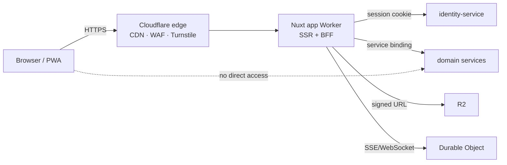
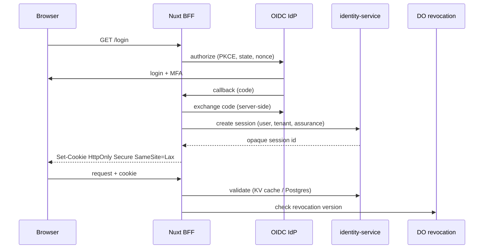
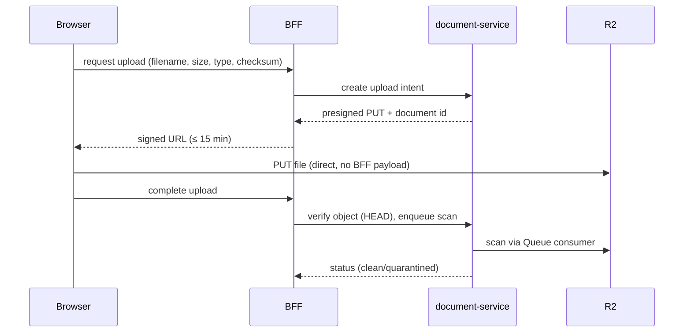

# Frontend Architecture

> **Status:** Accepted · **Owner:** Frontend Guild · **Version:** 2.0
>
> Four Nuxt 4 applications on Cloudflare Workers, one design system, one BFF contract. The browser
> never holds an access token and never talks to a domain service directly.

## 1. Applications

| App | Audience | Rendering | Key surfaces |
|---|---|---|---|
| `apps/portal` | Public, prospective families, staff entry | SSR + cache + islands | Programme discovery, application start, login, help |
| `apps/admin` | Institution administrators, registrars, finance, HR | SSR (private) | Configuration, admissions, enrolment, billing, reports, settings |
| `apps/parent` | Guardians | SSR + PWA | Children, attendance, results, invoices, payments, messages, consent |
| `apps/student` | Learners (age-appropriate) | SSR + PWA | Timetable, assignments, resources, results, messages |

Shared: `packages/ui` (design system), `packages/contracts` (Zod DTOs), `packages/platform`
(telemetry, error types).

## 2. Topology

- Nuxt runs on Cloudflare Workers (Nitro `cloudflare-module` preset).
- The BFF is the **only** backend the browser calls.
- Static assets are immutable and cached at the edge.
- Private responses are `Cache-Control: private, no-store`.
- Public catalogue pages can be cached with tenant-aware cache keys and tags.

## 3. Authentication and session

Rules:

- **No access/refresh token in browser storage.** The browser only has an opaque session cookie.
- Cookies: `HttpOnly`, `Secure`, `SameSite=Lax` (or `Strict` for admin), `__Host-` prefix where
  possible, narrow `Path`, no `Domain` unless required by custom domains.
- CSRF: double-submit token or origin check for state-changing requests; `SameSite` is not enough.
- Session idle timeout 30 min (admin 15 min); absolute lifetime 12 h; rotation on privilege change.
- Step-up MFA for money movement, role changes, transcript issuance, bulk export.
- Logout revokes server-side; "log out all devices" revokes all sessions.
- Tenant switch issues a new session context and audits the switch.
- CSP with nonces/hashes; no inline scripts; `frame-ancestors 'none'`; Trusted Types where supported.

## 4. BFF responsibilities

| Responsibility | In BFF | In domain service |
|---|---|---|
| Session cookie handling | ✅ | — |
| OIDC callback | ✅ | — |
| Response shaping for UI | ✅ | — |
| Aggregating 2–3 services | ✅ (read-only) | — |
| Business invariants | ❌ | ✅ |
| Database access | ❌ | ✅ |
| Authorization decision | Enforce | Decide/verify |
| File upload signing | Request | ✅ |
| Rate limiting | Edge + gateway | Per-tenant quotas |

BFF routes live in `apps/<app>/server/api/**`. They may call services only through typed clients
generated from OpenAPI/contracts. They must not contain SQL or Drizzle.

## 5. Data fetching and state

| Concern | Choice |
|---|---|
| Server data | `useAsyncData` / `useFetch` against BFF routes |
| Mutations | `$fetch` with typed request/response, optimistic UI only where safe |
| Client state | Pinia for UI/session-adjacent state only; no duplicated server truth |
| Forms | Zod schema shared with server; validate on blur + submit; server is authoritative |
| Realtime | SSE/WebSocket to a DO (messaging, live trip, presence) with reconnect/backoff |
| Offline | IndexedDB queue for attendance/marks; service worker sync; conflict surfaced |
| Pagination | Cursor-based; virtualized tables for large lists |
| Errors | Problem Details → user-friendly message + recovery action + trace ID |

**Server state rule:** after a mutation, update from the response or revalidate; never assume the
write succeeded because the request returned 200 without a body. Show "processing" for async work.

## 6. Rendering and performance

| Technique | Use |
|---|---|
| SSR | Authenticated first paint, SEO for public pages |
| Streaming | Large dashboards; shell first, data streams |
| Islands | Public pages with small interactive islands |
| Route rules | Cache public pages; `no-store` for private; stale-while-revalidate for reference data |
| Code splitting | Per-route; heavy charts/editors lazy |
| Image optimisation | Cloudflare Images; responsive `srcset`; AVIF/WebP |
| Video | Cloudflare Stream; signed playback for private content |
| Fonts | Self-hosted, subset, `font-display: swap` |
| Third parties | Avoid; if required, isolate and consent |

Budgets (enforced in CI):

- Initial JS ≤ 170 KB gzip per app shell (excluding lazy route chunks).
- LCP p75 ≤ 2.5 s on 3G Fast / mid-tier Android.
- INP p75 ≤ 200 ms.
- CLS ≤ 0.1.
- No layout shift from late-loading fonts/ads (no ads).
- Lighthouse performance ≥ 90 on key routes.

## 7. Design system and accessibility

- `packages/ui` wraps Nuxt UI + Tailwind tokens; no ad-hoc colours/spacing in pages.
- WCAG 2.2 AA is a release gate: semantic HTML, labels, focus management, keyboard, contrast,
  target sizes, reduced motion, error identification.
- Every component has stories and axe tests; every page has a Playwright accessibility check.
- Forms: visible labels, inline errors, `aria-describedby`, no colour-only status.
- Tables: caption, sortable headers, row actions accessible by keyboard.
- Modals: focus trap, Escape, restore focus, `aria-modal`.
- Age-appropriate UI for learners: simplified language, larger targets, no dark patterns.
- RTL support via logical CSS properties; no hard-coded left/right.

## 8. Internationalisation

- Vue I18n with ICU message format.
- Per-user locale, per-tenant default, fallback chain.
- Localized dates, numbers, currency, names and addresses.
- Translation keys are code-reviewed; no concatenated sentences.
- Content (not just UI) can be localized: templates, consent, report comments.
- Timezones: display in institution timezone; store UTC.
- Currency: ISO 4217; minor-unit formatting at the edge; never float arithmetic.

## 9. Caching and multi-tenancy in the frontend

- Public pages: cache by host + locale + programme; purge by tag on content change.
- Authenticated pages: never cached at the edge.
- Tenant branding resolved from host before render; unknown host → neutral 404.
- No tenant data in shared client bundles or static props.
- Session/tenant context is server-side; the client receives only what it needs.
- Search/indexed pages exclude private data.

## 10. File uploads and downloads

- Validate type, size, extension and magic bytes; never trust `Content-Type`.
- Virus scan before availability; quarantine bucket for failures.
- Downloads use short-lived signed URLs with `Content-Disposition: attachment`.
- No user-controlled paths; R2 keys are generated.
- Images re-encoded to strip EXIF (including GPS) unless explicitly required.

## 11. Real-time and offline

| Feature | Mechanism | Failure behaviour |
|---|---|---|
| Messaging | WebSocket to DO, fallback to polling | Queue messages; show "reconnecting" |
| Live trip | DO state + SSE | Last known position + timestamp |
| Attendance offline | IndexedDB + service worker | Sync on reconnect; conflict resolution |
| Marks offline | IndexedDB draft | Explicit "not submitted" until synced |
| Notifications | Web Push + in-app inbox | In-app always available |

Offline rules:

- Client generates idempotency keys; server dedupes.
- Conflicts are shown to the user, never silently overwritten.
- Offline mode is limited to explicitly supported flows; no fake success states.
- Data at rest on device is minimised and cleared on logout where feasible.

## 12. Frontend security

- Strict CSP, HSTS, `X-Content-Type-Options`, `Referrer-Policy`, `Permissions-Policy`.
- No `v-html` with user content; sanitize with a vetted library if absolutely required.
- URL parameters validated; no open redirects.
- CSRF protection and origin checks.
- No secrets in `NUXT_PUBLIC_*`; assume all client config is public.
- Dependency and bundle scanning in CI; no unvetted third-party scripts.
- Auth guards are UX only; server enforces every permission.
- Sensitive pages set `no-store` and disable bfcache where appropriate.
- Clickjacking protection; frame ancestors none.

## 13. Testing

| Level | Tool | Scope |
|---|---|---|
| Unit | Vitest | composables, stores, formatters, guards |
| Component | Vitest + Testing Library | UI behaviour, a11y roles |
| Visual | Playwright screenshots | Design system regressions |
| E2E | Playwright | Critical journeys per persona |
| Accessibility | axe-core | Every page/component |
| Performance | Lighthouse CI | Budgets on key routes |
| Contract | Generated clients + mock server | BFF ↔ services |

Critical E2E journeys: login/MFA, apply, enrol, take attendance (online/offline), enter marks,
publish results, pay invoice, download receipt, invite guardian, switch tenant, export report.

## 14. Deployment

- Each app is a Worker; preview deployment per PR with an isolated tenant and database branch.
- Static assets fingerprinted and cached immutably.
- Environment config via `wrangler` vars; secrets via Secrets Store.
- Rollback via Cloudflare deployment versions; database changes are backward-compatible.
- Feature flags gate incomplete UI; no dead routes in production.
- Synthetic checks per region for login and public pages.
