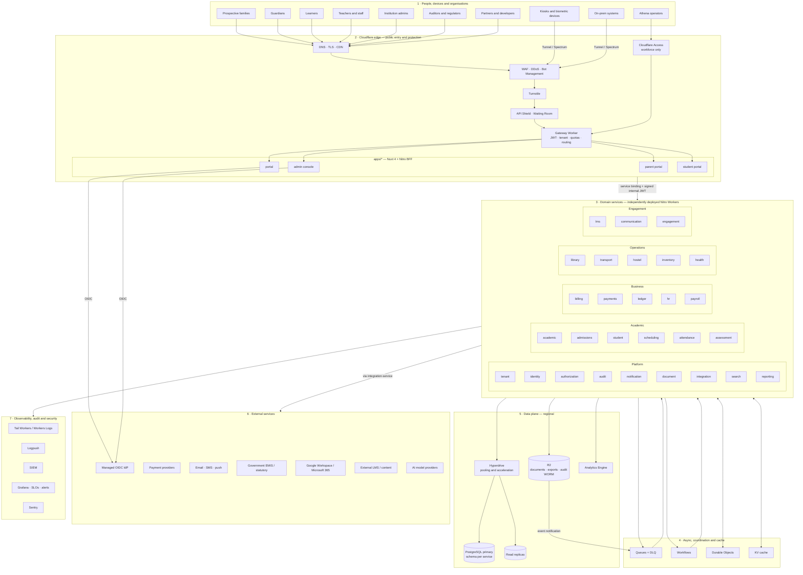

# Full Context Map

> **Status:** Accepted · **Owner:** Architecture Guild · **Version:** 1.0
>
> One picture of the platform in context: **who uses it, what sits at the edge, which services own
> which capabilities, where data lives, what is external, and which controls observe/protect it.**
> For implementation detail, follow the links at the end of each layer.

## 1. Full context diagram

## 2. How to read it

| Layer | What it owns | Trust boundary | Deep dive |
|---|---|---|---|
| **1 Actors** | Humans, devices and organisations | Untrusted | [Personas](../00-product/vision-and-scope.md) |
| **2 Edge** | TLS, WAF, DDoS, bot control, API protection, routing | Internet → verified request | [Security architecture](../04-security/security-architecture.md) |
| **3 Services** | Bounded-context business rules and data ownership | Signed internal context | [Service catalog](service-catalog.md) |
| **4 Runtime** | Async delivery, durable processes, coordination, cache | At-least-once / per-key | [Integration & events](integration-and-events.md) |
| **5 Data** | Transactional truth, objects, analytics, backups | Tenant + service scoped | [Data architecture](../03-data/data-architecture.md) |
| **6 External** | Identity, money, messaging, government, productivity, AI | Contract + DPA | [Extensibility](extensibility.md) |
| **7 Observe** | Traces, logs, metrics, audit, alerts | Read-only / restricted | [Observability & DR](../07-devops/observability-sre-dr.md) |

### The lifecycle in one pass

1. A guardian or staff member reaches **Cloudflare edge** over TLS; WAF/DDoS/bot rules and Turnstile
   filter the request.
2. The **gateway** validates the session/JWT, resolves the tenant and enforces quotas.
3. The request lands in a **Nuxt app/BFF**, which holds the opaque session cookie and calls domain
   services over **service bindings** with a short-lived signed context.
4. A **domain service** authorizes via the PDP, sets `app.tenant_id` inside the transaction, and
   reads/writes **PostgreSQL through Hyperdrive**.
5. State changes are written to an **outbox**, relayed to **Queues**, and consumed idempotently by
   other services; long jobs run as **Workflows**; coordination uses **Durable Objects**.
6. Documents, exports and audit archives go to **R2**; high-cardinality operational metrics go to
   **Analytics Engine**.
7. External providers are reached only through `integration-service` with scoped credentials.
8. Traces, logs and audit events flow to **Tail Workers/Logpush**, SIEM and Grafana; security alerts
   page on-call.

## 3. What this diagram intentionally omits

- Internal class/package design and database columns — see the
  [monorepo](monorepo-and-tooling.md) and [schemas](../03-data/schema-core.md).
- Every synchronous/async edge between services — see the
  [service catalog](service-catalog.md) dependency rules.
- Per-tenant dedicated cells — see [Multi-tenancy](multi-tenancy.md).
- Deployment environments and previews — see
  [CI/CD & infrastructure](../07-devops/cicd-environments-infrastructure.md).

## 4. Non-negotiable boundaries

| Boundary | Rule |
|---|---|
| Browser → platform | No access tokens in JavaScript; opaque session cookie at the BFF |
| Gateway → service | Tenant and principal come from verified context, never request body/header |
| Service → database | Explicit `tenant_id` + RLS; runtime role has no `BYPASSRLS` |
| Service → service | Signed service JWT; callee re-authorizes; no shared database |
| Service → external | Via `integration-service`; least-privilege credentials; egress allowlist |
| Operator → platform | Cloudflare Access + MFA + break-glass; every action audited |
| Anywhere → audit | Append-only, hash-chained, WORM archive; never used as the only copy of business data |
