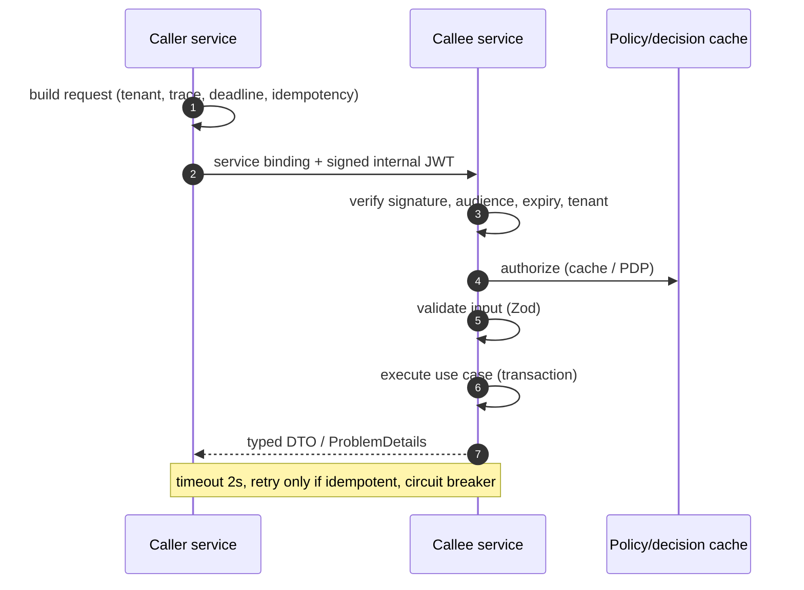
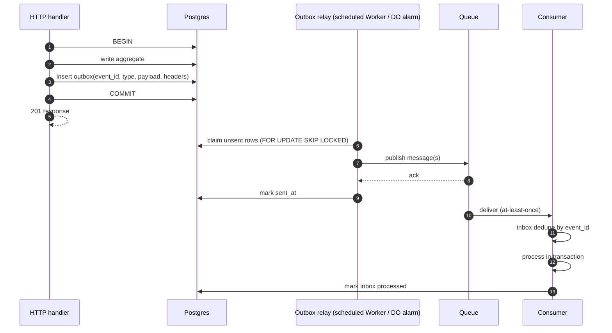
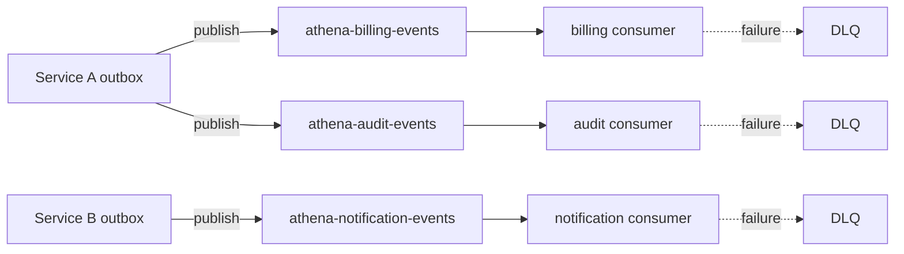
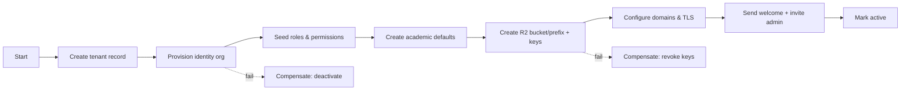

# Integration & Events

> **Status:** Accepted · **Owner:** Architecture Guild · **Version:** 2.0
>
> Synchronous calls are for answers. Everything else is an event. This document defines how services
> communicate without shared databases, distributed transactions or lost messages on Cloudflare.

## 1. Decision summary

| Need | Mechanism | Guarantee |
|---|---|---|
| Read data now | Service binding (sync HTTP/RPC) | At-most-once response; caller handles timeout |
| Command needing an answer | Service binding + idempotency key | Effect-once |
| State change others care about | Transactional outbox → Queue | At-least-once delivery |
| Multi-step business process | Workflow (orchestration) | Durable, resumable, compensatable |
| Strict ordering / single writer | Durable Object | Serialized per object |
| Rate limiting / sequence / locks | Durable Object | Strong per key |
| Partner notification | Webhook via `integration-service` | At-least-once with retries + DLQ |
| Cache / reference data | KV | Eventually consistent, versioned |
| Large payload | R2 object + reference in event | Durable object storage |

**No distributed transactions.** No service writes another service's tables. No two-phase commit.

## 2. Service-to-service synchronous calls



### Rules

1. **Deadline propagation.** Caller sends `x-athena-deadline-ms`; callee rejects work it cannot
   finish within 80% of the remaining budget.
2. **No retry storms.** Retries only for idempotent operations and network/5xx; max 2, exponential
   backoff with jitter, budget-aware.
3. **Circuit breaker per dependency.** Open after 5 failures in 30 s; half-open probe; fallback or
   explicit degraded response.
4. **No sync chains deeper than 2.** A → B → C is allowed for read enrichment; A → B → C → D is not.
5. **Bulkheads.** Per-dependency concurrency caps; a slow service cannot exhaust the caller.
6. **Contract tests.** Provider and consumer share `packages/contracts`; CI fails on breaking change.
7. **Internal auth.** Signed service JWT: `iss=athena`, `aud=<target>`, `sub`, `tenant_id`, `scope`,
   `trace_id`, `exp ≤ 60s`. Gateway strips inbound internal headers. No static shared secret.
8. **Tenant propagation.** Tenant comes from the verified token, never from a query parameter or
   client header.

## 3. Transactional outbox

Writing to Postgres and publishing to a Queue are two systems. The outbox makes them atomic.



### Outbox table (per service schema)

```sql
create table outbox (
  id              uuid primary key,
  tenant_id       uuid not null,
  event_type      text not null,
  event_version   integer not null default 1,
  aggregate_type  text not null,
  aggregate_id    uuid not null,
  payload         jsonb not null,
  headers         jsonb not null default '{}'::jsonb,
  created_at      timestamptz not null default now(),
  available_at    timestamptz not null default now(),
  attempts        integer not null default 0,
  sent_at         timestamptz,
  last_error      text
);

create index outbox_pending_idx
  on outbox (available_at)
  where sent_at is null;

create index outbox_tenant_idx on outbox (tenant_id, created_at);
```

Relay rules:

- Claim rows with `FOR UPDATE SKIP LOCKED`, batch ≤ 100, publish, then mark sent.
- If publish fails, increment `attempts`, set `available_at = now() + backoff`, keep the row.
- After N attempts (e.g. 10), move to a dead-letter table and alert.
- Relay is idempotent; duplicate publish is acceptable because consumers dedupe.
- Partition/archive outbox rows after 30 days; never let it grow unbounded.

## 4. Queues and consumers

Cloudflare Queues are **at-least-once**, batched and not strictly ordered.

### Topology



- One queue per consumer service (and environment). Publishers send to each interested queue based
  on a reviewed subscription map. If fan-out subscriptions exceed ~10, introduce a stateless
  fan-out router.
- Consumers are idempotent and batch-aware. `max_batch_size` 50, `max_batch_timeout` 5 s,
  `max_retries` 5, then DLQ.
- Consumer concurrency is tuned to protect Postgres; queue lag is an SLO.
- Poison messages go to DLQ with the original payload reference, error, attempt count and trace ID.
- DLQ replay is an operator action with an audit record; never automatic infinite retry.

### Inbox table (per consumer schema)

```sql
create table inbox (
  consumer     text not null,
  event_id     uuid not null,
  event_type   text not null,
  received_at  timestamptz not null default now(),
  processed_at timestamptz,
  primary key (consumer, event_id)
);
```

Processing pattern:

1. Insert inbox row; on unique conflict, acknowledge and stop (already seen).
2. Execute the use case in the same transaction as marking `processed_at`.
3. On failure, roll back; let the queue retry.
4. Side effects outside Postgres (email, PSP) use their own idempotency keys.

### Ordering

Queues do not guarantee order. Use one of:

- **Aggregate version:** consumer ignores events with `version <= last_seen_version`.
- **Durable Object** per aggregate for strict serialization (e.g. invoice numbering, seat
  reservation, publication lock).
- **State reconciliation:** consumers can fetch current state instead of replaying every event.

## 5. Event contract

### Envelope (CloudEvents 1.0 JSON)

```json
{
  "specversion": "1.0",
  "id": "0192f4c1-7a2e-7c3b-9f10-2d6a8e4b1c55",
  "source": "athena.student",
  "type": "athena.student.enrolled.v1",
  "subject": "students/0192f4c1-...",
  "time": "2026-11-10T09:14:22.318Z",
  "datacontenttype": "application/json",
  "tenantid": "0192f2a0-...",
  "traceparent": "00-4bf92f3577b34da6a3ce929d0e0e4736-00f067aa0ba902b7-01",
  "dataschema": "https://schemas.athena.example/student/enrolled/v1.json",
  "data": {
    "enrolment_id": "0192f4c1-...",
    "student_id": "0192f3b2-...",
    "section_id": "0192f3c9-...",
    "term_id": "0192f2f1-...",
    "status": "active",
    "effective_from": "2026-09-01"
  }
}
```

Rules:

- `type` is `athena.<context>.<past-tense>.<vN>`.
- `id` is UUIDv7, globally unique, used for dedupe.
- `tenantid` is mandatory and verified against the consumer's context.
- `traceparent` propagates the distributed trace.
- Payloads contain **IDs and minimal facts**, not full PII dumps. Consumers fetch details if needed.
- Large payloads live in R2/Postgres; the event carries `object_ref` and a checksum.
- Schemas live in `packages/contracts/src/events/<context>/<event>.vN.ts` (Zod) and are published as
  JSON Schema. CI checks backward compatibility.
- Additive changes are allowed in a minor way (new optional fields). Removing/renaming/retyping
  requires a new major event version and a dual-publish window.
- Consumers must tolerate unknown fields.

### Event catalog (initial)

| Event | Producer | Primary consumers | Contains |
|---|---|---|---|
| `athena.tenant.provisioned.v1` | tenant | identity, authorization, academic, notification | tenant, region, plan |
| `athena.identity.user.created.v1` | identity | authorization, notification, audit | user, tenant, roles pending |
| `athena.academic.section.created.v1` | academic | scheduling, attendance, assessment, student | section, term, course |
| `athena.admissions.applicant.converted.v1` | admissions | student, billing, notification | applicant, programme, term |
| `athena.student.enrolled.v1` | student | billing, attendance, assessment, notification, reporting | enrolment, student, section |
| `athena.student.withdrawn.v1` | student | billing, attendance, notification, reporting | enrolment, effective date, reason |
| `athena.attendance.recorded.v1` | attendance | reporting, notification (thresholds) | session, student, status |
| `athena.assessment.published.v1` | assessment | notification, reporting, student | section, term, publication id |
| `athena.billing.invoice.issued.v1` | billing | payments, notification, ledger, reporting | invoice, payer, amount, due date |
| `athena.payments.captured.v1` | payments | billing, ledger, notification, reporting | payment, amount, currency, PSP ref |
| `athena.payments.refunded.v1` | payments | billing, ledger, notification | refund, payment, amount |
| `athena.ledger.journal.posted.v1` | ledger | reporting, audit | journal, accounts, amount |
| `athena.hr.staff.hired.v1` | hr | payroll, authorization, notification | staff, contract, start date |
| `athena.audit.event.recorded.v1` | audit | SIEM (Logpush) | audit hash, category |
| `athena.document.uploaded.v1` | document | search, integration, business owner | document, owner, classification |

## 6. Workflows (durable orchestration)

Use Workflows when a process:

- spans multiple services or steps,
- can take minutes/hours/days,
- must survive Worker restarts and retries,
- needs visible progress and compensation.

**Use for:** tenant provisioning, term billing run, report-card batch, payroll run, data import,
bulk admissions decisions, retention/deletion jobs.

**Do not use for:** per-request latency paths, high-frequency event handling, or anything that can
be a simple Queue consumer.

### Workflow rules

- Every step is idempotent and keyed by `workflow_id + step_name`.
- Steps are small; checkpoint after each.
- Compensations are explicit and tested.
- Status is queryable by operators and the tenant admin.
- Retention and PII handling are configured; outputs go to R2/Postgres, not workflow history.
- A stuck workflow raises an alert; there is a runbook to resume/terminate.



## 7. Durable Objects

A Durable Object provides **single-threaded, strongly consistent** execution per key. It is the
right tool for coordination — not for storing business records.

| DO class | Key | Purpose | Fallback if unavailable |
|---|---|---|---|
| `RateLimiter` | `tenant:route:bucket` | Token bucket per tenant/IP/route | Edge rate-limiting rules; fail closed for auth/payments |
| `IdempotencyStore` | `tenant:client:key` | Deduplicate write requests | Database unique constraint |
| `SequenceAllocator` | `tenant:doc_type` | Invoice/receipt numbers | DB sequence with retry |
| `SeatReserver` | `section_id` | Atomic capacity reservation | DB row lock |
| `PublicationLock` | `section:term` | One publisher at a time | DB advisory lock |
| `SessionRevoker` | `tenant:user` | Immediate session cutoff | Postgres version check |
| `LiveTrip` | `vehicle_id` | Real-time transport state | Last known snapshot |
| `Presence` | `conversation_id` | Typing/presence/WebSocket fan-out | Polling |
| `AuditChain` | `tenant:stream:day` | Hash-chain head | DB row lock + reconciliation |

Rules:

- Shard keys deliberately; never one global counter.
- Use alarms for periodic work; no busy loops.
- Persist only coordination state; authoritative data in Postgres/R2.
- Design for eviction: rehydrate from Postgres on wake.
- Monitor request rate per object; a hot object is an architecture defect.
- DO SQLite storage is not a reporting store.

## 8. Webhooks

### Outbound (Athena → partner)

- Subscription per tenant, event types, endpoint, secret, active flag.
- Payload: CloudEvents envelope + HMAC-SHA256 signature over `timestamp.body`.
- Headers: `Athena-Signature: t=...,v1=...`, `Athena-Event-Id`, `Athena-Delivery-Id`.
- Retries: 6 attempts over 24 h with exponential backoff; then DLQ.
- Replay protection: timestamp tolerance 5 min; partner should dedupe by event ID.
- Delivery log with response status, latency, attempt, error (no secrets).
- SSRF protection: HTTPS only, block private IP ranges, no redirects, egress allowlist where possible.
- Disable automatically after sustained failures; notify tenant admin.
- Signing secrets rotatable with overlap.

### Inbound (partner → Athena)

- Terminate at gateway; route to `payments-service` or `integration-service`.
- Verify signature against the **raw body** before parsing.
- Enforce timestamp/replay window; store `provider_event_id` uniquely.
- Acknowledge quickly (2xx) after durable persistence; process asynchronously via Queue.
- Never trust amounts/status from the client; re-fetch from provider when needed.
- Keep raw payload in R2 (encrypted, retention-scoped) for dispute evidence.

## 9. Sagas and consistency

| Process | Style | Compensation |
|---|---|---|
| Enrolment | Orchestrated Workflow | Release seat, void draft invoice, notify |
| Payment allocation | Choreographed events | Reverse allocation, credit note |
| Tenant offboarding | Orchestrated Workflow | Restore access within grace period, then delete |
| Payroll approval | Orchestrated Workflow | Unlock run before lock; after lock, corrective run |
| Report card publication | Orchestrated + DO lock | Unpublish (new version), notify correction |

Rules:

- Every step has an idempotency key.
- Compensations are business actions, not database rollbacks.
- A saga can end in a **manual intervention** state; that is a valid, visible outcome.
- No saga holds a database transaction across service calls.

## 10. Failure handling and operations

| Failure | Behaviour | Alert |
|---|---|---|
| Outbox relay down | Events accumulate; no loss | Lag > 5 min (P2), > 30 min (P1) |
| Queue publish failure | Retry with backoff; outbox row retained | Publish error rate > 1% |
| Consumer failure | Retry; then DLQ | DLQ > 0 |
| Poison message | DLQ; no infinite retry | Immediate P3 |
| Workflow step failure | Retry; then pause + operator | Workflow failed > 15 min |
| DO hot object | Latency; possible throttling | > 100 req/s per object |
| Duplicate event | Inbox dedupe | Spike in duplicates (info) |
| Schema mismatch | Consumer rejects to DLQ | Any schema error |

**Replay tooling:** an operator CLI/Worker endpoint lists DLQ messages, shows payload references,
allows replay to the original or a repair queue, and records an audit event. Replay is idempotent.

## 11. Security and privacy

- Events are data: classify them, minimize PII, encrypt sensitive fields, and apply retention.
- Never put passwords, tokens, full medical records, full bank details or card data in events.
- Consumers verify `tenantid` matches the message's authenticated context; a cross-tenant event is a
  security incident.
- Queue payloads are encrypted at rest by Cloudflare; application-level encryption is used for
  highly sensitive fields.
- Dead-letter payloads inherit the original classification and access restrictions.
- Webhook secrets live in Secrets Store; never in tenant config or logs.
- A compromised service can publish forged events: all consumers validate the event signature
  (platform-signed) and tenant, and treat authorization decisions as their own.
