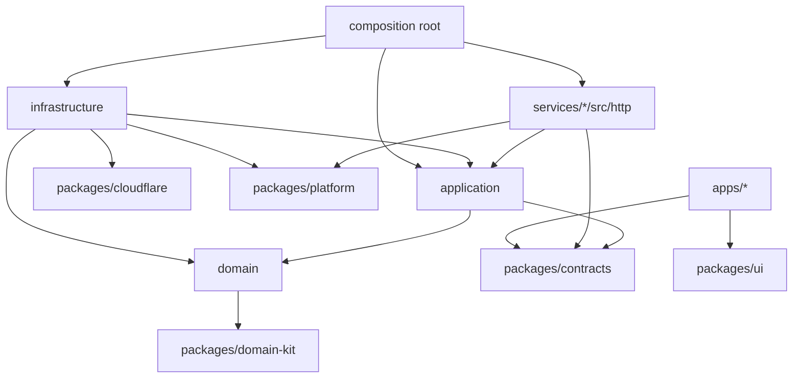

# Monorepo & Tooling

> **Status:** Accepted · **Owner:** Platform Engineering · **Version:** 2.0
>
> This document defines how the codebase is laid out, how boundaries are enforced, and how the
> supplied plan's **strict type policy** and **layered architecture** are applied — per service, not
> to one monolithic application.

## 1. Repository layout

```text
schoolmgt/
├── apps/                       # Nuxt 4 frontends + BFF (Cloudflare Workers)
│   ├── portal/                 # public site + staff entry
│   ├── admin/                  # institution administration console
│   ├── parent/                 # guardian portal / PWA
│   └── student/                # learner portal / PWA
├── services/                   # independently deployed Nitro Workers
│   ├── gateway/                # public edge router (no domain logic)
│   ├── tenant/
│   ├── identity/
│   ├── authorization/
│   ├── audit/
│   ├── notification/
│   ├── document/
│   ├── integration/
│   ├── search/
│   ├── reporting/
│   ├── academic/
│   ├── admissions/
│   ├── student/
│   ├── scheduling/
│   ├── attendance/
│   ├── assessment/
│   ├── billing/
│   ├── payments/
│   ├── ledger/
│   ├── hr/
│   ├── payroll/
│   ├── library/
│   ├── transport/
│   ├── hostel/
│   ├── inventory/
│   ├── health/
│   ├── lms/
│   ├── communication/
│   └── engagement/
├── packages/
│   ├── contracts/              # Zod schemas, DTOs, event contracts, OpenAPI fragments
│   ├── domain-kit/             # Entity, AggregateRoot, Result, DomainError, Clock, IDs
│   ├── platform/               # config, logger, OTel, auth context, HTTP helpers, errors
│   ├── cloudflare/             # typed wrappers for KV, R2, Queues, DO, Workflows, Hyperdrive
│   ├── ui/                     # Vue/Nuxt design system (Nuxt UI based)
│   ├── openapi/                # spec generation, client types, contract tests
│   ├── testing/                # factories, test tenant, fixtures, MSW handlers
│   ├── eslint-config/
│   └── tsconfig/
├── infra/
│   ├── terraform/              # Cloudflare account resources, DNS, WAF, R2, Queues, Access
│   ├── wrangler/               # shared config fragments / deployment scripts
│   └── scripts/                # migrations, seeding, tenant provisioning
├── docs/                       # this documentation set
├── tools/
│   └── generators/             # `pnpm gen service|app|package`
├── .github/workflows/
├── package.json
├── pnpm-workspace.yaml
├── turbo.json
├── tsconfig.base.json
└── wrangler.jsonc              # only for root-level tooling; each Worker has its own
```

### Why this shape

- **Apps** are replaceable presentation layers. They never own business invariants or SQL.
- **Services** are the deployable unit and the ownership boundary.
- **Packages** are shared *technical* capabilities and contracts. Domain rules do not live in
  packages shared across bounded contexts.
- **Infra** is code, reviewed like code, with plan output in pull requests.
- **Docs** travel with the code they describe.

### Migrating the current prototype

The repository currently has a single Nuxt app (`app/`, `server/`, `shared/`, `public/`). In Phase 2:

1. Move the Nuxt app into `apps/portal/` without changing its internal Nuxt structure.
2. Keep `server/api/health.get.ts` as a BFF health route; move admin placeholders into `apps/admin/`.
3. Make the root `package.json` a private workspace root (`private: true`, no app dependencies).
4. Add `pnpm-workspace.yaml`, `turbo.json`, `tsconfig.base.json`, shared configs and the service
   generator.
5. Create `services/gateway`, `services/tenant`, `services/identity`, `services/authorization`,
   `services/audit` from the template; wire them through service bindings.
6. Delete nothing until the new path is verified; migrate route by route behind a flag.

The existing prototype is useful for UI exploration but must not become a second source of truth.

## 2. Technology baseline| Concern | Choice | Notes |
|---|---|---|
| Package manager | pnpm 10 (workspaces, strict peer deps) | Lockfile committed; `packageManager` pinned. |
| Task runner | Turborepo 2 | Affected builds; remote cache in R2. |
| Runtime | Node.js 22 LTS (tooling), Cloudflare Workers (runtime) | No Node APIs in Worker code unless polyfilled. |
| Language | TypeScript 5.x, `strict` | See §4. |
| Service framework | Nitro (Cloudflare module preset) | `defineEventHandler`, `readValidatedBody`, `readValidatedQuery`. |
| Frontend | Nuxt 4, Vue 3, Nuxt UI, Tailwind | SSR + islands; PWA. |
| Validation | Zod | Every boundary; schemas are the source of types. |
| ORM | Drizzle ORM + Drizzle Kit | `postgres-js` driver through Hyperdrive. |
| Database | PostgreSQL 17 | Regional, per-service schema. |
| Testing | Vitest, `@cloudflare/vitest-pool-workers`, Playwright, Pact-style contracts | See [Test strategy](../08-quality/test-strategy.md). |
| Lint/format | ESLint 9 flat config, Prettier, Stylelint | CI enforced. |
| Git hooks | Husky + lint-staged + commitlint | Conventional Commits. |
| Versioning | Changesets (packages), service deploy tags | Independent service deploys. |
| API docs | OpenAPI 3.1 generated from Zod | Published per service. |
| Observability | OpenTelemetry, Workers Logs/Tail Workers, Logpush, Sentry | See [Observability](../07-devops/observability-sre-dr.md). |

## 3. Package naming and dependency rules

- npm scope: `@athena/*`.
- Service package: `@athena/student-service`.
- App package: `@athena/portal`.
- Shared package: `@athena/contracts`, `@athena/platform`.

### Allowed dependencies



| From | May import | Must never import |
|---|---|---|
| `domain` | `domain-kit`, standard library | Drizzle, Cloudflare bindings, HTTP, another domain |
| `application` | `domain`, `contracts`, ports | Drizzle, R2/KV/Queues, H3/Nitro |
| `infrastructure` | `domain`, `application` ports, `cloudflare` | HTTP handlers |
| `http` | `application`, `contracts`, `platform` | Drizzle directly, another service's source |
| `apps/*` | `contracts`, `ui`, `platform` | `services/*/src`, Drizzle, service bindings directly |
| Any service | its own code, `packages/*` | another service's source code |

Enforcement:

- `dependency-cruiser` rules in CI.
- ESLint `import/no-restricted-paths` per folder.
- TypeScript project references; no barrel files that re-export infrastructure into domain.
- A PR that adds a cross-service source import fails automatically.

## 4. Strict TypeScript policy

### 4.1 Compiler settings (`tsconfig.base.json`)

```jsonc
{
  "compilerOptions": {
    "strict": true,
    "noUncheckedIndexedAccess": true,
    "exactOptionalPropertyTypes": true,
    "noImplicitOverride": true,
    "noFallthroughCasesInSwitch": true,
    "noUnusedLocals": true,
    "noUnusedParameters": true,
    "noPropertyAccessFromIndexSignature": true,
    "useUnknownInCatchVariables": true,
    "verbatimModuleSyntax": true,
    "isolatedModules": true,
    "module": "ESNext",
    "moduleResolution": "Bundler",
    "target": "ES2022",
    "lib": ["ES2023"],
    "types": ["@cloudflare/workers-types"],
    "skipLibCheck": false
  }
}
```

### 4.2 What is banned

| Pattern | Rule |
|---|---|
| `any` (explicit or implicit) | `@typescript-eslint/no-explicit-any: error` |
| Unsafe `as SomeType` on external/untrusted data | `no-restricted-syntax` + review; use Zod parse |
| `@ts-ignore` | `@typescript-eslint/ban-ts-comment: error`; `@ts-expect-error` requires description + expiry ticket |
| Non-null assertion on untrusted values | `@typescript-eslint/no-non-null-assertion: error` |
| Floating promises | `@typescript-eslint/no-floating-promises: error` |
| Unawaited async in handlers | `@typescript-eslint/no-misused-promises: error` |

### 4.3 What is allowed (documented exceptions)

- `as const` for literal inference.
- `satisfies` for shape checking without widening.
- Type guards (`is` functions) after runtime validation.
- A **boundary adapter** for third-party types that cannot be inferred, isolated in
  `infrastructure/adapters/*`, with a runtime schema test. It must be reviewed by the service owner
  and carry a comment explaining why inference is impossible.
- `unknown` for untrusted input, immediately narrowed.

### 4.4 Type sources

| Source | Type mechanism |
|---|---|
| HTTP request | `readValidatedBody(event, schema.parse)` → `z.infer<typeof schema>` |
| Query string | `readValidatedQuery(event, schema.parse)` |
| Database row | `InferSelectModel<typeof table>` |
| Insert | `InferInsertModel<typeof table>` |
| Domain entity | Explicit class/interface; no Drizzle leakage |
| Events | JSON Schema + Zod generated types, runtime validation |
| Cloudflare env | `Env` interface + H3 module augmentation |
| API response | `ApiResponse<T>` / `ProblemDetails` from `@athena/contracts` |

### 4.5 H3 context augmentation

```ts
// packages/platform/src/h3.d.ts
import type { AuthContext } from '@athena/contracts';
import type { Env } from '@athena/cloudflare';

declare module 'h3' {
  interface H3EventContext {
    cloudflare: {
      env: Env;
      context: ExecutionContext;
    };
    auth: AuthContext; // populated by middleware, never trusted raw
    traceId: string;
    tenantId: string;
  }
}
```

Middleware populates these; handlers still validate and authorize. `event.context.auth` is typed,
not cast.

### 4.6 Example: handler → use case → repository

```ts
// services/student/src/http/enrolments.post.ts
import { enrolStudentSchema } from '@athena/contracts/student';
import { defineEventHandler, readValidatedBody, setResponseStatus } from 'h3';
import { EnrolStudent } from '../application/enrolStudent';

export default defineEventHandler(async (event) => {
  const input = await readValidatedBody(event, enrolStudentSchema.parse);
  const useCase = new EnrolStudent(event.context);
  const result = await useCase.execute(input);

  setResponseStatus(event, 201);
  return result; // typed DTO
});
```

```ts
// services/student/src/application/enrolStudent.ts
import type { EnrolStudentInput } from '@athena/contracts/student';
import type { EnrolmentRepository, SeatReserver } from '../domain/ports';

export class EnrolStudent {
  constructor(
    private readonly enrolments: EnrolmentRepository,
    private readonly seats: SeatReserver,
  ) {}

  async execute(input: EnrolStudentInput): Promise<EnrolmentDto> {
    const seat = await this.seats.reserve(input.sectionId);
    const enrolment = Enrolment.create(input, seat);
    await this.enrolments.save(enrolment);
    return toDto(enrolment);
  }
}
```

The domain has no Cloudflare or Drizzle import; the composition root wires the implementations.

## 5. The C#-inspired layering, applied per service

```text
services/student/
├── src/
│   ├── domain/
│   │   ├── entities/            # Student, Enrolment, Guardian
│   │   ├── value-objects/       # StudentNumber, Relationship, EffectivePeriod
│   │   ├── policies/            # capacity, status transitions, consent rules
│   │   ├── errors/              # DomainError subclasses
│   │   └── ports/               # repository + service interfaces
│   ├── application/
│   │   ├── enrolStudent.ts      # use case (one public method)
│   │   ├── withdrawStudent.ts
│   │   └── dtos.ts
│   ├── infrastructure/
│   │   ├── db/schema.ts         # Drizzle tables for schema `student`
│   │   ├── db/repositories.ts   # implements ports
│   │   ├── cloudflare/          # KV/R2/Queue/DO adapters
│   │   └── outbox.ts
│   ├── http/
│   │   ├── enrolments.post.ts
│   │   └── students.get.ts
│   ├── composition.ts           # dependency wiring per request
│   └── worker.ts                # Nitro entry / bindings
├── drizzle/                     # generated migrations
├── test/                        # unit, integration, contract
├── wrangler.jsonc
├── service.yaml
├── openapi.yaml
└── README.md
```

**Rules**

- One use case per business action; it owns the transaction boundary.
- Domain entities enforce invariants; they are not anemic data bags.
- Repositories return domain types, never Drizzle rows.
- HTTP handlers do: parse → authorize → call use case → map result → set status. No business logic.
- Infrastructure is replaceable; tests use in-memory fakes for domain/application.
- Cross-cutting concerns (auth, tracing, idempotency, audit) are middleware/adapters, not repeated in
  every handler.

## 6. Cloudflare bindings and configuration

Each Worker has its own `wrangler.jsonc` (no shared global bindings).

```jsonc
{
  "name": "athena-student",
  "main": "src/worker.ts",
  "compatibility_date": "2026-01-01",
  "compatibility_flags": ["nodejs_compat"],
  "observability": { "enabled": true },
  "vars": { "ENVIRONMENT": "staging", "SERVICE_NAME": "student" },
  "hyperdrive": [{ "binding": "HYPERDRIVE", "id": "<per-env-id>" }],
  "kv_namespaces": [{ "binding": "CACHE", "id": "<per-env-id>" }],
  "r2_buckets": [{ "binding": "DOCUMENTS", "bucket_name": "athena-documents-staging" }],
  "queues": {
    "producers": [{ "binding": "EVENTS", "queue": "athena-events-staging" }],
    "consumers": [{ "queue": "athena-student-events-staging", "max_batch_size": 50 }]
  },
  "durable_objects": {
    "bindings": [{ "name": "SEAT_RESERVER", "class_name": "SeatReserver" }]
  },
  "services": [
    { "binding": "AUTHORIZATION", "service": "athena-authorization" },
    { "binding": "DOCUMENT", "service": "athena-document" }
  ]
}
```

Rules:

- **Secrets never in `wrangler.jsonc` or `vars`.** Use Cloudflare Secrets Store / `wrangler secret`
  references; local `.dev.vars` is git-ignored.
- Bindings are explicit and minimal; a service cannot reach a binding it does not declare.
- Environment names are consistent: `dev`, `staging`, `prod`, plus `pr-<number>` previews.
- Each binding has an owner and a documented failure behaviour.
- Service bindings are only to declared, allowed dependencies (see service catalog).

## 7. Local development

```bash
pnpm install
pnpm db:up                 # Docker Postgres 17 + seed (or Neon branch)
pnpm db:migrate            # apply service migrations
pnpm dev                   # Turborepo: apps + selected services via Miniflare
pnpm dev --filter=portal --filter=student-service
```

| Concern | Local approach |
|---|---|
| Workers runtime | `wrangler dev` / Miniflare; same bindings via `wrangler.jsonc` |
| Database | Docker Postgres or a Neon branch; `HYPERDRIVE` local connection string |
| Queues/Workflows/DO | Miniflare emulation; integration tests use `vitest-pool-workers` |
| R2 | Miniflare local bucket |
| Identity | Local OIDC stub or IdP dev tenant; never production credentials |
| Email/SMS | Captured by a local sink; no real sends |
| Payments | PSP sandbox keys; webhook replay fixtures |
| Feature flags | Local config file, tenant-scoped |

Parity rule: if a behaviour cannot be exercised locally or in a preview environment, it is not done.

## 8. Build, test and deploy tasks

```jsonc
// turbo.json (abridged)
{
  "tasks": {
    "build": { "dependsOn": ["^build"], "outputs": ["dist/**", ".output/**"] },
    "typecheck": { "dependsOn": ["^build"], "outputs": [] },
    "lint": { "dependsOn": ["^build"], "outputs": [] },
    "test": { "dependsOn": ["^build"], "outputs": ["coverage/**"] },
    "test:integration": { "dependsOn": ["build"], "cache": false },
    "db:generate": { "cache": false },
    "db:migrate": { "cache": false },
    "deploy:dry-run": { "dependsOn": ["build", "typecheck", "test"] },
    "deploy": { "dependsOn": ["build", "typecheck", "test", "test:integration"] }
  }
}
```

- CI uses `--filter=...[origin/main]` to build only affected projects.
- Turborepo remote cache uses an **R2 bucket** (S3-compatible) with per-branch keys.
- Deploys are per service; a monorepo does not mean a monolith release.
- Database migrations run as a separate CI job **before** the Worker deploy, with a backup/PITR
  checkpoint and an expand/contract check.

## 9. Code generation and golden path

`pnpm gen service <name>` creates:

- `services/<name>/` with the layered template, `wrangler.jsonc`, `service.yaml`, `README.md`,
  `openapi.yaml`, health endpoint, outbox, migrations folder, unit + integration tests.
- Gateway route registration (explicit, reviewed).
- Terraform placeholders for queues/R2 bindings.
- Dashboard/alert stubs and an on-call runbook stub.

`pnpm gen app <name>` scaffolds a Nuxt app with the design system, auth middleware, i18n, a11y
checks and Playwright config.

Generated code is a starting point; reviewers still verify security, tenancy and failure behaviour.

## 10. Conventions

| Item | Convention | Example |
|---|---|---|
| TS files | `camelCase.ts` | `enrolStudent.ts` |
| Vue components | `PascalCase.vue` | `StudentCard.vue` |
| Nuxt routes | file-based, `[id]` for params | `server/api/students/[id].get.ts` |
| Service name | singular domain + `-service` | `student-service` |
| DB schema | singular domain | `student` |
| Tables | plural `snake_case` | `student_guardians` |
| API paths | plural `kebab-case` | `/v1/student-guardians` |
| Events | `athena.<context>.<past-tense>.v<major>` | `athena.student.enrolled.v1` |
| Permissions | `resource:action` | `invoice:void` |
| Feature flags | `domain.capability` | `finance.autopay` |
| Branches | `feat/<ticket>-<slug>`, `fix/...`, `chore/...` | `feat/SMS-142-guardian-portal` |
| Commits | Conventional Commits | `feat(student): add guardian linkage` |
| ADRs | `NNNN-title.md` | `0010-event-schema-registry.md` |

## 11. Pull request checklist

- [ ] Requirement ID referenced; acceptance test added.
- [ ] No `any`, no unsafe assertion, `pnpm typecheck` clean.
- [ ] Tenancy: every query has `tenant_id`; cross-tenant test added/updated.
- [ ] Authorization: permission declared; 401/403 tests.
- [ ] Idempotency for writes; retries safe.
- [ ] Failure behaviour: timeout, retry, DLQ, fallback documented.
- [ ] OpenAPI/event contract updated; backward compatible.
- [ ] Migration is expand/contract; rollback considered.
- [ ] Observability: trace, metrics, logs with PII redaction.
- [ ] Security review for auth, crypto, file upload, payments, PII.
- [ ] Docs/runbook updated; `service.yaml` SLO/capacity accurate.
- [ ] Accessibility and i18n checked for UI changes.
- [ ] Bundle/Worker size and cost impact considered.

## 12. Tooling decisions and alternatives

| Choice | Why | Alternative considered |
|---|---|---|
| pnpm + Turborepo | Fast, simple, language-agnostic, R2 remote cache | Nx (more powerful graph, heavier) |
| Nitro for services | Same TS stack, Cloudflare preset, H3 helpers | Hono (leaner RPC), raw Workers |
| Drizzle | Typed SQL + migrations, good Postgres support | Kysely (more explicit), Prisma (less CF-native) |
| Zod | Runtime + static types, shared contracts | Valibot (smaller), TypeBox |
| Vitest + workers pool | Real Worker runtime in tests | Jest (slower, no Workers pool) |
| Changesets | Independent package versioning | Fixed monorepo version |
| Wrangler + Terraform | Code deploy + account resources | Wrangler only (account drift), Terraform only (Worker code friction) |
