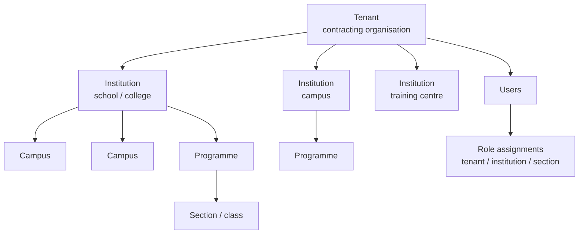
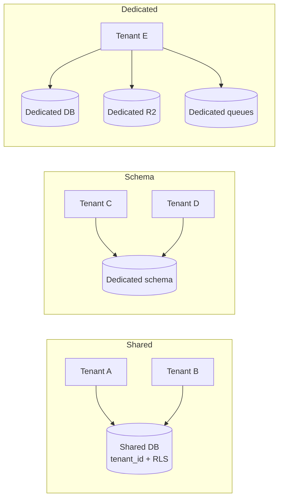
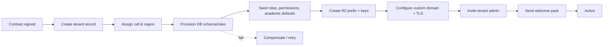

# Multi-Tenancy

> **Status:** Accepted · **Owner:** Architecture & Security · **Version:** 2.0
>
> Tenant isolation is the highest-severity invariant in Athena. A cross-tenant read or write is a
> security incident, not a bug. Isolation is enforced in depth and tested continuously.

## 1. Tenant model



| Level | Meaning | Isolation relevance |
|---|---|---|
| **Tenant** | Contracting customer; top-level data boundary | `tenant_id` on every row; billing and residency unit |
| **Institution** | School/college/campus within a tenant | ABAC scope; users may have different roles per institution |
| **Campus** | Physical location | Filtering, scheduling, operations |
| **Programme / section** | Academic delivery unit | ReBAC/ABAC scope (teacher-of, guardian-of) |

A user may belong to multiple tenants (e.g. a consultant). The **active tenant** is selected at
login and carried in the session; switching tenants issues a new session context and is audited.

## 2. Isolation modes

| Mode | Description | Default for | Trade-off |
|---|---|---|---|
| **Shared** | Shared Postgres cluster/schema, `tenant_id` + RLS | Most customers | Lowest cost; requires rigorous predicates and testing |
| **Schema** | Dedicated Postgres schema per tenant (same cluster) | Regulated mid-market | Better blast-radius; more migration overhead |
| **Dedicated cell** | Separate Workers config, database, R2, queues, keys | Large/enterprise/sovereign | Strongest isolation; highest cost |

The application code is identical in all modes. The difference is provisioning and connection
routing, not branching business logic.



## 3. Database isolation

### 3.1 Physical layout

- A **cell** has one PostgreSQL cluster (primary + replica) per environment.
- Each service owns a **schema** and a **role**: `student_app`, `billing_app`, etc.
- A service role has no access to another service's schema.
- High-volume services (attendance, audit, payments) may get a dedicated cluster within the cell.
- Enterprise tenants may get a dedicated cell with its own cluster.

### 3.2 Runtime roles

| Role | Privileges | Used by |
|---|---|---|
| `<service>_app` | `SELECT/INSERT/UPDATE/DELETE` on its schema; **no** `BYPASSRLS` | Service Worker runtime |
| `<service>_ro` | `SELECT` only, RLS enforced | Reporting/search projections |
| `<service>_migrator` | DDL on its schema | CI migration job only |
| `analytics_ro` | `SELECT` on approved views, no PII columns | Analytics |
| `support_ro` | Time-bound, approved views, audited | Break-glass support |

No human uses the application role. No service uses the migrator role at runtime.

### 3.3 Row-level security

Every tenant-scoped table has `tenant_id uuid not null`. RLS is enabled and forced:

```sql
alter table student.enrolments enable row level security;
alter table student.enrolments force row level security;

create policy enrolments_tenant_isolation on student.enrolments
  using (tenant_id = current_setting('app.tenant_id', true)::uuid)
  with check (tenant_id = current_setting('app.tenant_id', true)::uuid);
```

Per request/transaction:

```sql
begin;
select set_config('app.tenant_id', $1, true); -- true = transaction-local
-- queries
commit;
```

**Critical rules:**

1. Every query also includes an explicit `tenant_id = $n` predicate. RLS is defence in depth, not the
   only control.
2. `SET LOCAL` must be inside the same transaction as the queries. Never set it on a pooled session
   and reuse it.
3. Hyperdrive query caching is disabled for tenant-scoped statements, or the cache key includes the
   tenant. See [Cloudflare review](cloudflare-platform-review.md) §3.4.
4. A missing tenant context raises an error, never defaults to "all tenants".
5. Foreign IDs return **404**, not 403, to avoid existence leaks.
6. Cross-tenant tests run on every PR with two seeded tenants.

### 3.4 Query helper

```ts
// packages/cloudflare/src/db/tenantTransaction.ts
export async function withTenant<T>(
  db: Database,
  tenantId: TenantId,
  fn: (tx: Transaction) => Promise<T>,
): Promise<T> {
  return db.transaction(async (tx) => {
    await tx.execute(sql`select set_config('app.tenant_id', ${tenantId}, true)`);
    return fn(tx);
  });
}
```

Code review rejects raw `db.select()` in a tenant-scoped repository without `withTenant`.

## 4. Tenant context propagation

```mermaid
sequenceDiagram
  participant U as User
  participant G as Gateway
  participant A as App/BFF
  participant S as Service
  participant DB as Postgres

  U->>G: request (session cookie or OAuth token)
  G->>G: resolve tenant from host/token; verify membership
  G->>A: forward + signed tenant context
  A->>S: service binding + internal JWT (tenant_id)
  S->>S: verify JWT, check tenant claim, authorize
  S->>DB: BEGIN; set_config('app.tenant_id', ..., true)
  DB-->>S: rows only for tenant
```

- Tenant is never taken from a request body, query string or client header.
- A platform operator acting on a tenant uses a **scoped support token** with explicit tenant,
  reason, ticket and expiry; every action is audited.
- Background jobs and Queue consumers carry `tenant_id` in the message and set it per transaction.
- Workflows store the tenant in state and re-verify on every step.

## 5. Per-tenant encryption

| Layer | Mechanism |
|---|---|
| Transport | TLS 1.3 at edge; mTLS/service JWT internally |
| Database at rest | Provider encryption (AES-256) |
| Sensitive columns | Application-level envelope encryption (AES-256-GCM) |
| Keys | Per-tenant DEK, wrapped by a master key in Secrets Store; rotation supported |
| Search | Encrypted fields are not indexed in plaintext; use blind indexes for exact match |
| R2 | Server-side encryption + per-tenant prefix + presigned URLs; optional per-tenant key |
| Backups | Encrypted; restore access restricted and audited |

High-sensitivity fields: medical notes, support plans, national IDs, bank details, safeguarding
notes, disciplinary records. These are encrypted at the application layer and excluded from
broad searches/exports.

> Cloudflare does not provide a general-purpose KMS/HSM. The master key lives in Secrets Store with
> strict access; regulated tenants may require an external KMS/HSM, which is a documented
> exception. Key custody is reviewed annually.

## 6. Tenant provisioning



- Runs as a **Workflow**, idempotent, visible status.
- Target ≤ 10 minutes; enterprise dedicated cells may take longer and are scheduled.
- Provisioning never copies data from another tenant. Templates are code/config, not rows.
- The first admin invitation is single-use, expiring, and requires MFA enrollment.
- A tenant cannot be marked active until smoke tests pass (login, create institution, create learner).

## 7. Tenant lifecycle

| State | Behaviour |
|---|---|
| `trial` | Full or limited features; watermark; expiry workflow |
| `active` | Normal |
| `past_due` | Grace period; read-only after threshold; admin notified |
| `suspended` | Login blocked except billing/admin; data retained; APIs return 402/403 with reason |
| `offboarding` | Export available; writes disabled; retention clock starts |
| `deleted` | Data purged per policy; deletion certificate issued |

Rules:

- Suspension never deletes data.
- Offboarding provides a complete export (CSV/JSON + documents) and a manifest with checksums.
- Deletion is a Workflow with legal-hold checks, dual approval, audit, and a certificate.
- Backups expire per policy; deletion from backups is documented and bounded.
- A deleted tenant's identifiers are tombstoned to prevent accidental reuse.

## 8. Noisy-neighbour and quotas

| Resource | Default quota | Enforcement |
|---|---|---|
| API requests | Per plan (e.g. 60 rpm/user, 5k rpm/tenant) | Gateway + DO token bucket |
| Burst | 3× sustained for 60 s | DO |
| Concurrent exports | 2 per tenant | Workflow/queue admission |
| File storage | Per plan | Document service + R2 usage |
| Notification volume | Per plan | Notification service |
| Bulk jobs | Queue position + fair scheduling | Per-tenant concurrency |
| AI tokens | Per plan | AI Gateway |

- Quotas are **server-side** and visible to tenant admins.
- A tenant exceeding quota gets `429` with `Retry-After` and a machine-readable reason.
- Fairness: queue consumers process batches per tenant round-robin where feasible; one tenant's
  100k notification job cannot starve another's password reset.
- Heavy tenants are candidates for a dedicated cell.

## 9. Custom domains and branding

- Cloudflare for SaaS (Custom Hostnames) issues and renews TLS for `school.example.com`.
- Domain verification via DNS TXT or HTTP token; no domain is trusted until verified.
- Host → tenant mapping is cached in KV with a short TTL and invalidated by a DO on change.
- Branding (logo, colours, email sender) is tenant configuration, validated and size-limited.
- Cookies are scoped to the custom domain; no cross-tenant cookie leakage.
- Apex-domain and wildcard support is explicit; unknown hosts return a neutral 404, not another
  tenant's login.

## 10. Data residency

- Each tenant is assigned a **cell** in a region (e.g. `eu-west`, `us-east`, `af-south`).
- Postgres, backups, R2 buckets, queues and logs for that tenant stay in-region.
- Cloudflare Workers execute globally, but data access is pinned to the cell's database; where
  contractually required, Cloudflare Regional Services/Data Localization restricts execution and
  TLS termination to the region.
- Cross-region replication is opt-in and documented per tenant (e.g. DR replica).
- Sub-processors are listed per region; a change triggers customer notice.

## 11. Support access and impersonation

- No standing access to tenant data. Support uses a **break-glass** flow:
  ticket ID + tenant approval (or emergency approval) + MFA + time-bound role.
- Impersonation is read-only by default; write actions require a second approver.
- A persistent banner shows impersonation; the tenant admin can revoke it.
- Every action is audited with the operator identity, tenant, reason and ticket.
- Session recordings/audit exports are retained per policy.

## 12. Cross-tenant test suite

Every service CI runs:

1. Seed tenants A and B with similar records.
2. Authenticate as A; attempt to read/update/delete B's records by ID.
3. Assert 404/empty, never data.
4. Attempt list queries with forged `tenant_id` params/headers; assert ignored.
5. Attempt Queue/Workflow messages with a mismatched tenant; assert rejection + security event.
6. Attempt R2 signed URL from A for B's object; assert denial.
7. Attempt search query; assert no B results.
8. Attempt cache poisoning with a guessed key; assert tenant-scoped keys.

A failure blocks merge. The suite is also run against staging nightly with production-like data
shapes (synthetic).

## 13. Tenant isolation checklist (PR)

- [ ] New table has `tenant_id`, index leading with `tenant_id`, RLS enabled/forced.
- [ ] All queries use `withTenant` or an explicit tenant predicate.
- [ ] IDs from other tenants return 404.
- [ ] Cache keys include tenant and a version.
- [ ] R2 keys include tenant prefix; signed URL checks ownership.
- [ ] Queue/Workflow payload carries and verifies tenant.
- [ ] Search/vector metadata filters by tenant.
- [ ] Rate limits are per tenant.
- [ ] Audit event records tenant and actor.
- [ ] Cross-tenant tests added.
