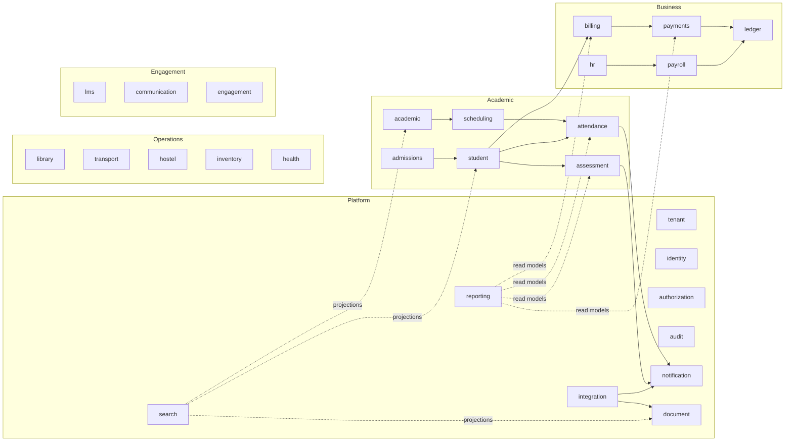
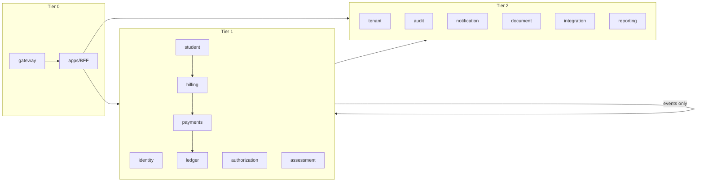

# Service Catalog

> **Status:** Accepted · **Owner:** Architecture Guild · **Version:** 2.0
>
> Every service is an independently deployable Cloudflare Worker with its own database schema,
> credentials, release cadence and on-call owner. A service that cannot be deployed alone is not a
> service.

## 1. Service design rules

| Rule | Rationale |
|---|---|
| **One bounded context, one owner** | A team owns 2–4 services; no shared ownership. |
| **One schema, one writer** | Only the owning service writes its tables. Others read via API/events. |
| **No cross-service foreign keys** | IDs are opaque references; integrity via events and reconciliation. |
| **No shared library with business rules across contexts** | Share technical primitives only (`packages/platform`), not domain logic. |
| **Public by contract, private by default** | Services are reachable only through the gateway or service bindings. |
| **Every service has a README, OpenAPI, runbook, SLO and capacity card** | Operability is part of the definition of done. |
| **Merge before you split** | If two services always change together, they are one service. Avoid nano-services. |
| **Split on data ownership or scaling need, not on org chart** | Premature splitting multiplies failure modes. |

### Service tiers

| Tier | Characteristics | Examples |
|---|---|---|
| **Tier 0 — Edge** | Every request, latency-critical, no business state | gateway, BFF apps |
| **Tier 1 — Core** | Money, identity, enrolment, grades; strong consistency; 99.9%+ | identity, student, billing, payments, ledger, assessment |
| **Tier 2 — Supporting** | Important but degradable; async tolerated | notification, document, reporting, search, integration |
| **Tier 3 — Optional** | Feature-specific; can be disabled per tenant | library, transport, hostel, lms, engagement |

## 2. Catalog overview



## 3. Platform services

### `tenant-service`

| Field | Detail |
|---|---|
| **Purpose** | Tenant lifecycle, institutions, plans, entitlements, domains, cell assignment. |
| **Owns** | `tenant`, `institution`, `campus`, `plan`, `subscription`, `entitlement`, `tenant_domain`, `cell_assignment`, `provisioning_job`. |
| **Sync API** | `GET/POST /internal/tenants`, `GET /internal/tenants/{id}/context`, `POST /internal/tenants/{id}/suspend`, `GET /internal/entitlements`. |
| **Events** | `tenant.provisioned.v1`, `tenant.suspended.v1`, `tenant.plan_changed.v1`, `institution.created.v1`. |
| **Cloudflare** | Workflow (provisioning), DO (provisioning lock), KV (tenant→cell cache), Queue (downstream setup). |
| **SLO** | 99.95% read; provisioning p95 ≤ 10 min. |
| **Phase** | 2 (Foundation). |

### `identity-service`

| Field | Detail |
|---|---|
| **Purpose** | User identity, profiles, session authority, MFA enrollment state, SCIM, account lifecycle. |
| **Owns** | `user`, `profile`, `identity_link`, `session`, `mfa_factor`, `scim_token`, `invitation`, `consent`. |
| **Sync API** | `POST /internal/sessions/validate`, `POST /internal/sessions/revoke`, `GET /internal/users/{id}/context`, `POST /internal/users/invite`, SCIM 2.0 endpoints via gateway. |
| **Events** | `identity.user.created.v1`, `identity.user.updated.v1`, `identity.session.revoked.v1`, `identity.user.deactivated.v1`. |
| **Cloudflare** | External OIDC IdP (delegated), Postgres (authority), DO (revocation), KV (session snapshot), Queue (audit/provisioning). |
| **SLO** | 99.95%; session validation p95 ≤ 50 ms (cache hit), ≤ 200 ms (authority). |
| **Phase** | 2. |

**Boundary:** identity answers *who you are* and *whether this session is valid*. It does not decide
what you may do — that is `authorization-service`.

### `authorization-service`

| Field | Detail |
|---|---|
| **Purpose** | Policy decision point: RBAC + ABAC + ReBAC decisions, role catalog, assignments, policy versions. |
| **Owns** | `role`, `permission`, `role_permission`, `role_assignment`, `relation_tuple`, `policy`, `policy_version`, `decision_cache_metadata`. |
| **Sync API** | `POST /internal/decisions` (single/batch), `GET /internal/permissions?principal=`, `POST /internal/relationships`, `DELETE /internal/relationships`. |
| **Events** | `authorization.role.changed.v1`, `authorization.assignment.changed.v1`, `authorization.policy.published.v1`. |
| **Cloudflare** | Cedar WASM policy engine in-Worker; Postgres relationship graph; KV decision cache; DO invalidation; Queue audit. |
| **SLO** | 99.95%; decision p95 ≤ 25 ms (cache), ≤ 100 ms (graph). |
| **Phase** | 2. |

**Model:** RBAC for coarse roles, ABAC for attributes (institution, campus, section, classification),
ReBAC for relationships (`guardian_of`, `teacher_of`, `assigned_to`, `approver_of`). Deny by default.
See [Identity & access](../04-security/identity-and-access.md).

### `audit-service`

| Field | Detail |
|---|---|
| **Purpose** | Tamper-evident audit trail for security, administrative and financial actions; evidence export. |
| **Owns** | `audit_event`, `audit_chain_head`, `audit_export`, `retention_policy`, `legal_hold`. |
| **Sync API** | `POST /internal/events` (from services), `GET /internal/audit` (auditor), `POST /internal/exports`. |
| **Events** | `audit.event.recorded.v1` (for SIEM), `audit.export.ready.v1`. |
| **Cloudflare** | Queue (ingest), DO (per-tenant chain head, sharded), Postgres (hot 90 days), R2 with object lock (WORM archive), Logpush. |
| **SLO** | 99.9%; ingest p95 ≤ 500 ms; no loss (outbox + DLQ). |
| **Phase** | 2. |

### `notification-service`

| Field | Detail |
|---|---|
| **Purpose** | Template rendering, preferences, channel delivery (email/SMS/push/in-app), retries and delivery evidence. |
| **Owns** | `template`, `template_version`, `preference`, `notification`, `delivery_attempt`, `suppression`, `broadcast`. |
| **Sync API** | `POST /internal/notifications`, `GET /internal/notifications/{id}`, preference endpoints. |
| **Events** | `notification.queued.v1`, `notification.delivered.v1`, `notification.failed.v1`, `notification.bounced.v1`. |
| **Cloudflare** | Queue (fan-out), Workflow (large broadcasts), KV (template/preference cache), R2 (rendered artefacts), external email/SMS/push providers via `integration-service`. |
| **SLO** | 99.9% accept; delivery p95 ≤ 60 s (transactional). |
| **Phase** | 2. |

### `document-service`

| Field | Detail |
|---|---|
| **Purpose** | Object metadata, uploads, virus scanning, versioning, signed access, retention, legal hold. |
| **Owns** | `document`, `document_version`, `access_grant`, `scan_result`, `retention_rule`, `legal_hold`. |
| **Sync API** | `POST /internal/documents/upload-url`, `POST /internal/documents/{id}/complete`, `GET /internal/documents/{id}/download-url`, `DELETE /internal/documents/{id}`. |
| **Events** | `document.uploaded.v1`, `document.scanned.v1`, `document.deleted.v1`, `document.hold.applied.v1`. |
| **Cloudflare** | R2 (objects + event notifications), Queue (scanning/processing), KV (metadata cache), presigned URLs. |
| **SLO** | 99.9%; signed URL p95 ≤ 100 ms; scan p95 ≤ 2 min. |
| **Phase** | 2. |

### `integration-service`

| Field | Detail |
|---|---|
| **Purpose** | Outbound webhooks, connectors, credential references, delivery logs, import/export jobs, partner adapters. |
| **Owns** | `connector`, `connector_credential_ref`, `webhook_subscription`, `delivery`, `import_job`, `export_job`, `mapping`. |
| **Sync API** | `POST /internal/webhooks`, `POST /internal/connectors/{id}/invoke`, import/export job endpoints. |
| **Events** | `integration.delivery.succeeded.v1`, `integration.delivery.failed.v1`, `integration.import.completed.v1`. |
| **Cloudflare** | Queue (delivery), Workflow (imports/exports), R2 (payloads/large files), KV (connector config cache), Tunnel (on-prem devices), Secrets Store. |
| **SLO** | 99.9%; webhook p95 ≤ 5 s. |
| **Phase** | 2 (webhooks), 4 (connectors). |

### `search-service`

| Field | Detail |
|---|---|
| **Purpose** | Full-text and semantic search over learners, staff, courses, documents and help content. |
| **Owns** | `index_definition`, `projection_checkpoint`, `search_synonym`, `embedding_metadata`. |
| **Sync API** | `GET /internal/search?q=&types=`, `POST /internal/reindex`. |
| **Events** | `search.index.updated.v1`, `search.reindex.completed.v1`. |
| **Cloudflare** | Postgres FTS/trigram, Vectorize (semantic), Workers AI embeddings, Queue (indexing), KV (query cache). |
| **SLO** | 99.5%; p95 ≤ 200 ms. |
| **Phase** | 4. |

### `reporting-service`

| Field | Detail |
|---|---|
| **Purpose** | Read models, dashboards, scheduled reports, exports, cross-institution analytics. |
| **Owns** | `report_definition`, `report_run`, `read_model_*`, `dashboard`, `export_artifact`, `metric_snapshot`. |
| **Sync API** | `GET /internal/dashboards/{key}`, `POST /internal/reports/{id}/run`, `GET /internal/exports/{id}`. |
| **Events** | `reporting.run.completed.v1`, `reporting.export.ready.v1`. |
| **Cloudflare** | Read replicas, materialized views, Workflow (long runs), R2 (exports), Analytics Engine (ops metrics), Queue (refresh). |
| **SLO** | 99.5%; dashboard p95 ≤ 500 ms; export async. |
| **Phase** | 3 (basic), 4 (advanced). |

## 4. Academic services

### `academic-service`

| Field | Detail |
|---|---|
| **Purpose** | Institution academic configuration: years, terms, levels, programmes, courses, curricula, sections, rooms, calendars. |
| **Owns** | `academic_year`, `term`, `education_level`, `programme`, `programme_version`, `course`, `course_version`, `curriculum`, `curriculum_version`, `section`, `section_teacher`, `room`, `calendar`, `holiday`, `grading_scheme` (reference). |
| **Sync API** | CRUD under `/internal/academic/*`; `GET /internal/academic/context?institution_id=`. |
| **Events** | `academic.year.created.v1`, `academic.term.activated.v1`, `academic.section.created.v1`, `academic.curriculum.published.v1`. |
| **Cloudflare** | Postgres, KV (reference cache), Queue (downstream projections), Workflow (bulk rollover). |
| **SLO** | 99.9%; p95 ≤ 200 ms. |
| **Phase** | 3. |

### `admissions-service`

| Field | Detail |
|---|---|
| **Purpose** | Intakes, application forms, applications, documents, review stages, offers, waitlist, conversion. |
| **Owns** | `intake`, `application_form`, `application`, `application_answer`, `application_document`, `review`, `decision`, `offer`, `waitlist_entry`, `applicant`. |
| **Sync API** | Public application endpoints via gateway; internal review/decision/convert endpoints. |
| **Events** | `admissions.application.submitted.v1`, `admissions.offer.issued.v1`, `admissions.offer.accepted.v1`, `admissions.applicant.converted.v1`. |
| **Cloudflare** | Postgres, R2 (documents via document-service), Turnstile (public forms), Workflow (offer expiry/bulk decisions), Queue (notifications), KV (form schema cache). |
| **SLO** | 99.9%; public form p95 ≤ 500 ms; conversion atomic. |
| **Phase** | 3. |

### `student-service`

| Field | Detail |
|---|---|
| **Purpose** | Learner record, guardians and relationships, enrolment, status history, support plans, authorised pick-up, consent. |
| **Owns** | `student`, `student_profile`, `guardian`, `student_guardian`, `pickup_authorisation`, `enrolment`, `enrolment_status_history`, `support_plan`, `support_plan_review`, `student_identifier`, `consent`. |
| **Sync API** | `GET /internal/students/{id}`, `GET /internal/students/{id}/context`, `POST /internal/enrolments`, `POST /internal/students`, guardian endpoints. |
| **Events** | `student.created.v1`, `student.enrolled.v1`, `student.withdrawn.v1`, `student.status.changed.v1`, `student.guardian.linked.v1`. |
| **Cloudflare** | Postgres, KV (student context cache), Queue (billing/attendance/notification projections), Workflow (bulk enrolment), DO (seat reservation per section). |
| **SLO** | 99.95%; p95 ≤ 300 ms; enrolment transaction p95 ≤ 800 ms. |
| **Phase** | 3. |

### `scheduling-service`

| Field | Detail |
|---|---|
| **Purpose** | Periods, timetable generation and adjustment, room/resource allocation, exam scheduling, invigilation. |
| **Owns** | `period`, `timetable`, `timetable_entry`, `constraint`, `room_booking`, `exam_session`, `exam_room`, `invigilator_assignment`. |
| **Sync API** | Timetable CRUD, generate/adjust, conflict check, published views. |
| **Events** | `scheduling.timetable.published.v1`, `scheduling.conflict.detected.v1`, `scheduling.exam.scheduled.v1`. |
| **Cloudflare** | Postgres, Workflow (generation), KV (published timetable cache), Queue (notifications/projections). |
| **SLO** | 99.5%; read p95 ≤ 200 ms; generation async. |
| **Phase** | 4. |

### `attendance-service`

| Field | Detail |
|---|---|
| **Purpose** | Registers, attendance records, absence/excuse workflows, thresholds, staff attendance, offline sync. |
| **Owns** | `attendance_session`, `attendance_record`, `absence_request`, `absence_reason`, `attendance_policy`, `attendance_correction`, `staff_clock_event`. |
| **Sync API** | `POST /internal/attendance/sessions`, `POST /internal/attendance/records:batch` (idempotent), `GET /internal/attendance/summary`. |
| **Events** | `attendance.session.opened.v1`, `attendance.recorded.v1`, `attendance.absence.threshold_reached.v1`, `attendance.corrected.v1`. |
| **Cloudflare** | Postgres (partitioned by term/month), DO (per-session sync lock/idempotency), KV (roster cache), Queue (notifications/aggregates), PWA offline queue at client. |
| **SLO** | 99.95%; batch write p95 ≤ 500 ms; offline sync exactly-once. |
| **Phase** | 3. |

### `assessment-service`

| Field | Detail |
|---|---|
| **Purpose** | Grading schemes, assessments, marks, moderation, report cards, transcripts, competencies, academic standing. |
| **Owns** | `grading_scheme`, `grade_band`, `assessment`, `assessment_score`, `rubric`, `rubric_level`, `moderation`, `report_card`, `report_card_snapshot`, `transcript`, `transcript_version`, `competency`, `outcome_result`, `standing_decision`. |
| **Sync API** | Assessment CRUD, mark entry/bulk, moderation, publish, report card/transcript generation. |
| **Events** | `assessment.published.v1`, `assessment.marks.moderated.v1`, `assessment.report_card.issued.v1`, `assessment.transcript.issued.v1`. |
| **Cloudflare** | Postgres, Workflow (report card batch/transcript generation), R2 (PDFs), Queue (notifications/projections), DO (publication lock per section/term). |
| **SLO** | 99.95%; mark write p95 ≤ 500 ms; report card batch ≤ 5 min/500 learners. |
| **Phase** | 3. |

## 5. Business services

### `billing-service`

| Field | Detail |
|---|---|
| **Purpose** | Fee structures, assignments, invoices, credit notes, scholarships, instalments, dunning, payer accounts. |
| **Owns** | `fee_schedule`, `fee_item`, `fee_assignment`, `invoice`, `invoice_line`, `credit_note`, `scholarship`, `scholarship_award`, `instalment_plan`, `payer`, `dunning_action`. |
| **Sync API** | Fee setup, invoice query/create, credit note, statement, allocation request (delegates to payments), dunning. |
| **Events** | `billing.invoice.issued.v1`, `billing.invoice.paid.v1`, `billing.credit_note.issued.v1`, `billing.overdue.v1`. |
| **Cloudflare** | Postgres, Workflow (term billing), DO (invoice number allocator), Queue (notifications/ledger), KV (fee cache). |
| **SLO** | 99.95%; invoice read p95 ≤ 300 ms; generation idempotent. |
| **Phase** | 3. |

### `payments-service`

| Field | Detail |
|---|---|
| **Purpose** | Payment intents, PSP adapters, webhooks, refunds, settlement files, reconciliation, unallocated credits. |
| **Owns** | `payment_intent`, `payment`, `payment_event`, `refund`, `settlement`, `settlement_line`, `reconciliation_exception`, `psp_account`, `psp_webhook_event`. |
| **Sync API** | `POST /internal/payments/intents`, `POST /internal/payments/{id}/refund`, `GET /internal/payments/reconciliation`. |
| **Events** | `payments.captured.v1`, `payments.failed.v1`, `payments.refunded.v1`, `payments.reconciled.v1`, `payments.unmatched.v1`. |
| **Cloudflare** | Postgres, Queue (allocation/ledger/notification), Workflow (daily reconciliation), DO (idempotency + PSP rate limit), R2 (settlement files), Secrets Store (PSP keys), external PSPs. |
| **SLO** | 99.95%; webhook p95 ≤ 2 s; zero double capture. |
| **Phase** | 3. |

### `ledger-service`

| Field | Detail |
|---|---|
| **Purpose** | Chart of accounts, journals, periods, budgets, trial balance, financial statements, audit-ready books. |
| **Owns** | `account`, `journal`, `journal_line`, `accounting_period`, `budget`, `budget_line`, `fiscal_year`, `reconciliation`. |
| **Sync API** | `POST /internal/journals` (balanced, idempotent), `GET /internal/trial-balance`, statements, budget endpoints. |
| **Events** | `ledger.journal.posted.v1`, `ledger.period.closed.v1`, `ledger.budget.exceeded.v1`. |
| **Cloudflare** | Postgres (append-only), Workflow (period close), Queue, R2 (statements/exports), DO (period lock). |
| **SLO** | 99.99%; post p95 ≤ 500 ms; debits = credits invariant. |
| **Phase** | 3 (receivables/GL), 4 (budgets/procurement). |

### `hr-service`

| Field | Detail |
|---|---|
| **Purpose** | Staff records, contracts, qualifications, certifications, leave, recruitment, appraisals. |
| **Owns** | `staff`, `staff_profile`, `contract`, `qualification`, `certification`, `leave_type`, `leave_balance`, `leave_request`, `vacancy`, `applicant`, `appraisal`. |
| **Sync API** | Staff/contract/leave CRUD, approval workflows, expiry alerts. |
| **Events** | `hr.staff.hired.v1`, `hr.contract.changed.v1`, `hr.leave.approved.v1`, `hr.certification.expiring.v1`. |
| **Cloudflare** | Postgres, Workflow (approvals), Queue (payroll input/notifications), R2 (documents), KV (staff context cache). |
| **SLO** | 99.9%; p95 ≤ 300 ms. |
| **Phase** | 4. |

### `payroll-service`

| Field | Detail |
|---|---|
| **Purpose** | Payroll runs, salary structures, allowances, deductions, loans, statutory rules, payslips, bank files. |
| **Owns** | `salary_structure`, `pay_component`, `employee_pay`, `payroll_run`, `payslip`, `payslip_line`, `deduction`, `loan`, `statutory_rule`, `bank_file`. |
| **Sync API** | Run preview/approve/lock, payslip query, statutory export. |
| **Events** | `payroll.run.approved.v1`, `payroll.run.locked.v1`, `payroll.payslip.issued.v1`, `payroll.bank_file.ready.v1`. |
| **Cloudflare** | Postgres, Workflow (run, approvals), DO (run lock), R2 (payslips/bank files), Queue (ledger/notification), Secrets Store. |
| **SLO** | 99.9%; run completion ≤ 30 min/5k staff; immutable payslips. |
| **Phase** | 4. |

## 6. Operations services

| Service | Purpose | Key data | Cloudflare | Phase |
|---|---|---|---|---|
| `library-service` | Catalogue, copies, loans, reservations, fines | title, copy, loan, reservation, fine | Postgres, KV (catalogue cache), Queue (reminders), R2 (covers) | 4 |
| `transport-service` | Routes, stops, vehicles, drivers, assignments, trip visibility | route, stop, vehicle, driver, assignment, trip, ping | Postgres, DO (live trip state), Queue (alerts), KV (route cache) | 4 |
| `hostel-service` | Hostels, rooms, beds, allocations, roll-call, exeat | hostel, room, bed, allocation, roll_call, exeat | Postgres, DO (roll-call session), Queue (alerts), R2 (consent) | 4 |
| `inventory-service` | Stock, assets, locations, movements, reorder, maintenance | item, stock_level, location, movement, asset, maintenance | Postgres, Queue (reorder alerts), R2 (manuals), KV (catalogue) | 4 |
| `health-service` | Clinic visits, medication, immunisations, consent | visit, diagnosis_code, medication, administration, immunisation, consent | Postgres (field encryption), R2 (documents), Queue (alerts), strict ABAC | 4 |

## 7. Engagement services

| Service | Purpose | Key data | Cloudflare | Phase |
|---|---|---|---|---|
| `lms-service` | Course content, resources, assignments, submissions, quizzes, rubrics | module, resource, assignment, submission, quiz, attempt, rubric | Postgres, R2 (content), Stream (video), Queue (grading/notifications), Workflow (bulk grading) | 4 |
| `communication-service` | Announcements, conversations, moderation, attachments | announcement, audience, conversation, message, participant, moderation | Postgres, DO (presence/typing), Queue (delivery), R2 (attachments), WebSockets | 4 |
| `engagement-service` | Behaviour/merit, clubs, activities, alumni, fundraising | incident, sanction, merit, club, membership, alumni_profile, campaign, donation | Postgres, Queue (notifications), R2 (media), Workflow (campaigns) | 4–5 |

## 8. Dependency rules



| Rule | Enforcement |
|---|---|
| Tier 1 may call Tier 2 synchronously (with timeout/circuit breaker). | Code review + dependency-cruiser. |
| Tier 2 must not synchronously call Tier 1. Use events. | Service binding allowlist. |
| No cycles between services. | CI dependency graph check. |
| Cross-context reads prefer local projections. | ADR + review. |
| A service may call at most 2 other services per request. | Gateway/BFF instrumentation + lint. |

## 9. Release phases and deployable count

| Phase | New services | Cumulative deployables |
|---|---|---|
| 2 — Foundation | gateway, tenant, identity, authorization, audit, document, notification, integration, portal/admin BFF | 10 |
| 3 — Core MVP | academic, admissions, student, attendance, assessment, billing, payments, ledger, reporting (basic) | 19 |
| 4 — Expansion | scheduling, hr, payroll, library, transport, hostel, inventory, health, lms, communication, engagement, search, reporting (advanced), parent/student BFFs | 33 |
| 5 — Hardening | none (stabilise) | 33 |
| 6+ — Extensions | marketplace, Workers for Platforms | 34+ |

> A deployable is a Worker or a frontend app. The count is intentionally visible: every addition
> carries on-call, observability, security review and cost. Services may be merged if the split does
> not earn its keep.

### Post-GA extensions (not counted above)

| Service | Purpose | Reuses |
|---|---|---|
| `research-service` | Projects, grants, ethics, publications, supervision | ledger, document, notification, authorization |
| `accreditation-service` | Standards, evidence, self-study, reviewer access | document, notification, authorization |
| `cafeteria-service` | Meal plans, allergy flags, account balances | billing, payments, inventory, health |
| `facilities-service` | Buildings, bookings, maintenance, safety checks | inventory, notification, document |

These are deliberately deferred; each requires an ADR and the same service-readiness checklist.

## 10. Service ownership template

Every service repository folder contains `service.yaml`:

```yaml
name: student-service
bounded_context: student
tier: 1
owner: team-alpha
slack: "#team-alpha"
oncall: student-primary
data:
  schema: student
  classification: confidential
  retention: learner_lifecycle_plus_7y
api:
  openapi: ./openapi.yaml
  public: false
  version: v1
events:
  publishes: [student.created.v1, student.enrolled.v1, student.withdrawn.v1]
  consumes: [admissions.applicant.converted.v1, academic.section.created.v1]
slo:
  availability: 99.95
  latency_p95_ms: 300
dependencies:
  sync: [authorization-service, document-service]
  async: [billing-service, notification-service, audit-service]
capacity:
  peak_rps: 1500
  db_qps: 4000
```

CI validates this file, generates dashboards/runbook stubs and fails if ownership or SLO is missing.
