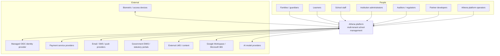
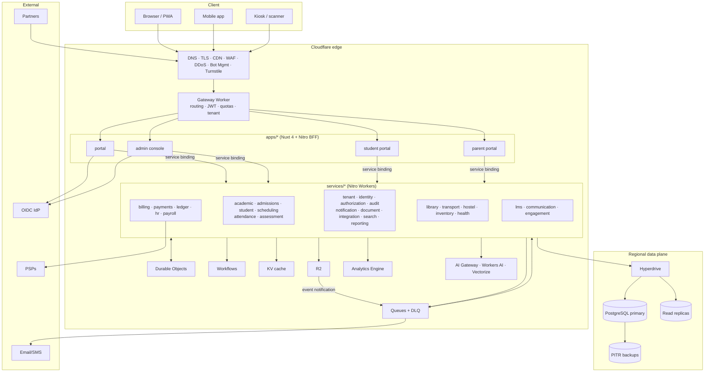
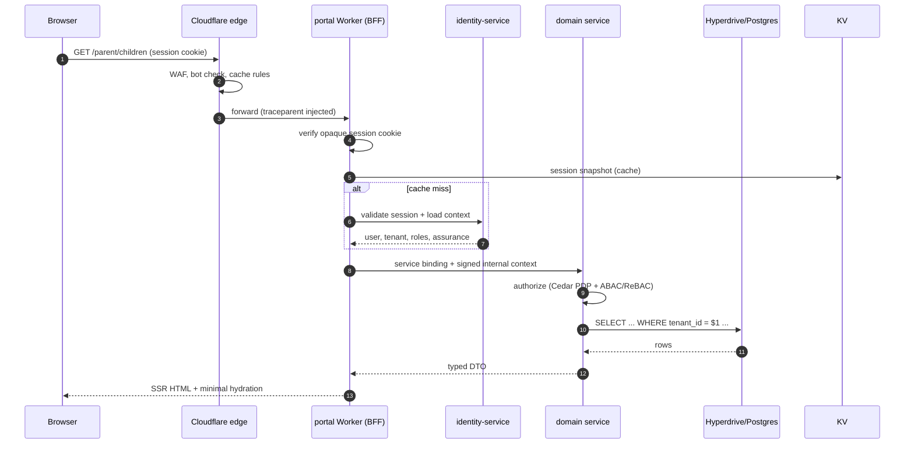
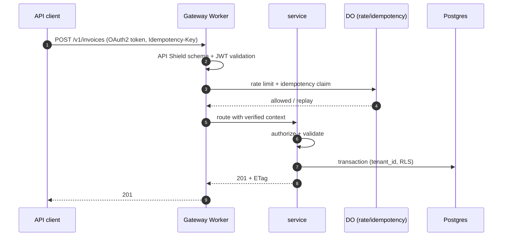
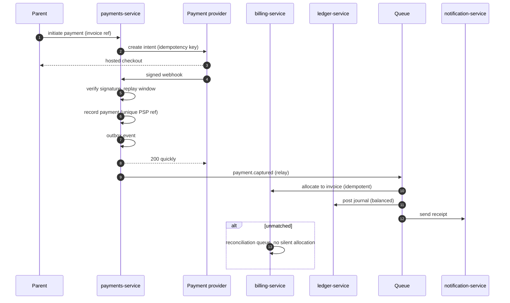
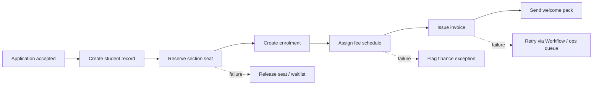
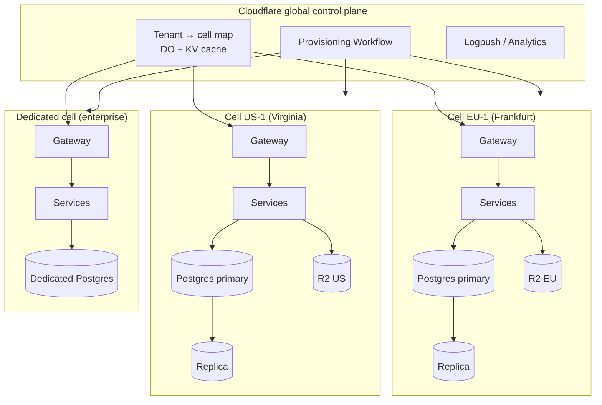
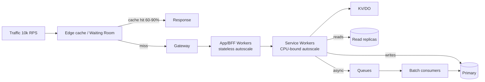

# System Architecture

> **Status:** Accepted · **Owner:** Architecture Guild · **Version:** 2.0 (Cloudflare-native)
> **Review:** [Cloudflare platform review](cloudflare-platform-review.md)

## 1. Architectural drivers

| Driver | Architectural response |
|---|---|
| Every education level, one product | Configurable academic model; no code forks per institution type |
| 1M daily users, global, bursty | Edge rendering and caching; stateless Workers; queue buffering; regional DB cells |
| Money and grades must be correct | Strongly consistent PostgreSQL, transactions, append-only ledger, immutable snapshots |
| Sensitive learner data | Tenant isolation in depth, least privilege, encryption, audit, residency |
| Many integrations | API-first, webhooks, event contracts, adapter layer, Workers for Platforms |
| Small team, large surface | Bounded contexts, shared golden path, managed Cloudflare primitives |
| Vendor concentration | Pure domain/application code; Cloudflare bindings behind ports; documented exit paths |

## 2. Principles

1. **Bounded contexts own their data.** A service exposes behaviour, never its tables.
2. **Sync for queries and commands that need an answer; async for everything else.** No distributed
   transactions. Multi-step business processes are sagas/Workflows with compensations.
3. **The edge is for latency and protection, not for truth.** Authoritative state lives in
   PostgreSQL and R2; KV is a cache; DO is coordination.
4. **Design for failure.** Timeouts, retries with jitter, circuit breakers, idempotency, DLQs,
   graceful degradation and load shedding are mandatory.
5. **Zero trust internally.** Every hop authenticates and authorizes; service bindings are not a
   security boundary by themselves.
6. **Observable by default.** Every request and event carries a trace; every service emits RED/USE
   metrics and structured logs with PII redaction.
7. **Configuration over code.** Calendars, levels, grading, fees, workflows, templates and branding
   are tenant data.
8. **Accessible, localised, low-bandwidth first.** WCAG 2.2 AA; ICU messages; PWA/offline capture.
9. **No hidden coupling.** Contracts are versioned; database changes are backward-compatible.
10. **Cost is an architectural concern.** Every design names its unit cost and scaling limit.

## 3. System context (C4 level 1)

## 4. Container view (C4 level 2)

### Deployable units

| Unit | Runtime | Public? | Responsibility |
|---|---|---|---|
| `gateway` | Worker | Yes | TLS termination at edge, WAF integration, JWT/API-key validation, tenant resolution, routing, quotas, request limits |
| `apps/*` | Workers (Nuxt/Nitro) | Yes | SSR, session cookie, BFF aggregation, UI |
| `services/*` | Workers (Nitro) | **No** (service bindings only, except webhooks via gateway) | Domain logic and data ownership |
| `platform-ops` | Worker + Access | Internal | Tenant provisioning, support tooling, break-glass |
| `extensions` | Workers for Platforms | Partner-scoped | Isolated customer/partner extensions |

## 5. Request lifecycle

### 5.1 Interactive portal request

Rules:

- The browser never calls a domain service directly; only the gateway/app Worker.
- The BFF holds no business invariants. It composes and shapes data.
- Every service re-checks authorization; a valid internal token is not a permission.
- Responses carry `traceparent`/request ID and cache directives; authenticated responses are
  `private, no-store` unless explicitly cacheable.

### 5.2 Public API request

### 5.3 Payment capture and reconciliation

### 5.4 Enrolment saga

The saga runs as a **Workflow** with idempotent steps and explicit compensations. It never holds a
database transaction open across services.

## 6. Service communication

| Pattern | Mechanism | When | Rules |
|---|---|---|---|
| **Public sync** | Gateway → app/service | Browser, partner API | OAuth2/JWT, rate limits, OpenAPI schema, idempotency |
| **Internal sync** | Service binding (RPC/fetch) | Read composition, command needing an answer | Signed internal JWT, timeout ≤ 2 s, circuit breaker, max depth 2 |
| **Async event** | Queue + outbox | State changes other contexts care about | At-least-once, idempotent, CloudEvents envelope, DLQ |
| **Durable process** | Workflow | Onboarding, billing run, report cards, payroll | Idempotent steps, visible status, bounded retries |
| **Coordination** | Durable Object | Rate limits, sequences, locks, presence, revocation | Sharded key, alarm-driven, no long-term business data |
| **Cache** | KV | Reference data, rendered fragments | TTL + versioned key; never authoritative |
| **Objects** | R2 | Files, media, exports, backups | Presigned URLs, encryption, lifecycle, object lock for audit |
| **Search** | Postgres FTS / Vectorize | Full-text and semantic search | Projections only, rebuildable |
| **Webhooks out** | integration-service | Partner notifications | HMAC, retries, replay protection, delivery log |

### Sync call policy

- Timeout: 2 s default, 5 s for low-latency-critical reads, 10 s for report generation kickoff.
- Retries: only idempotent operations; max 2 with exponential backoff and jitter; no retry on 4xx.
- Circuit breaker: open after 5 failures in 30 s; half-open probe after 30 s; fallback/read-model or
  graceful error.
- Depth: A → B → C allowed only for read-only enrichment; A → B → C → D is prohibited.
- Bulkheads: per-dependency concurrency caps; a slow dependency cannot exhaust Worker resources.
- Every response includes a machine-readable error code and `trace_id`.

## 7. Data ownership

| Service | Owns | Never owns |
|---|---|---|
| tenant | tenant, institution, plan, entitlement, domain, cell assignment | user credentials, learner records |
| identity | user, profile, credential link, session, MFA, SCIM | roles/permissions decisions |
| authorization | roles, permission catalog, assignments, ReBAC tuples, policy versions | user PII |
| academic | years, terms, levels, programmes, courses, curricula, sections | enrolment, marks |
| admissions | applications, intakes, offers, decisions | learner record, invoices |
| student | learner, guardian, relationship, enrolment, support plan | marks, invoices |
| attendance | sessions, records, absence, corrections | learner PII beyond IDs |
| assessment | schemes, assessments, scores, report cards, transcripts | learner identity |
| billing | fee schedules, invoices, lines, credits, scholarships | payment instruments |
| payments | payment intents, transactions, refunds, PSP events, reconciliation | ledger accounts, invoices |
| ledger | chart of accounts, journals, periods, budgets | payment instruments |
| hr | staff, contracts, leave, recruitment, certifications | payroll calculations |
| payroll | runs, payslips, statutory rules | staff identity |
| notification | templates, preferences, delivery attempts | message content ownership |
| document | object metadata, versions, access grants, retention | business records |
| audit | immutable audit events, hash chain, exports | operational logs |
| reporting | read models, marts, scheduled reports | source-of-truth data |
| integration | connectors, webhook subscriptions, delivery logs | domain state |

**Rule:** IDs from other contexts are stored as opaque references. No foreign keys across schemas. A
service that needs another context's data keeps a projected copy updated by events, or asks for it
synchronously.

## 8. Multi-tenancy and cells

- **Shared cell:** many tenants, `tenant_id` + RLS, logical schema per service.
- **Dedicated cell:** one large/regulated tenant; separate Workers config, database, R2 bucket, keys.
- **Tenant routing:** gateway resolves tenant from hostname/token, looks up the cell map, routes to the
  correct origin; the map is cached in KV and invalidated by a DO.
- **Residency:** cell is pinned to a region; DB, backups, R2 and logs stay in-region. Cloudflare
  Regional Services/Data Localization is used where contractually required.
- **Noisy neighbour:** per-tenant quotas at gateway (RPS, burst, concurrent jobs, storage), queue
  fairness, and per-tenant rate-limit buckets in DO.

See [Multi-tenancy](multi-tenancy.md).

## 9. Failure modes and degradation

| Failure | Detection | User impact | Behaviour |
|---|---|---|---|
| PostgreSQL primary unavailable | Hyperdrive errors, health checks | Writes fail; reads may serve stale | Fail fast for writes, serve cache/read replica for safe reads, page on-call, failover runbook |
| Read replica lag | Replication metric | Stale dashboards/search | Route writes + read-your-writes to primary; flag stale data in UI |
| Hyperdrive pool exhausted | Saturation metric | Elevated latency/5xx | Backpressure, retry-after, shed low-priority traffic, scale pool |
| KV unavailable | Error rate | Slower auth/config reads | Fall through to authoritative store; never fail closed on cache miss |
| Queue unavailable | Publish errors | Delayed notifications/audit | Outbox retains events; relay retries; alert if lag > 5 min |
| Consumer poison message | DLQ count | One event stuck | DLQ + replay tool; no blocking of the partition/batch |
| DO unavailable | RPC errors | Rate limit/idempotency degraded | Fall back to edge rate limiting; reject if safety-critical |
| IdP unavailable | Login failures | New logins fail; sessions continue | Existing sessions remain valid until expiry; status page; no password bypass |
| PSP unavailable | Timeout/5xx | Cannot pay online | Show bank-transfer instructions; retry; never mark paid |
| R2 unavailable | 5xx | Documents unavailable | Metadata remains; retry; no data loss |
| AI provider unavailable | Timeout | Copilot unavailable | Feature disabled gracefully; core workflows unaffected |
| Region failure | Synthetic + provider health | Cell unavailable | DNS/load-balancer failover to secondary; RTO/RPO per tier |

**Load shedding order:** AI/copilot → reporting exports → analytics → non-critical notifications →
search → read caching → core writes. Core attendance/marks capture and payment webhooks are never
shed.

## 10. Capacity and scaling model

| Layer | Scaling mechanism | Limit / action |
|---|---|---|
| Edge cache | Cache Rules, Tiered Cache | Public pages and reference data; purge by tag |
| Gateway | Stateless Workers | Per-tenant and per-IP quotas; Waiting Room for spikes |
| Apps | Stateless Workers | SSR caching; streaming; avoid per-request heavy work |
| Services | Stateless Workers | CPU limits; move heavy work to Queues/Workflows |
| Reads | Replicas + KV + read models | Replica lag budget; read-your-writes on primary |
| Writes | Vertical + cell sharding | Batch attendance writes; partition hot tables |
| Async | Queues + batch consumers | Backpressure; DLQ; per-tenant fairness |
| Coordination | DO sharding | Key = tenant + bucket; monitor hot objects |
| Storage | R2 + lifecycle | Presigned URLs; archive to infrequent access |
| Database | Cell split | Move large tenants to dedicated cells; partition by term/date |

### Load model (to be signed off)

- 1M DAU, 100k peak concurrent sessions, 10k RPS sustained, 30k burst.
- 80% reads / 20% writes; attendance and results days are 3–5× baseline.
- Read:write ratio drives replicas and cache; write rate drives partitioning and queue buffering.
- Every service publishes a capacity card: requests/s per instance, DB QPS, queue lag, cost per
  1,000 operations.

## 11. Consistency and correctness

| Data | Consistency | Mechanism |
|---|---|---|
| Money, ledger, invoices | Strong | Single-writer transactions, unique constraints, balanced journal check |
| Enrolment capacity | Strong | Row lock/atomic counter in Postgres or DO reservation |
| Attendance | Strong per learner/session; eventual aggregates | Unique `(session_id, student_id)`, idempotent upsert |
| Marks | Strong per assessment; eventual report card | Transaction + snapshot at publication |
| Notifications | Eventual | Queue, retries, DLQ |
| Search/reporting | Eventual | Projections rebuilt from events/source |
| Audit | Append-only, tamper-evident | Outbox → Queue → hash chain → R2 object lock |
| Sessions | Strong revocation, cached validation | Postgres authority + DO invalidation + KV cache |

**Eventual consistency UX rule:** if the user just wrote data, read from the primary or the write
response. Never show a stale read as if it were current; label "processing" states explicitly.

## 12. Deployment topology

- **Workers:** one deployment per service per environment; gradual deployments with version
  overrides; instant rollback.
- **Database:** regional primary + replica per cell; PITR; migrations before deploy.
- **R2:** region-pinned buckets; lifecycle; object lock for audit; event notifications to Queues.
- **Queues:** per environment and per domain; DLQ; consumer concurrency tuned per service.
- **Workflows:** per environment; retention aligned to audit/retention policy.
- **DO:** jurisdiction/region pinned where required; class per concern.
- **Terraform:** account-level resources (DNS, WAF, Access, R2, Queues, Hyperdrive configs, Logpush).
- **Wrangler:** Worker code, bindings, routes, vars, secrets references.

See [CI/CD, environments & infrastructure](../07-devops/cicd-environments-infrastructure.md).

## 13. Architecture decision summary

| Decision | ADR |
|---|---|
| Microservices in a monorepo | [ADR-0001](../adr/0001-microservices-in-a-monorepo.md) |
| Cloudflare Workers + Nitro | [ADR-0002](../adr/0002-cloudflare-workers-and-nitro.md) |
| PostgreSQL + Hyperdrive + RLS | [ADR-0003](../adr/0003-postgres-hyperdrive-and-rls.md) |
| Queues, Workflows, Durable Objects | [ADR-0004](../adr/0004-queues-workflows-durable-objects.md) |
| Managed identity + Cedar/ReBAC | [ADR-0005](../adr/0005-managed-identity-and-cedar.md) |
| Nuxt BFF | [ADR-0006](../adr/0006-nuxt-bff-frontend.md) |
| Wrangler + Terraform | [ADR-0007](../adr/0007-wrangler-terraform-and-gitops.md) |
| REST/OpenAPI + event contracts | [ADR-0008](../adr/0008-rest-openapi-and-event-contracts.md) |
| Phased service delivery | [ADR-0009](../adr/0009-phased-service-delivery.md) |
