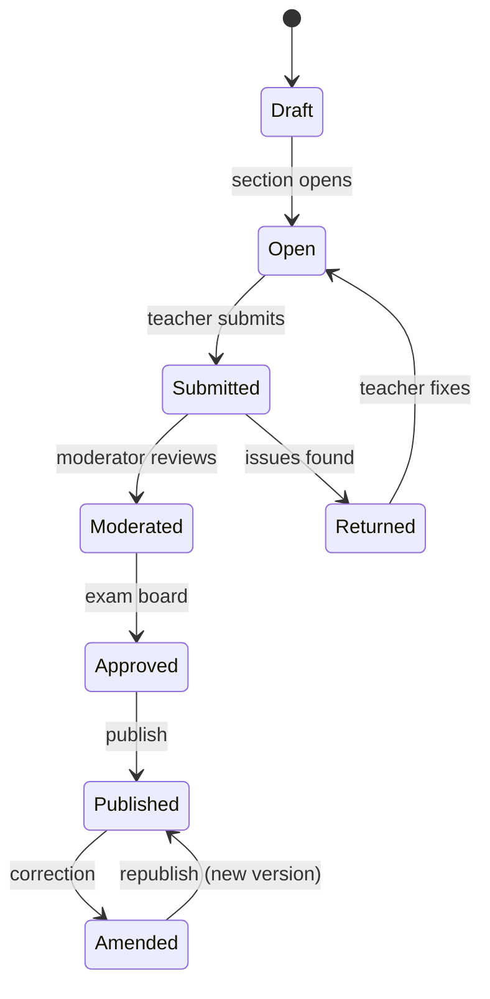

# Academics & Assessment

> **Status:** Accepted · **Owner:** Academic Domain · **Version:** 1.0
>
> This document specifies how Athena models calendars, programmes, delivery and achievement across
> every education level, and the invariants that make results defensible.

## 1. Academic calendar

### 1.1 Supported structures

| Structure | Use | Model |
|---|---|---|
| Fixed terms | Most K-12 | `academic_year` → 3 terms, fixed dates |
| Semesters | Colleges/universities | `academic_year` → 2 semesters (+ summer) |
| Trimesters | Some schools/universities | 3 equal terms |
| Blocks/modules | TVET, professional courses | Term → short blocks; course runs in a block |
| Rolling intakes | Training providers, early years | Multiple intakes per year; enrolment effective dates |
| Year-round | Early years/daycare | Continuous with holiday closures |

Rules:

- Terms have `starts_on`, `ends_on`, `sequence`, `status` (`planned`, `active`, `closed`).
- Dates are inclusive; timezone is the institution's.
- Terms cannot overlap within the same academic year unless the institution explicitly allows
  concurrent terms (e.g. summer school); the model supports it via `allows_overlap`.
- Closing a term locks marks/report cards and triggers finance period checks.
- Holidays and closures are separate records and are considered by attendance/scheduling.

### 1.2 Calendar invariants

| Invariant | Enforcement |
|---|---|
| No term outside its academic year | Check constraint / application validation |
| No duplicate term sequence in a year | Unique `(academic_year_id, sequence)` |
| Term close requires no unpublished results (configurable) | Workflow check |
| Calendar changes after start are audited | Audit event with before/after |
| Scheduling uses institution timezone | All date rules resolved in IANA timezone |

## 2. Structure and delivery

### 2.1 Hierarchy

```text
Tenant
└── Institution (school / college / campus group)
    ├── Campus
    ├── Academic year
    │   └── Term / semester / block
    ├── Education level (ordered)
    ├── Programme (versioned)
    │   ├── Programme level(s)
    │   ├── Curriculum version
    │   └── Programme courses (sequence, credits, required)
    ├── Course (versioned)
    │   └── Section (term, campus, teacher, room, capacity)
    └── Grading scheme (versioned)
```

### 2.2 Programme and course versioning

- A **programme version** is a published, immutable snapshot of structure (courses, credits,
  progression rules).
- Learners enrol against a programme version. Changing the structure creates a new version; existing
  learners stay on their version unless migrated explicitly.
- A **course version** holds outcomes, credit value and assessment structure.
- A **section** references a course version and term; content changes during a term are recorded as
  section-level amendments, not silent edits.

### 2.3 Section rules

| Rule | Detail |
|---|---|
| Capacity | `capacity` + reserved seats; enrolment cannot exceed without override |
| Teacher assignment | One lead teacher + optional co-teachers/assistants; role-scoped |
| Room | Optional; scheduling enforces no double-booking |
| Delivery mode | `in_person`, `online`, `hybrid`, `workplace` |
| Language | Section language for materials/communication |
| Roster | Derived from active enrolments; cached in KV |
| Merge/split | New section with transfer records; never mutate history |

## 3. Curriculum

- Curriculum framework: `national`, `ib`, `cambridge`, `tvet_competency`, `custom`.
- Versioned outcomes/competencies with codes, descriptions and parent-child structure.
- Mapping: course version → outcomes; assessment → outcomes; programme → exit outcomes.
- Publication is immutable; edits create a new version.
- Coverage reports show which outcomes have evidence.
- Import/export via CSV/OneRoster/Ed-Fi adapters where available.

## 4. Assessment models

### 4.1 Assessment types

| Type | Typical use | Scoring |
|---|---|---|
| Diagnostic | Early years, placement | Descriptive/competency |
| Formative | Continuous assessment | Points/percentage, low weight |
| Summative | Term exams, projects | Points/percentage |
| Practical | TVET, labs, clinical | Rubric/competency |
| Observation | Early years | Developmental bands |
| Quiz | LMS | Auto-scored |
| Thesis/dissertation | Tertiary | Rubric + committee |

### 4.2 Assessment definition

| Field | Purpose |
|---|---|
| `type` | Behaviour and default grading |
| `weight` | Contribution to a grouping (e.g. coursework 40%, exam 60%) |
| `max_score` | Upper bound |
| `rubric_id` | Criteria-based scoring |
| `due_at` / `opens_at` | Timing |
| `grouping` | Category used for weighting/drop rules |
| `is_exam` | Exam scheduling/invigilation |
| `published_at` | Visibility gate |
| `scheme_version_id` | Grading scheme used |

### 4.3 Weighted total

```text
coursework = (assignment1/max1*100 * w1 + assignment2/max2*100 * w2) / (w1+w2)
final      = coursework * 0.4 + exam/100 * 0.6
grade      = scheme.band_for(final)
```

Rules:

- Weights within a grouping must sum to 100% (or the scheme's configured total).
- "Drop lowest N" / "best N of M" are explicit strategies, versioned and auditable.
- Missing marks are `null`, not zero, until explicitly treated as zero by policy.
- Rounding is half-up at the defined precision (usually 2 dp); GPA uses the scheme's precision.
- Recalculation after publication creates a new version; it never mutates the published snapshot.

### 4.4 GPA / CGPA

```text
GPA  = Σ(grade_points × credits) / Σ(credits)
CGPA = Σ(grade_points × credits across terms) / Σ(credits across terms)
```

- Grade points come from the scheme's bands (e.g. A=4.0, B=3.0).
- Credits come from the course version; zero-credit courses are excluded or flagged.
- Repeated courses: policy chooses best attempt, latest attempt, or both (configurable).
- Transfer credits are marked with source and evidence.
- GPA is computed for a term and cumulative; both are snapshotted.

### 4.5 Competency-based (TVET, early years)

- Competency = statement + criteria + evidence requirements.
- Result: `competent`, `not_yet_competent`, `exempt`, `not_assessed`.
- Evidence can be observation, portfolio, workplace assessment, test.
- A qualification is awarded when all required competencies are met, including workplace hours.
- No GPA unless the institution explicitly configures one.

## 5. Moderation and publication



Controls:

- **Segregation of duties:** the person who enters marks cannot be the sole approver where policy
  requires; the system enforces `marker != approver` for configured roles.
- **Moderation record:** moderator, date, sample size, changes, rationale.
- **Exam board:** quorum, decisions (pass/fail/progress/refer), minutes.
- **Publication lock:** a DO per `(section, term)` prevents concurrent publication.
- **Snapshot:** publication copies scheme version, scores, weights, comments and computed totals into
  an immutable snapshot.
- **Visibility:** before `published_at`, learners/guardians receive 404/empty; staff see draft based
  on permission.
- **Correction:** after publication, an amendment creates a new version, notifies affected parties
  and is audited.

## 6. Report cards and transcripts

### 6.1 Report card

- Scope: learner × term (or subject/term, configurable).
- Contents: subjects, scores/grades, teacher comments, attendance summary, conduct/competency,
  overall band/GPA, next-term targets.
- Templates are versioned and localized; rendering is server-side to PDF.
- Generation runs as a Workflow, writes PDFs to R2, and records a snapshot.
- Guardians see only their learner's report; staff see according to scope.

### 6.2 Transcript

- Official record of courses, credits, grades, GPA/CGPA, awards and standing.
- Issued only from published results; each issue is versioned.
- Contains a verification identifier and QR code pointing to a public verification endpoint that
  reveals only name, institution, award, date and status — never full marks.
- Revocation/supersession is recorded; old versions remain verifiable as superseded.
- Digital signature (platform key) over the canonical transcript payload; verification instructions
  published.

### 6.3 Retention

- Report cards/transcripts retained for the learner lifecycle + statutory period (default 7 years;
  configurable; transcripts often permanent).
- Source marks retained per policy; snapshots retained with the credential.
- Deletion only via retention workflow with legal-hold check.

## 7. Progression and academic standing

| Decision | Inputs | Outcomes |
|---|---|---|
| Promote | Credits/GPA/attendance/competency | Next level/term |
| Repeat | Failed required courses | Repeat term/section |
| Refer/supplementary | Near-pass | Resit assessment |
| Probation | GPA below threshold | Conditions + monitoring |
| Exclude | Repeated failure/disciplinary | Exit with appeal |
| Graduate | All requirements met | Award + transcript |
| Transfer credit | External evidence | Exemption with record |

Rules:

- Progression rules are versioned per programme.
- Decisions are made by an authorized board, recorded with rationale.
- A learner can appeal; appeals are workflow-controlled and audited.
- Automated recommendations are allowed; automatic final decisions are not (human approval).

## 8. Cross-level edge cases

| Case | Handling |
|---|---|
| Learner moves creche → primary in same group | Same person, new student record/enrolment; history retained |
| Learner changes programme mid-year | Close enrolment, create new; fees prorated by policy |
| Multi-campus learner | Enrolment per campus; shared person identity |
| Joint/dual award | Programme links to multiple awarding bodies; transcript lists both |
| External candidate | Student record with `candidate` type; no full enrolment |
| Incarcerated/remote learner | Delivery mode + access accommodations; no special schema |
| Special needs/IEP | Support plan linked to learner; accommodations applied to assessments |
| Name change | New profile version; historical documents retain the name at issue |
| Deceased learner | Status + communication suppression + retention/legal rules |

## 9. Academic data integrity

| Control | Detail |
|---|---|
| Effective dating | Programme/curriculum/scheme versions selected by date/enrolment |
| Snapshotting | Publication freezes inputs; no retroactive mutation |
| Versioning | Every structural change creates a version |
| Audit | Who changed what, when, before/after |
| Reconciliation | Recomputed totals compared to stored totals nightly |
| Test vectors | Golden tests for weighting, rounding, GPA, competency rules |
| Access | Marks are confidential; staff see only assigned sections |
| Backup | PITR + immutable snapshots for transcripts |

## 10. APIs and events (summary)

| Action | API | Event |
|---|---|---|
| Create academic year/term | `POST /v1/academic-years`, `/terms` | `academic.year.created.v1` |
| Publish curriculum | `POST /v1/curricula/{id}/publish` | `academic.curriculum.published.v1` |
| Create section | `POST /v1/sections` | `academic.section.created.v1` |
| Record marks | `PUT /v1/assessments/{id}/scores` | `assessment.scores.updated.v1` (internal) |
| Publish results | `POST /v1/sections/{id}/publications` | `assessment.published.v1` |
| Issue report card | `POST /v1/report-cards/{id}/issue` | `assessment.report_card.issued.v1` |
| Issue transcript | `POST /v1/transcripts` | `assessment.transcript.issued.v1` |

All write APIs accept `Idempotency-Key`; all reads are tenant- and scope-filtered. See
[API & event contracts](../05-api/api-and-event-contracts.md).
