# Domain Model

> **Status:** Accepted · **Owner:** Architecture & Product · **Version:** 2.0
>
> The model must express a creche, a 2,000-pupil secondary school, a TVET institute and a university
> without schema changes or customer-specific code. The trick is to separate **structure**
> (institution, level, programme, course, section), **delivery** (term, timetable, attendance) and
> **achievement** (assessment, grade, credential) — and make each configurable.

## 1. Bounded contexts

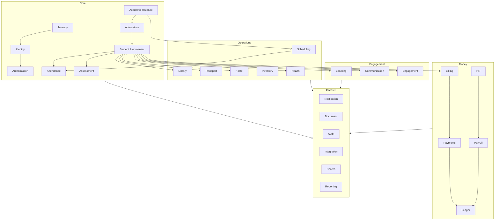

### Context relationships

| Upstream | Downstream | Relationship |
|---|---|---|
| tenant | all | Published language (tenant/institution IDs); customer-supplier |
| identity | authorization, all | Published language (principal, session); conformist |
| academic | admissions, student, scheduling, assessment | Published language (programme, term, section); customer-supplier |
| admissions | student | Event-driven handoff (`applicant.converted`) |
| student | billing, attendance, assessment, notification | Event-driven + synchronous context reads |
| billing | payments, ledger | Events + explicit allocation commands |
| payments | billing, ledger | Events (`captured`, `refunded`, `unmatched`) |
| assessment | reporting, notification | Events; immutable publication snapshots |
| hr | payroll | Synchronous input snapshot + events |
| document | all | Shared service (metadata + R2) |
| audit | all | Shared service (append-only) |

## 2. Structure: one model, every level

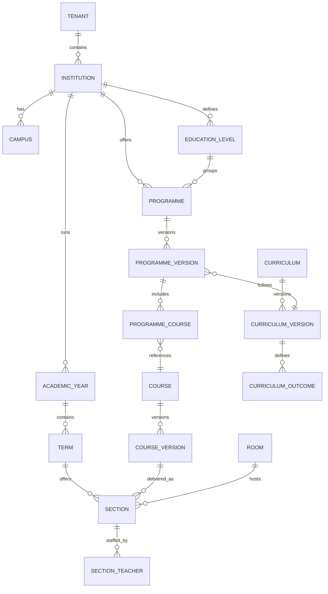

| Concept | Early years | Primary | Secondary | TVET | Tertiary |
|---|---|---|---|---|---|
| Institution type | `early_years` | `primary` | `secondary` | `tvet` | `tertiary` |
| Level | Age band / room | Grade 1–6 | Grade 7–12 | Level 1–6 / trade | Year 1–N / stage |
| Programme | Room/age group | Class/grade | Stream (Science, Arts) | Trade/qualification | Degree/diploma |
| Course | Activity area | Subject | Subject | Unit of competency | Module/course |
| Section | Group | Class | Class | Group/workshop | Course section |
| Term | Term/rolling | Term | Term | Term/block | Semester/trimester |
| Grading | Developmental | Continuous + exam | Continuous + exam | Competency | GPA/credits |
| Credit | — | — | — | Competency points | Credit hours |
| Progression | Age/readiness | Grade | Grade/exam | Competency | Credits/GPA |

**Design rules**

- `education_level` is an ordered, tenant-defined record (`sequence`, `code`, `name`, `age_min`,
  `age_max`), not an enum.
- A programme can span multiple levels (e.g. a through-school) via `programme_level`.
- A course can be delivered in multiple programmes and sections; content is versioned.
- A section is the **unit of delivery** for attendance, timetable, marks and teacher assignment.
- Curriculum is versioned and immutable once published; programme versions reference a curriculum
  version.
- Grading schemes are separate from levels and can be shared or overridden.

## 3. Identity, people and relationships

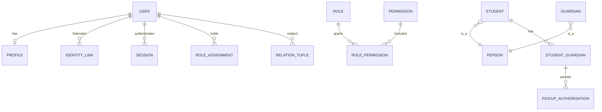

| Invariant | Rule |
|---|---|
| One identity per human per tenant | Duplicate detection on verified email/phone; merges are audited and reversible. |
| A person can hold multiple roles | Staff member and guardian in the same institution is valid. |
| Guardian link is verified | No access to a learner until the relationship is verified by the institution or an invite flow. |
| Custody/contact flags are explicit | `can_pickup`, `can_receive_communications`, `financial_responsibility`, `emergency_contact`. |
| Role assignments are scoped | `(tenant)`, `(institution)`, `(campus)`, `(section)`; never global by accident. |
| Deleting a user does not delete records | Deactivate, anonymise where lawful, retain audit. |

## 4. Admissions and enrolment

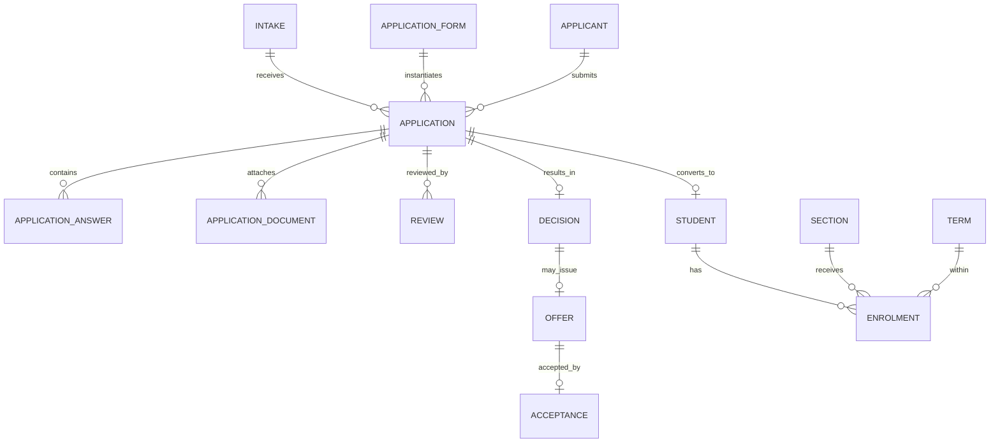

### Lifecycles

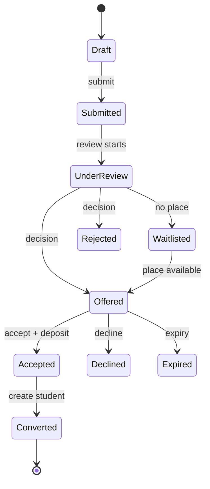

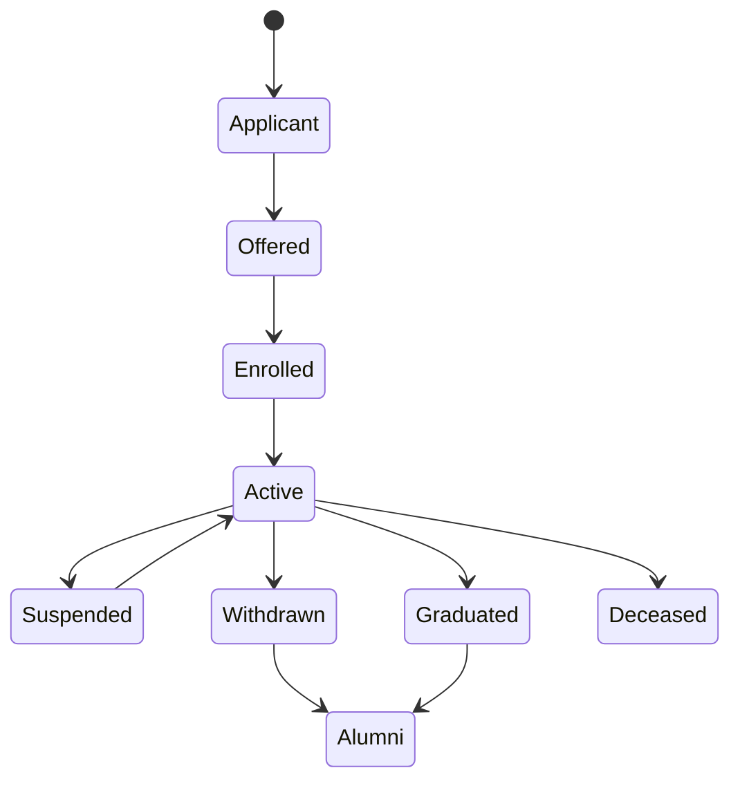

### Invariants

| Invariant | Enforcement |
|---|---|
| One conversion per accepted application | Unique `application_id` on student; idempotent conversion |
| Offer acceptance respects expiry and capacity | Transaction + seat reservation (DO/DB) |
| One active enrolment per learner per section/term | Partial unique index |
| Capacity cannot be exceeded without override | Seat reservation + override record (actor, reason) |
| Withdrawal preserves history | Status history table; no destructive update |
| Enrolment effective dates do not overlap for the same programme | Exclusion constraint / application check |
| Guardian access requires verified relationship | Authorization relationship check |

## 5. Attendance

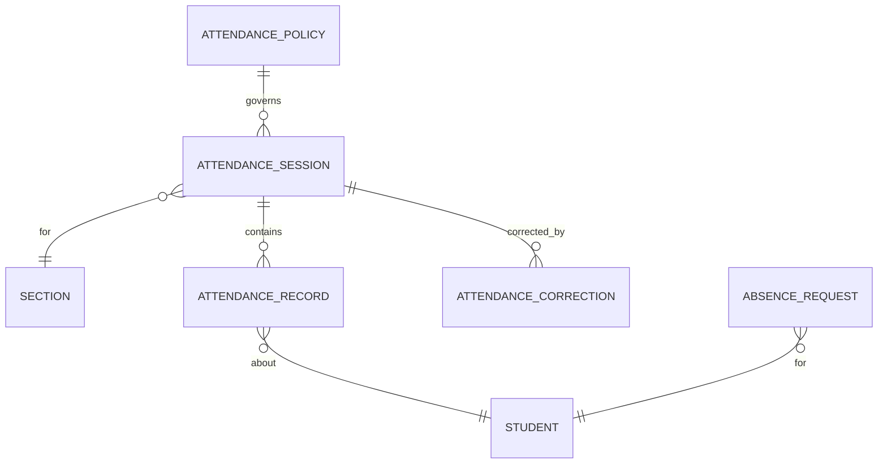

| Invariant | Rule |
|---|---|
| One record per learner per session | `unique (tenant_id, session_id, student_id)` |
| Session belongs to the tenant/institution | Composite FK / validated context |
| Corrections never overwrite history | Insert correction + new current value; audit before/after |
| Offline submissions are idempotent | Client key + server unique constraint |
| Future attendance is rejected | Date ≤ institution local today (configurable) |
| Absence threshold alerts fire once per threshold/period | Idempotent notification key |

## 6. Assessment and credentials

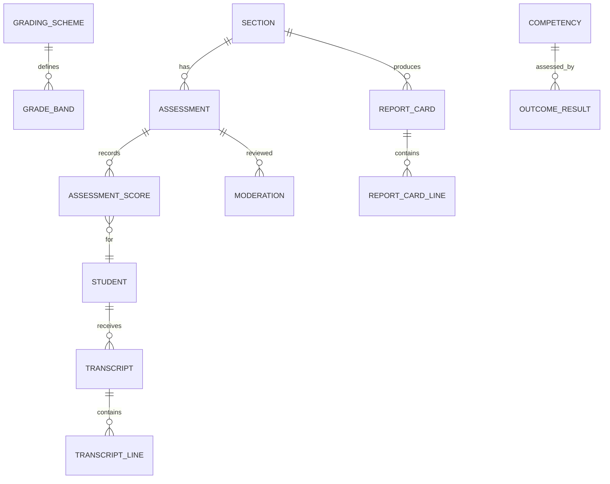

### Publication lifecycle

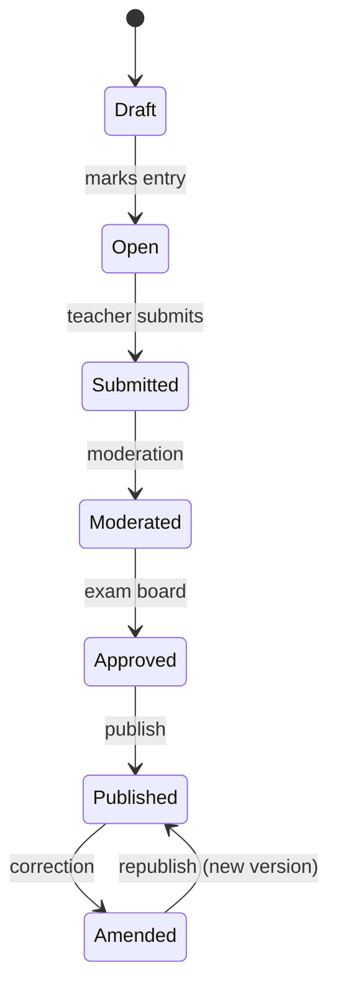

| Invariant | Rule |
|---|---|
| Score within bounds | `0 ≤ score ≤ max_score`; null means not submitted |
| Weights are valid | Sum of weights = 100% per configured grouping, or configured total |
| Publication is immutable | Snapshot stored; amendments create a new version |
| Results hidden until publication | Authorization + query filter by `published_at` |
| Transcripts only from published results | Transcript builder rejects unpublished/moderated-only data |
| GPA formula is versioned and tested | Formula reference + test vectors per scheme |
| Moderation separation of duties | Moderator ≠ sole marker where policy requires |
| Report card snapshot is reproducible | Store inputs (scheme version, scores, comments) |

### Cross-level grading

| Level | Scheme example | Computation |
|---|---|---|
| Early years | Developmental bands | Observation rubric, no GPA |
| Primary | Continuous + terminal | Weighted subjects → aggregate band |
| Secondary | Letter/percentage | Subject grade → aggregate/position (policy-controlled) |
| TVET | Competency (competent/not yet) | Outcome evidence → trade completion |
| Tertiary | GPA 4.0/5.0/7.0 | Credit-weighted grade points → GPA/CGPA |

The engine supports **points-based**, **percentage**, **letter**, **descriptive** and **competency**
modes. A scheme is data; the calculation is a versioned strategy selected by the scheme.

## 7. Money

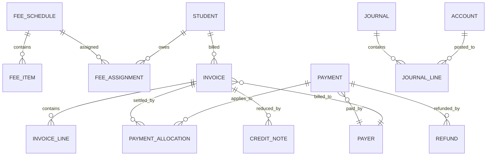

| Invariant | Rule |
|---|---|
| Invoice total = sum of lines + tax − discounts | Computed and stored; recomputed on issue |
| Issued invoice is immutable | Changes via credit note/void; original retained |
| Payment amount > 0 | Database check + validation |
| Allocation sum ≤ payment amount | Transaction + constraint |
| Refund ≤ captured − refunded | Transaction + constraint |
| One PSP reference per payment | Unique index per tenant/provider |
| Ledger is balanced | `sum(debit) = sum(credit)` per journal; enforced in code + DB check |
| Posted journal is immutable | Reversal journal only |
| Closed period rejects postings | Period status check |
| Currency never mixes in one journal | Journal currency + account currency rules |

### Invoice lifecycle

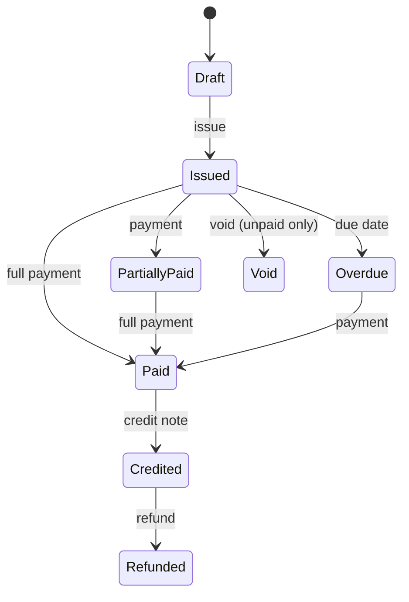

### Payment lifecycle

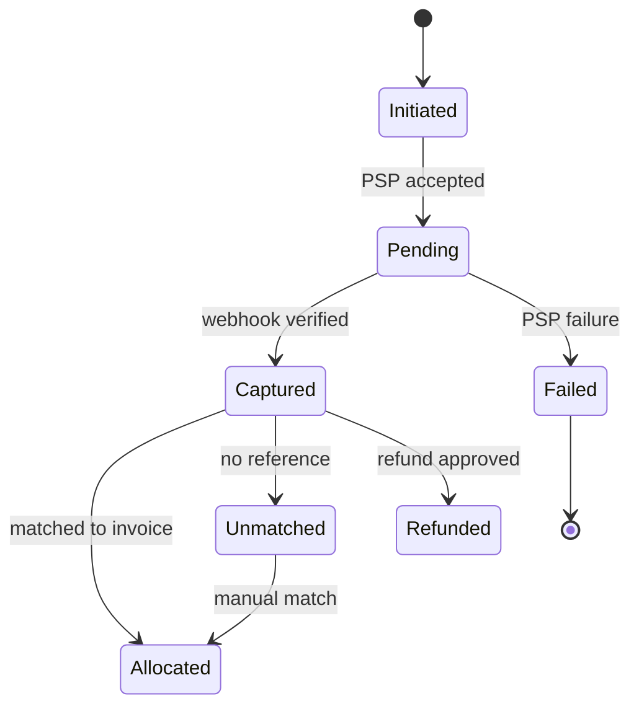

## 8. People operations (HR & payroll)

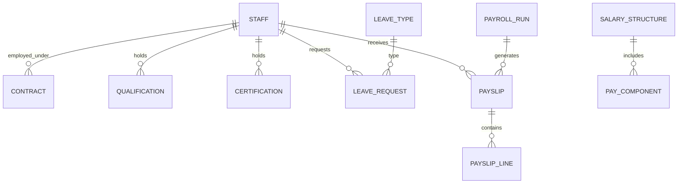

| Invariant | Rule |
|---|---|
| One active contract per staff member per institution | Effective-dated, no overlap |
| Leave balance cannot go negative unless policy allows | Transaction + policy check |
| Payroll run is unique per period/group | Unique constraint |
| Locked payroll is immutable | Corrections via new run |
| Payslip net = earnings − deductions | Recomputed and checked |
| Statutory rules are effective-dated | Rule version selected by pay date |
| Segregation of duties | Preparer ≠ approver for runs and bank files |

## 9. Operations

| Context | Aggregate roots | Key invariants |
|---|---|---|
| Scheduling | Timetable, ExamSession | No teacher/room double-booking; capacity; published version immutable |
| Library | Title, Copy, Loan | One active loan per copy; loan limit; fine policy |
| Transport | Route, Vehicle, Trip | Vehicle capacity; one active assignment per learner/route; driver licence valid |
| Hostel | Hostel, Room, Bed, Allocation | One active allocation per bed; gender/policy rules; roll-call completeness |
| Inventory | Item, StockLevel, Asset | Stock movement balanced; no negative stock; asset assigned to one holder |
| Health | Visit, MedicationAdministration | Consent; need-to-know; administration double-check; immutable record |
| LMS | CourseContent, Assignment, Submission | One submission version per attempt; deadline policy; rubric weights |
| Communication | Announcement, Conversation | Audience resolved at send; moderation; retention |
| Engagement | Incident, Club, Donation | Confidentiality; consent; financial reconciliation |

## 10. Cross-cutting domain policies

| Policy | Where enforced | Notes |
|---|---|---|
| Tenant isolation | Every service + DB RLS | See [Multi-tenancy](../01-architecture/multi-tenancy.md) |
| Authorization | `authorization-service` + service PEP | Deny by default |
| Audit | Every command + `audit-service` | Before/after for sensitive changes |
| Idempotency | Write endpoints + consumers | Client key + inbox |
| Soft delete | Learner, staff, documents | `deleted_at`; retention job hard-deletes |
| Effective dating | Contracts, fees, enrolment, rules | `valid_from`/`valid_to`, no overlap |
| Optimistic concurrency | Mutable aggregates | `version` / ETag |
| Money | Billing, payments, ledger | Integer minor units at PSP; numeric in DB |
| Time | All services | UTC storage; institution timezone for display/rules |
| Localization | Templates, labels, report comments | ICU + per-tenant default |

## 11. Event storming summary (core flow)

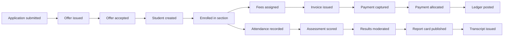

Each arrow is an event or a command; the owning service is the only writer of its state. See
[Integration & events](../01-architecture/integration-and-events.md) for contracts.

## 12. What the model deliberately does not do

- It does not encode a specific national curriculum; frameworks are data.
- It does not assume terms, grade names or credit definitions.
- It does not assume a learner has one guardian, one campus or one programme forever.
- It does not allow custom fields to participate in money/grades without promotion.
- It does not delete history to "fix" a record; corrections are additive and audited.
