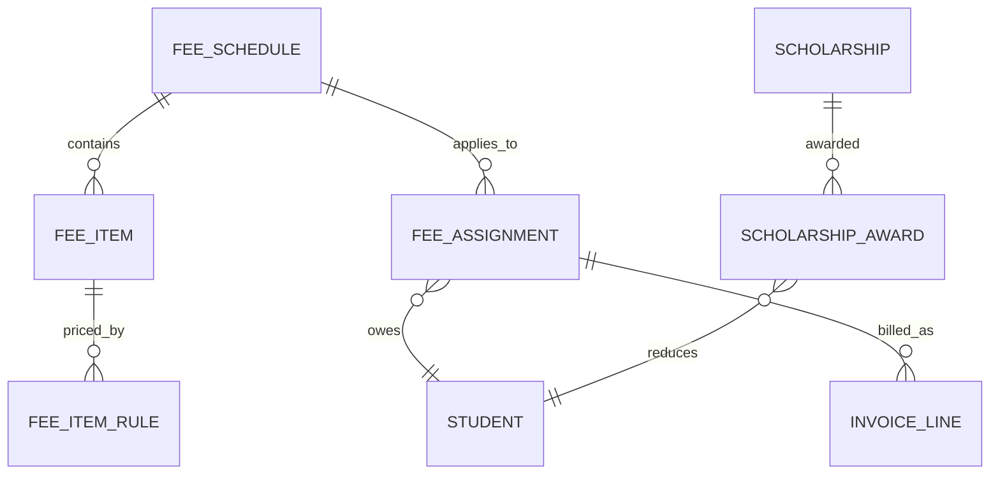
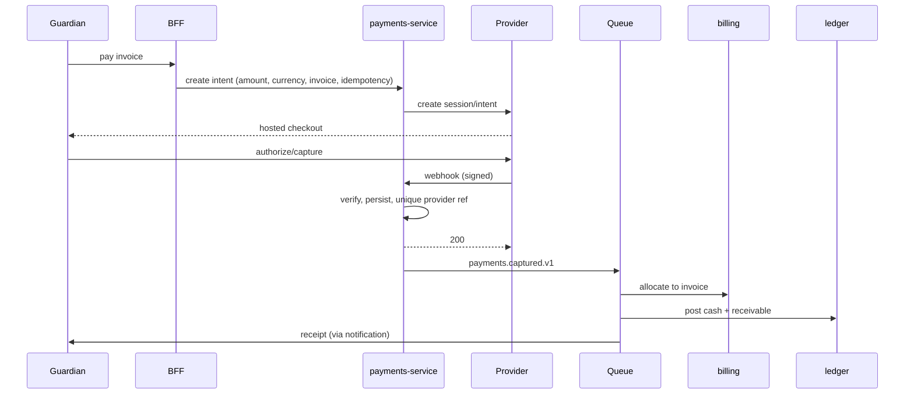
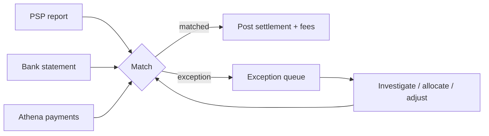
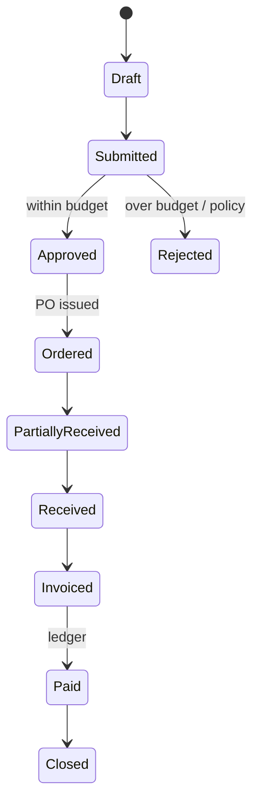
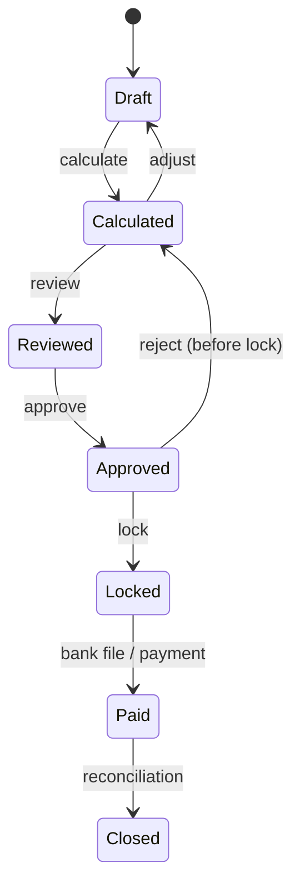

# Finance Domain

> **Status:** Accepted · **Owner:** Finance Domain · **Version:** 1.0
>
> Finance is where trust is won or lost. Every number must be explainable, every payment
> reconcilable, every adjustment approved and every journal balanced. No silent writes.

## 1. Scope

| Area | Service | In scope |
|---|---|---|
| Fee configuration | billing | Fee schedules, items, cohorts, instalments, discounts, scholarships |
| Invoicing | billing | Invoices, credit notes, statements, dunning |
| Payments | payments | PSP integration, capture, refunds, settlement, reconciliation |
| Accounting | ledger | Chart of accounts, journals, periods, budgets, statements |
| Payroll | payroll | Runs, payslips, statutory rules, bank files |
| Procurement | ledger/inventory | Requisitions, POs, receipts, vendor bills, assets |

## 2. Money rules (non-negotiable)

1. **No floating point.** Database `numeric(19,4)`; application uses decimal strings/integers; PSP
   boundaries use integer minor units with an explicit currency exponent.
2. **One currency per document.** Invoice, payment and journal each have a currency; cross-currency
   settlement uses an explicit FX rate and gain/loss account.
3. **Issued documents are immutable.** Corrections are credit notes, refunds or reversal journals.
4. **Every posting is balanced.** `sum(debits) = sum(credits)` per journal, enforced in code and by a
   deferred constraint/trigger.
5. **Every money movement has an idempotency key.** Client key, PSP reference or event ID.
6. **Every adjustment has an actor and reason.** No anonymous write-offs.
7. **Segregation of duties.** Preparer ≠ approver for refunds, credit notes above threshold, payroll
   runs and bank files.
8. **Reconciliation is daily.** Unmatched items are visible, aged and owned.
9. **No card data.** PAN/CVV never touch Athena; PSP-hosted fields or tokens only. SAQ-A scope.
10. **Audit before/after.** Amounts, dates, payer, allocations and approvals are auditable.

## 3. Billing

### 3.1 Fee schedule



A fee schedule is selected by:

`institution + academic year/term + programme/level + intake + residency + campus + custom attributes`

Fee items can be:

| Type | Example | Behaviour |
|---|---|---|
| Mandatory | Tuition | Always invoiced |
| Optional | Bus route, meals | Invoiced on selection/consent |
| Conditional | Lab fee for science | Rule-based |
| Instalment | Tuition in 3 parts | Split by due dates |
| One-off | Admission fee | Once per learner |
| Recurring | Monthly daycare | Per period |

Rules:

- Effective-dated; a change does not alter already-issued invoices.
- Proration for mid-term join/leave is a configured policy (daily/term-based/none).
- Discounts (sibling, staff, early payment) are rules with eligibility and approval.
- Scholarships/bursaries have a funding source and reduce specific items, not "the total" blindly.
- Tax is applied per item with a jurisdiction profile; tax-inclusive vs exclusive is explicit.
- Fee assignment is idempotent per learner/term/schedule; re-running does not duplicate.

### 3.2 Invoice

```text
subtotal = Σ(line.quantity × line.unit_price)
discount = Σ(line.discount) + scholarship_allocations
tax      = Σ(line.tax)
total    = subtotal − discount + tax
balance  = total − Σ(allocations) − Σ(credit_notes)
```

Status: `draft → issued → partially_paid → paid`, plus `overdue`, `void`, `credited`.

Rules:

- Invoice number is unique and gap-free per institution (DO/sequence allocator); never reused.
- Due date and instalments are explicit; dunning schedule is configured.
- Issue is atomic: lines, totals, ledger receivable and event either all commit or none.
- Void only if unpaid; otherwise credit note.
- A credit note references the invoice and reason; it does not delete lines.
- Statements aggregate invoices/credits per payer with aging buckets.

### 3.3 Payer model

A payer can be a guardian, a sponsor, an employer or the learner (adult). One invoice has one payer;
one payer can pay for multiple learners. The learner remains the service recipient. This separation
is essential for scholarships and corporate billing.

## 4. Payments

### 4.1 Providers

| Provider type | Examples | Integration |
|---|---|---|
| Cards | Stripe, Adyen | Hosted checkout / payment element; webhooks |
| Bank transfer | Local banks | Virtual account/reference; manual or file reconciliation |
| Mobile money | MTN MoMo, M-Pesa, Airtel | Provider API + webhooks; polling fallback |
| Cash/cheque | Front desk | Recorded by authorized staff with receipt |
| Sponsors | Corporate/charity | Invoice + remittance advice |

Each provider is an adapter with capabilities: currencies, methods, refunds, partial refunds,
webhooks, settlement reports, 3-D Secure.

### 4.2 Capture



Rules:

- Amount and currency are re-verified server-side; client cannot set the paid amount.
- A payment is `captured` only after a verified provider event or a server-side capture call.
- Webhook handling is idempotent by `provider_event_id`; duplicates are acknowledged, not reapplied.
- If allocation fails, the payment remains an **unallocated credit**; it is never lost or silently
  applied to another invoice.
- Partial payments are allowed; overpayment becomes credit or is refunded per policy.
- Refunds require approval, reference the original payment, and cannot exceed the refundable amount.
- Chargebacks create a reversal + dispute workflow; they do not delete the original payment.

### 4.3 Reconciliation

Daily process:

1. Fetch provider settlement/transaction report.
2. Match by provider reference/amount/date to payments.
3. Match settlement net of fees to bank deposit.
4. Post fees as expense and clear the PSP clearing account.
5. Produce exceptions: missing in Athena, missing at provider, amount mismatch, duplicate, refund
   mismatch.
6. Assign exceptions to finance; age them; escalate.



**No invoice is marked paid solely because a bank alert was seen.** Only a reconciled provider/bank
record counts.

### 4.4 Settlement accounting

```text
Dr  Bank                          net_settlement
Dr  PSP fees expense              fees
Cr  PSP clearing account          gross_captured
```

Refunds and chargebacks reverse the relevant accounts. FX differences post to an FX gain/loss account.

## 5. Ledger (double-entry)

### 5.1 Chart of accounts

| Type | Normal balance | Examples |
|---|---|---|
| Asset | Debit | Bank, cash, receivables, prepaid |
| Liability | Credit | Payables, deferred revenue, tax payable |
| Equity | Credit | Retained earnings, reserves |
| Revenue | Credit | Tuition, transport, meals, grants |
| Expense | Debit | Salaries, utilities, supplies, fees |

Accounts are tenant-defined within a standard template; codes are unique per institution/group.
Dimensions: institution, campus, programme, fund, cost centre, project.

### 5.2 Journal

```sql
-- illustrative, not final DDL
create table ledger.journals (
  id uuid primary key,
  tenant_id uuid not null,
  institution_id uuid not null,
  journal_no text not null,
  journal_date date not null,
  period_id uuid not null,
  currency char(3) not null,
  description text not null,
  source_type text not null,      -- invoice, payment, payroll, manual
  source_id uuid,
  status text not null,           -- draft, posted, reversed
  posted_at timestamptz,
  posted_by uuid,
  unique (tenant_id, institution_id, journal_no)
);
```

Rules:

- Journal lines reference accounts and carry debit/credit in the journal currency.
- Sum of debits = sum of credits; enforced before commit and by a deferred check.
- Posted journals are immutable; reversals are new journals referencing the original.
- Periods have `open`, `soft_closed`, `closed`; closed periods reject postings (except authorised
  adjustments with a reopening audit).
- Source documents are linked for drill-down; deleting a source is forbidden.
- Numbering is sequential per institution/period; gaps require an audit note.

### 5.3 Reports

- Trial balance (by period, institution, fund).
- Income & expenditure (by programme/cost centre).
- Balance sheet.
- Aged receivables (0–30/31–60/61–90/90+).
- Budget vs actual with commitments.
- Fee collection and waiver reports.
- Audit-ready journal listing.

All reports are read-only, row-level filtered, and export audited. Cached read models are rebuilt
from journals, never from invoices directly.

## 6. Budgets and procurement

### 6.1 Budget

- Budget per fiscal year, institution, account and dimension.
- Phases: draft → approved → locked.
- Commitments (PO/requisition) reduce available budget.
- Actuals come from posted journals.
- Over-budget requires approval and is audited; it is never silently allowed.

### 6.2 Procurement



- Three-way match: PO ↔ goods receipt ↔ vendor invoice.
- Vendor master is validated (tax ID, bank details, sanctions screening where required).
- Bank detail changes require dual approval and out-of-band verification.
- Assets created from received items are tagged and depreciated per policy.

## 7. Payroll

### 7.1 Run lifecycle



Rules:

- One run per institution/period/group; unique constraint.
- Inputs are snapshotted: contracts, allowances, deductions, leave, timesheets, statutory rules.
- Calculation is deterministic and reproducible from the snapshot + rule version.
- Approver ≠ preparer; bank file approver ≠ preparer.
- Locked run is immutable; corrections use an adjustment run.
- Payslips are generated once and retained; reissue is a new version.
- Net pay = gross earnings − employee deductions; employer contributions are separate expenses.
- Statutory rules are effective-dated and jurisdiction-specific; rate changes create new versions.
- Bank files use the bank's format; account numbers are encrypted and masked in UI/logs.
- Payroll journals post to the ledger in the same period.

### 7.2 Statutory compliance

- Tax bands, social insurance, pension, levies, and reporting formats are configuration per
  jurisdiction, validated against official test vectors.
- Returns/exports are generated with a checksum and retained.
- A change in law is a versioned rule + regression tests + approval, not a code patch during a run.

## 8. Roles and segregation of duties

| Action | Roles | Control |
|---|---|---|
| Configure fees | Finance admin | Approval + audit |
| Issue invoice | Billing officer | Idempotent, audited |
| Record cash | Front desk cashier | Receipt + daily cash-up |
| Refund | Finance manager | Dual approval, threshold |
| Credit note | Finance manager | Reason + approval |
| Post journal | Accountant | Balanced, period check |
| Close period | Financial controller | Checklist + dual control |
| Payroll run | Payroll officer | Reviewer + approver |
| Bank file | Payroll manager | Dual approval + out-of-band check |

Conflicts are blocked by policy, not just convention: a user cannot approve their own refund, run,
or journal above threshold.

## 9. Failure handling

| Failure | Behaviour |
|---|---|
| PSP timeout on capture | Mark `pending`; reconcile; never mark paid optimistically |
| Duplicate webhook | Deduplicate by provider event ID; acknowledge |
| Webhook arrives before intent commit | Store raw event; retry processing; idempotent |
| Allocation service down | Payment stays as unallocated credit; retry via Queue |
| Ledger posting fails | Payment/invoice remain; outbox retries; alert; no partial journal |
| Bank file generation fails | No file released; retry; alert |
| Period closed unexpectedly | Reject posting; queue for authorised adjustment |
| FX rate missing | Reject cross-currency posting; require rate |

## 10. Reporting and reconciliation SLOs

| Metric | Target |
|---|---|
| Payments auto-reconciled | ≥ 99.5% |
| Unmatched payments age | < 2 business days median |
| Invoice generation (1,000 learners) | ≤ 2 min (async) |
| Daily settlement reconciliation | Complete by 10:00 local next day |
| Ledger imbalance | 0 |
| Refund approval turnaround | ≤ 2 business days |

## 11. Data retention and audit

- Financial records: 7 years minimum (jurisdiction may require longer).
- Invoices, credit notes, payment records, journals, payroll runs and bank files are immutable and
  archived to R2 with object lock.
- Audit trail includes before/after, actor, approver, reason, IP, trace ID.
- Deletion is not permitted for financial records; anonymisation only where legally required and
  without breaking the ledger.
- Auditor access is read-only, time-bound and audited.
