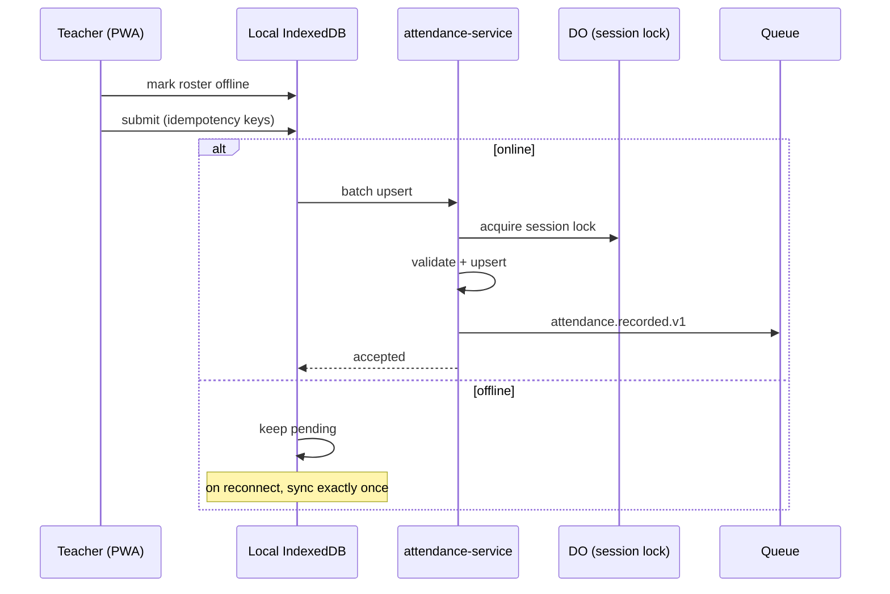

# Operations & Engagement

> **Status:** Accepted · **Owner:** Product & Domain · **Version:** 1.0
>
> Attendance, scheduling, library, transport, boarding, inventory, health, learning and
> communication share one rule: **the learner's safety and the institution's records come before
> convenience**. Each area has explicit invariants, permissions and audit.

## 1. Attendance

### 1.1 Model

| Entity | Purpose |
|---|---|
| `attendance_session` | A register for a section/period/day, with opener and deadline |
| `attendance_record` | One learner's status in one session |
| `absence_request` | Guardian/staff request with evidence and approval |
| `attendance_correction` | Additive correction with reason and actor |
| `attendance_policy` | Thresholds, escalation, authorised codes |
| `staff_clock_event` | Staff attendance from manual/kiosk/biometric |

### 1.2 Status codes

`present`, `absent`, `late`, `excused`, `sick`, `suspended`, `holiday`, `remote`, `not_expected`.

Codes are tenant-configurable in label and colour but map to a fixed semantic set for reporting.

### 1.3 Rules

| Rule | Detail |
|---|---|
| One record per learner per session | Unique constraint; batch upsert idempotent |
| Session scope | Section/period/day; no cross-institution mixing |
| Offline capture | PWA queues with client idempotency keys; sync exactly once |
| Corrections are additive | Original preserved; correction record + audit |
| Threshold alerts | Fire once per learner/threshold/term; configurable escalation |
| Late minutes | Optional; used for policy, not punishment automation |
| Biometric data | Device returns a token/match, not raw biometrics; consent + alternatives required |
| Staff attendance | Separate from learner attendance; privacy controls |
| Reporting | Daily, term, cohort, chronic absence; export audited |

## 2. Scheduling & timetabling

| Entity | Purpose |
|---|---|
| `period` | Named time slot (e.g. P1 08:00–08:45) |
| `timetable` | Versioned schedule for a term/cohort |
| `timetable_entry` | Section + period + room + teacher |
| `constraint` | Hard/soft rules (availability, room type, max load) |
| `exam_session` | Exam schedule with rooms/invigilators |

Rules:

- Hard constraints: no teacher/room/learner double-booking; room capacity; teacher availability.
- Soft constraints: preferred times, load balance, consecutive periods, travel time between campuses.
- Generation is asynchronous (Workflow); manual edits are validated immediately.
- Published timetables are versioned; changes notify affected learners/staff.
- Exams: seating capacity, access arrangements, invigilator ratios, clash detection.
- Substitutions record the absent teacher and replacement; audit and notify.

## 3. Library

| Entity | Purpose |
|---|---|
| `title` | Bibliographic record (ISBN, author, subjects) |
| `copy` | Physical copy with barcode and condition |
| `loan` | Copy ↔ borrower with due date and return |
| `reservation` | Queue for a title |
| `fine` | Overdue/lost/damage charge |

Rules:

- One active loan per copy; unique partial index.
- Borrower limits and loan periods by role/level.
- Returns are idempotent; lost items create a charge linked to billing.
- Reservations are fair (queue order) and expire.
- Catalogue search supports ISBN/title/author/subject; barcode scanning.
- Fines follow a policy; waivers require approval and are audited.
- Digital resources respect licensing (concurrent users, expiry).

## 4. Transport

| Entity | Purpose |
|---|---|
| `route` | Named route with stops and schedule |
| `stop` | Pickup/drop-off point with geo coordinates |
| `vehicle` | Bus/van with capacity, insurance, inspection |
| `driver` | Licensed driver with background checks |
| `assignment` | Learner ↔ route/stop/period |
| `trip` | Actual run with start/end, positions, boarding |
| `incident` | Delay, accident, behaviour, safeguarding |

Rules:

- Vehicle capacity is a hard limit; overloading is blocked.
- Driver licence/medical/background checks expire → assignment blocked and alerted.
- Learner assignment requires guardian consent and authorised pickup persons.
- Live trip visibility is scoped to guardians of assigned learners and authorised staff.
- Boarding/alighting can be recorded by device or attendant; corrections audited.
- GPS data retention is short (default 30 days) unless incident/legal hold.
- Incidents trigger safeguarding workflow and notifications.

## 5. Hostel / boarding

| Entity | Purpose |
|---|---|
| `hostel` | Building with warden and rules |
| `room` | Room with capacity and attributes |
| `bed` | Individual bed |
| `allocation` | Learner ↔ bed with effective dates |
| `roll_call` | Presence check at a time |
| `exeat` | Authorised leave with return time |
| `visitor` | Authorised visitor record |

Rules:

- One active allocation per bed and per learner.
- Gender/age/policy rules enforced; overrides require approval and audit.
- Roll-call completeness is tracked; missing learners escalate immediately.
- Exeat requires guardian + warden approval; overdue return alerts.
- Visitor access is logged; safeguarding checks apply.
- Medical/allergy information is available only to need-to-know staff.
- Night staff have a dedicated, offline-capable roll-call view.

## 6. Inventory & assets

| Entity | Purpose |
|---|---|
| `item` | Stock item or asset type |
| `stock_level` | Quantity by location |
| `movement` | Receipt, issue, transfer, adjustment |
| `asset` | Individually tracked asset with tag |
| `maintenance` | Schedule and history |
| `supplier` | Vendor (shared with procurement) |

Rules:

- Stock never goes negative without an explicit adjustment and approval.
- Every movement has a reason, actor and timestamp.
- Assets have custodian, location, condition and depreciation.
- Maintenance due dates generate alerts; safety-critical assets block use if overdue.
- Disposal requires approval and audit; hazardous items follow policy.
- Stock counts reconcile to movements; variances are investigated.

## 7. Health & wellbeing

| Entity | Purpose |
|---|---|
| `visit` | Clinic visit with symptoms, observation, outcome |
| `medication` | Prescribed medication and consent |
| `administration` | Dose given, time, witness |
| `immunisation` | Record and due dates |
| `allergy` | Allergy/condition alert |
| `consent` | Medical consent and emergency contacts |

Rules:

- Health data is **restricted**: school nurse, designated safeguarding lead, and emergency
  responders only. Teachers see alerts only (e.g. allergy) with consent.
- Field-level encryption at rest; access audited on every read.
- Medication administration requires prescription/consent and a second check where policy requires.
- Immunisation status is tracked; outbreaks produce anonymised aggregates.
- Emergency contacts and pickup authorisations are available offline to authorized staff.
- Retention follows health/legal policy; safeguarding records may have longer holds.
- No diagnosis is inferred or exposed to unauthorized staff; codes are used carefully.

## 8. Learning (LMS)

| Entity | Purpose |
|---|---|
| `module` | Ordered content within a course |
| `resource` | File/link/video with visibility rules |
| `assignment` | Task with rubric, deadline, submission type |
| `submission` | Learner response with timestamp and versions |
| `quiz` / `attempt` | Auto-scored assessment |
| `rubric` / `criterion` | Criteria and levels |
| `discussion` | Moderated course discussion |

Rules:

- Resources respect copyright/licensing and access scope.
- Submissions are timestamped server-side; late policy is explicit (not silently applied).
- One active submission per learner/assignment; resubmission creates a version.
- Rubric weights sum correctly; feedback is visible per policy.
- Plagiarism checks are advisory; a human makes the decision.
- Video uses Cloudflare Stream with signed playback for private content.
- Course content is versioned; learners keep access per policy after term end.
- Accessibility: captions, transcripts, keyboard navigation, alt text.

## 9. Communication

| Entity | Purpose |
|---|---|
| `announcement` | One-to-many message to a resolved audience |
| `conversation` | Threaded two-way messaging |
| `message` | Individual message with attachments |
| `template` | Versioned, localized content |
| `preference` | Channel/language/quiet hours |
| `broadcast` | Large send with progress and delivery stats |

Rules:

- Audience is resolved **at send time** and snapshotted; no accidental cross-tenant sends.
- Bulk sends require approval above a threshold; preview and test send are mandatory.
- Emergency broadcasts require an authorized role, bypass quiet hours, and are audited.
- Two-way messaging is moderated and retained per policy; safeguarding escalation is one click.
- Attachments are scanned and access-controlled.
- SMS/email bodies minimize PII; sensitive details require in-app login.
- Opt-out is honored except for statutory/emergency communications.
- Translation is per recipient locale; fallback is explicit.

## 10. Behaviour, activities, alumni

### 10.1 Behaviour & merit

- Incidents record type, severity, location, witnesses, narrative and action.
- Confidentiality: only designated staff and guardians (as policy) see details.
- Sanctions and rewards follow a workflow; appeals are recorded.
- Patterns trigger early-warning dashboards; no automatic punishment.
- Safeguarding incidents are escalated outside the normal behaviour flow with restricted access.

### 10.2 Clubs & activities

- Activities have schedule, capacity, fee (optional), consent and staff owner.
- Membership is effective-dated; waitlists are fair.
- Attendance can be taken; safeguarding ratios apply.
- Payments link to billing; refunds follow finance policy.

### 10.3 Alumni & fundraising

- Alumni profile is consent-based; contactability is explicit.
- Events, campaigns and donations are tracked; donations reconcile to the ledger.
- Donor data is restricted; anonymity preferences are honored.
- No learner data is exposed to alumni without consent.

### 10.4 Higher education: research, grants & accreditation

| Area | Capability | Controls |
|---|---|---|
| Research | Projects, investigators, ethics approvals, outputs, supervision | Ethics expiry, conflict-of-interest, restricted data |
| Grants | Funder, budget, milestones, spend, reporting, overhead | Segregation of duties, ledger link, audit |
| Publications | Authors, DOI, department, citations | Consent, embargo, repository policy |
| Accreditation | Standards, evidence, self-study, visits, actions | Versioned evidence, access for reviewers |
| Partnerships | Dual awards, articulation, placements | Agreement dates, credit mapping |

Rules:

- Grant spend reconciles to the ledger; budget overruns require approval.
- Ethics approval expiry blocks data collection and is alerted.
- Accreditation evidence is versioned and access is time-bound for reviewers.
- Research data is classified; participant data follows health/consent rules.

### 10.5 Cafeteria, uniforms and facilities

| Area | Capability | Controls |
|---|---|---|
| Cafeteria | Meal plans, dietary/allergy flags, account top-up, spend | Allergen alerts, consent, reconciliation |
| Uniform shop | Catalogue, sizes, orders, stock, payments | Inventory link, refunds via finance |
| Facilities | Buildings, rooms, maintenance, bookings, safety checks | Safety-critical maintenance blocks use |
| Visitors | Sign-in/out, safeguarding checks, badges | ID verification, audit, retention |

These use `inventory-service`, `billing-service`, `payments-service` and `document-service`; no separate
ledger. Allergy data is restricted and encrypted. Meal account balances are liabilities, not revenue,
until redeemed.

### 10.6 Post-GA domain extensions

`research-service`, `accreditation-service`, `cafeteria-service` and `facilities-service` are
deliberately deferred. They reuse existing finance, document, notification and authorization
services; they do not introduce a second ledger or identity model.

## 11. Cross-cutting rules

| Concern | Rule |
|---|---|
| Consent | Captured per purpose, versioned, withdrawable; minors require guardian where required |
| Safeguarding | Restricted access, need-to-know, escalation path, immutable records |
| Retention | Per record class; legal hold overrides deletion |
| Offline | Attendance, roll-call, pickup and emergency contacts are offline-capable |
| Accessibility | WCAG 2.2 AA for all staff/learner/guardian surfaces |
| Localization | Dates, names, addresses, templates and report comments |
| Audit | Every state change, especially health, safeguarding, finance and grades |
| Export | Authorized, row-filtered, watermarked, audited |
| Device data | Biometrics/GPS minimized, consented, retained briefly |

## 12. Events (summary)

| Event | Producer | Consumers |
|---|---|---|
| `attendance.recorded.v1` | attendance | reporting, notification |
| `attendance.absence.threshold_reached.v1` | attendance | notification, engagement |
| `scheduling.timetable.published.v1` | scheduling | notification, attendance, student |
| `library.loan.overdue.v1` | library | notification, billing |
| `transport.trip.started.v1` / `.ended.v1` | transport | notification, reporting |
| `hostel.roll_call.missing.v1` | hostel | notification, safeguarding |
| `health.medication.administered.v1` | health | audit, notification (guardian, per consent) |
| `lms.submission.received.v1` | lms | assessment, notification |
| `communication.broadcast.sent.v1` | communication | reporting, audit |
| `engagement.incident.recorded.v1` | engagement | notification, safeguarding |

All events are tenant-scoped, idempotent and minimize PII. See
[Integration & events](../01-architecture/integration-and-events.md).
