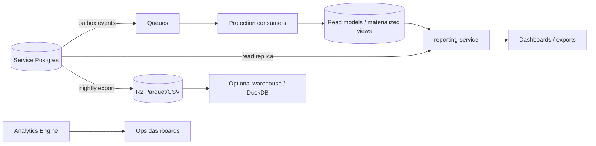
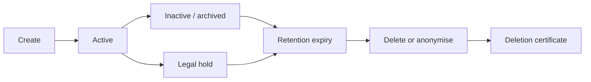

# Data Architecture

> **Status:** Accepted · **Owner:** Data & Architecture · **Version:** 2.0
>
> Athena's data is partitioned by **service ownership**, **tenant** and **region**. PostgreSQL is the
> transactional source of truth; R2 holds objects and archives; KV and Durable Objects are
> coordination/caching; Analytics Engine is for operational metrics, never for money.

## 1. Store responsibilities

| Store | Authoritative? | Use | Never use for |
|---|---|---|---|
| **PostgreSQL** (per service schema) | ✅ | Transactional records, money, grades, enrolment, audit hot data | Binary blobs, large exports |
| **R2** | ✅ for objects | Documents, media, PDFs, exports, backups, audit WORM archive | Transactional metadata, queries |
| **KV** | ❌ | Cache, public config, session snapshot, tenant map | Sessions/authorization as authority |
| **Durable Objects** | Coordination state | Rate limits, idempotency, sequences, locks, presence, chain heads | Primary business records |
| **Queues** | ❌ | Async delivery, fan-out, retries, DLQ | System of record, long-term storage |
| **Workflows** | Process state | Long-running orchestration, progress, compensation | High-frequency events, report queries |
| **Analytics Engine** | ❌ | Ops metrics, product telemetry | Billing, audit, financial reporting |
| **Vectorize** | ❌ (derived) | Semantic search embeddings | Source of truth |
| **D1** | ❌ (not used) | — | Core transactional data |
| **External warehouse** (later) | ❌ (derived) | Cross-tenant analytics, BI | Tenant-facing source of truth |

Reference DDL: [core](schema-core.md), [finance & assessment](schema-finance-assessment.md),
[operations & engagement](schema-operations.md).

## 2. Cell and service topology```mermaid
flowchart TB
  subgraph Cell["Cell (region-pinned)"]
    subgraph TierA["Tier-1 databases"]
      STU[(student)]
      BIL[(billing)]
      PAY[(payments)]
      LED[(ledger)]
      ASM[(assessment)]
    end
    subgraph TierB["Shared cluster (schemas)"]
      ACA[(academic)]
      ADM[(admissions)]
      ATT[(attendance)]
      PLT[(tenant · identity · authorization · audit)]
      SUP[(notification · document · integration · reporting)]
    end
    HD[Hyperdrive per service]
    RR[(Read replicas)]
  end
  STU & BIL & PAY & LED & ASM --> HD
  ACA & ADM & ATT & PLT & SUP --> HD
  HD --> RR
```

| Tier | Services | Physical layout |
|---|---|---|
| 1 | student, billing, payments, ledger, assessment, identity | Dedicated database (or cluster) per service; strong isolation and backup policy |
| 2 | academic, admissions, attendance, tenant, authorization, audit | Shared cluster, schema per service, separate roles |
| 3 | notification, document, integration, reporting, search | Shared cluster or service-specific store |

The physical layout can change without changing code: each service talks to a `HYPERDRIVE` binding
whose connection string is configuration. A service never assumes it shares a cluster with another.

## 3. Data classification

| Class | Examples | Controls |
|---|---|---|
| **Public** | Programme catalogue, public policies | CDN cache allowed; integrity controls |
| **Internal** | Staff directories, room lists, config | Auth required; audit for exports |
| **Confidential** | Learner records, attendance, marks, invoices | Tenant isolation, least privilege, encryption, audit |
| **Restricted** | Health, safeguarding, national IDs, bank details, SEND/IEP | Field-level encryption, need-to-know, access logging, no broad search/export |

Every column that holds personal data is tagged in the data catalog with: purpose, lawful basis,
classification, retention, and whether it is exported/indexed.

## 4. Tenant, service and region partitioning

| Dimension | Mechanism | Notes |
|---|---|---|
| Tenant | `tenant_id` + RLS + explicit predicates | Shared mode |
| Service | Schema/role ownership; no cross-schema access | Logical database per service |
| Region | Cell assignment; Postgres/R2/Queues in-region | Data residency |
| Time | Range partitioning for attendance, audit, notifications, ledger by month/term | Retention and query pruning |
| Size | Dedicated cell for large tenants | No code change |
| Hot/cold | Recent in Postgres; older in R2/archive | Query through reporting service |

### Partitioning guidance

| Table | Partition by | Retention |
|---|---|---|
| `attendance.attendance_records` | month (or term) | 7 years, then archive |
| `audit.audit_events` | month | 7 years hot + WORM archive |
| `notification.delivery_attempts` | month | 13 months |
| `ledger.journal_lines` | fiscal year | 7–10 years |
| `payments.payment_events` | month | 7 years |
| `lms.submissions` | term | policy |
| `reporting.metric_snapshots` | month | 25 months |

Partitions are created ahead by a scheduled job; a missing partition fails writes loudly (never
silently drops data).

## 5. Read models and analytics



Rules:

- Read models are **derived and rebuildable**; source of truth remains the service database.
- Projections record their checkpoint; replay from an event ID rebuilds state.
- Reporting reads replicas/materialized views, never the primary during peak.
- Cross-tenant analytics are aggregated/anonymised; tenant-facing reports are always filtered.
- Exports are generated asynchronously, stored in R2, watermarked, expiring and audited.
- There is no log-based CDC assumption: Cloudflare does not provide Debezium-style CDC here. The
  outbox is the change stream; nightly snapshots feed the lake.

## 6. Data lifecycle



| Stage | Rules |
|---|---|
| Create | Validate, classify, minimize, set retention class |
| Active | Access-controlled, audited, backed up |
| Inactive | Read-only or archived; still discoverable for legal/regulatory needs |
| Retention expiry | Workflow checks legal hold, then deletes/anonymises |
| Legal hold | Blocks deletion; visible to compliance; reviewed periodically |
| Deletion | Hard delete or irreversible anonymisation; cascades to derived stores; certificate |

### Retention matrix (defaults; tenant/jurisdiction may extend)

| Data | Retention | Notes |
|---|---|---|
| Learner core record | Lifecycle + 7 years | Transcripts may be permanent |
| Attendance | 7 years | Summaries retained longer |
| Assessment marks | Lifecycle + 7 years | Published snapshots retained with credentials |
| Transcripts/awards | Permanent | Verifiable after institution closure |
| Invoices/payments/journals | 7–10 years | Financial law |
| Payroll | 7–10 years | Statutory |
| Health records | Lifecycle + statutory (often 7–25 years) | Jurisdiction-specific |
| Safeguarding | Long/permanent | Legal hold; restricted |
| Audit | 7 years | WORM archive |
| Operational logs | 30–90 days | SIEM may retain longer |
| Sessions | 30 days after expiry | Security investigation window |
| Documents | Per classification/owner | Legal hold overrides |
| Analytics events | 25 months | Aggregated later |
| Backups | 35 days PITR; monthly 12 months | Financial archives separate |

## 7. Backup and disaster recovery

| Tier | RPO | RTO | Mechanism |
|---|---|---|---|
| Tier 1 (money, identity, grades) | ≤ 5 min | ≤ 1 h | Multi-AZ primary, PITR, cross-region replica, tested failover |
| Tier 2 | ≤ 15 min | ≤ 4 h | Multi-AZ, PITR, restore |
| Tier 3 | ≤ 1 h | ≤ 8 h | Daily snapshot, rebuild from source/events |
| R2 objects | ≈ 0 | ≤ 1 h | Versioning, cross-region replication for critical buckets |
| Audit | ≈ 0 | ≤ 4 h | WORM archive; immutable |

Rules:

- Restore is tested monthly for Tier 1 and quarterly for others; results recorded.
- Backups are encrypted; restore access is break-glass and audited.
- A restore does not silently overwrite production; it goes to an isolated environment first.
- Runbooks include data reconciliation after restore (outbox, sequences, projections).

## 8. Data quality

| Control | Detail |
|---|---|
| Constraints | NOT NULL, CHECK, UNIQUE, FK within service, exclusion for date ranges |
| Idempotency | Unique keys, inbox tables, request keys |
| Reconciliation | Nightly checks: ledger balance, invoice totals, enrolment capacity, attendance duplicates |
| Referential checks | Cross-service IDs verified asynchronously; orphans reported |
| Schema validation | Zod at write boundaries; JSONB validated by schema |
| Metrics | Null rates, orphan rates, duplicate rates, lag, reconciliation exceptions |
| Ownership | Each dataset has a steward and a quality SLO |
| Lineage | Event → projection → report documented in the data catalog |

## 9. Analytics and AI data

- Analytics uses **aggregated, de-identified** data by default.
- AI features use the minimum context; no training on tenant data without explicit contract.
- AI Gateway logs prompts/responses with PII redaction; retention short.
- Vector embeddings are tenant-scoped metadata; deletion propagates to the vector index.
- Model outputs are advisory; human approval for decisions affecting learners.
- Prompt injection defenses: treat retrieved content as untrusted, constrain tools, validate output.

## 10. Data access and export

| Actor | Access |
|---|---|
| Tenant user | Row/field-scoped by authorization; no cross-tenant |
| Tenant admin | Tenant data, except restricted health/safeguarding unless role grants |
| Support | Break-glass, time-bound, audited, read-only by default |
| Auditor | Read-only evidence, scoped, time-bound |
| Platform engineer | No production PII by default; use synthetic/aggregated data |
| Analytics | Aggregated/de-identified; no direct PII |

Exports:

- Async, R2-stored, expiring signed URL, watermark with actor/time.
- Row-level filtering applied by the query builder, not by the client.
- Export of restricted data requires a second approval and is audited.
- Bulk export limits and rate limits prevent exfiltration.

## 11. Data catalog (minimum metadata)

For each dataset: name, owner, service, classification, purpose, lawful basis, fields, retention,
residency, downstream copies, access roles, quality checks, lineage. The catalog is code-reviewed and
updated in the same PR as schema changes.

## 12. Anti-patterns

| Anti-pattern | Why |
|---|---|
| Cross-service SQL joins | Couples deployments; breaks ownership |
| Shared mutable tables | Hidden coupling; impossible to evolve |
| Storing money as float | Rounding errors |
| Using KV for permissions/sessions | Eventual consistency = security holes |
| Using DO as the primary database | Limited storage/throughput; no reporting |
| Unbounded JSONB as a schema substitute | No constraints, poor queries, hidden PII |
| Soft-deleting everything forever | Storage, privacy, query complexity |
| Analytics on the primary | Contention during peak |
| Backups never restored | False confidence |
