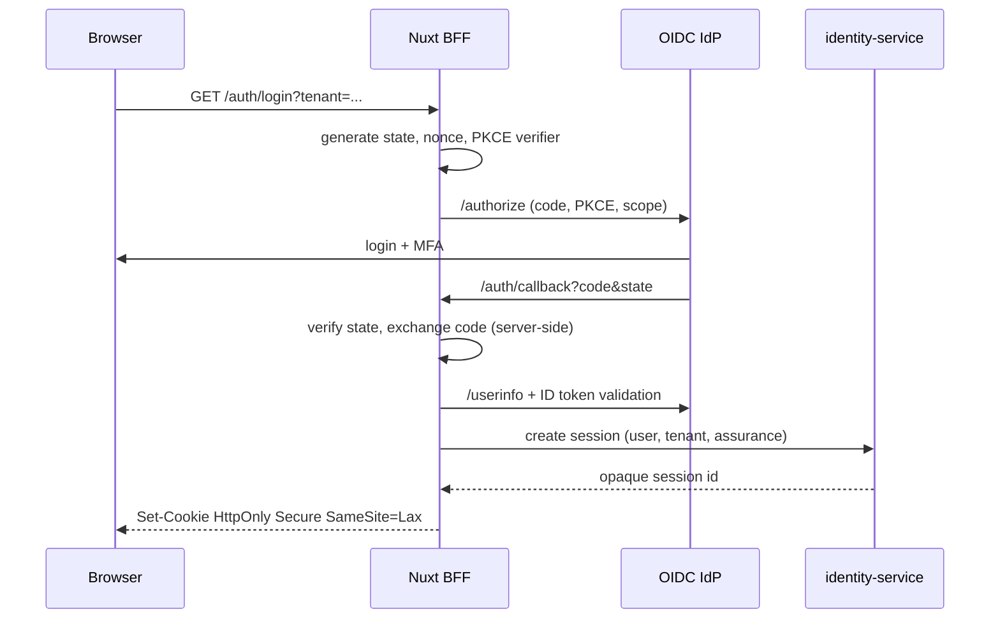
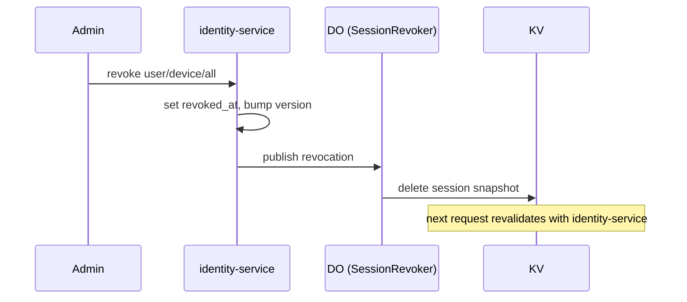
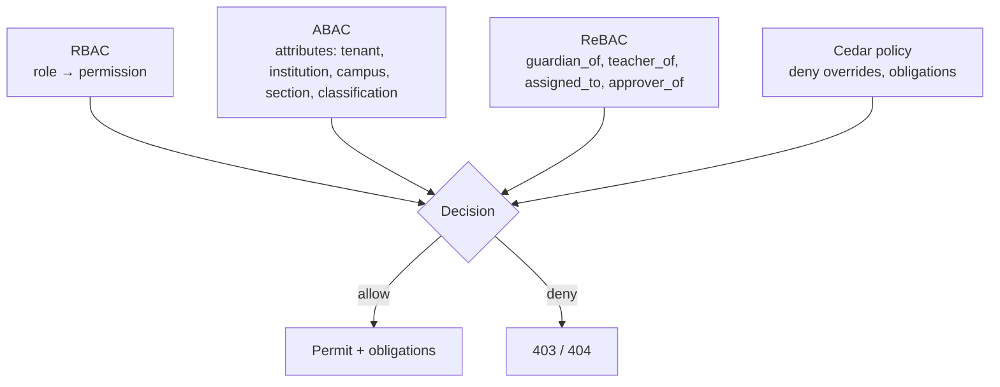
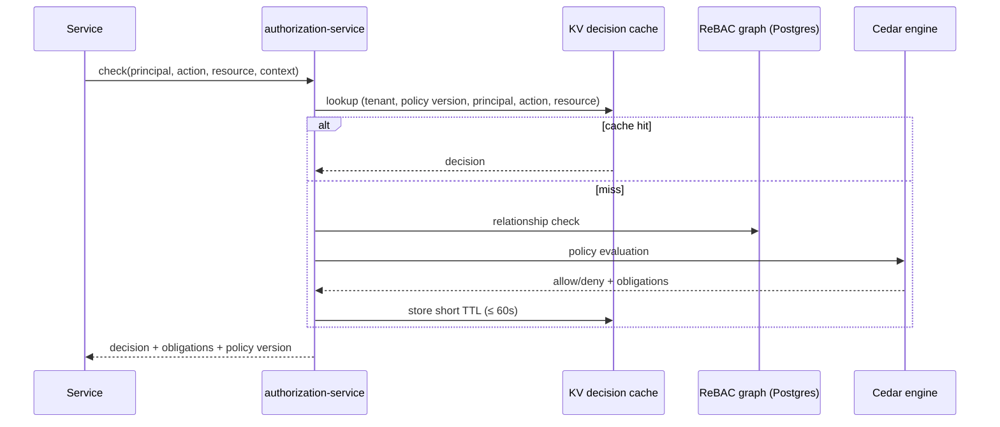

# Identity & Access

> **Status:** Accepted · **Owner:** Security & Identity · **Version:** 2.0
>
> Authentication answers *who*. Authorization answers *what, where and on whose behalf*. Athena keeps
> them separate: a managed OIDC provider authenticates, `identity-service` owns sessions and
> profiles, and `authorization-service` makes every access decision.

## 1. Identity provider

| Actor | Provider | Notes |
|---|---|---|
| Parents, learners, staff | Managed OIDC IdP (Clerk/Auth0/Entra External ID) | OIDC + SAML federation, MFA, SCIM; abstracted behind `identity-service` |
| Enterprise schools | Tenant SAML/OIDC federation | Just-in-time provisioning or SCIM; domain verification required |
| Platform operators | Cloudflare Access + MFA | Separate from customer identity; break-glass audited |
| Services | Platform-issued service JWT | Short-lived, audience-scoped |
| Partners | OAuth2 client credentials / mTLS | Scoped API access |

**Why buy identity:** credential storage, MFA, federation, breach response and compliance are
security-critical commodities. Building them is a deliberate exception requiring a threat model and
pen test.

## 2. Authentication flows

### 2.1 Browser (BFF)



Rules:

- Authorization Code + PKCE; no implicit flow.
- State + nonce verified; redirect URI exact match.
- ID token signature, issuer, audience, expiry and nonce verified.
- Tokens stay server-side; the browser gets only an opaque session cookie.
- Session fixation prevented: new session ID after login and privilege change.
- Login errors are uniform (no account enumeration).

### 2.2 API clients

- OAuth2 client credentials for server-to-server; scoped access tokens (≤ 15 min).
- API keys for simple integrations: hashed at rest, prefix shown once, scopes, expiry, last-used,
  rotation and revocation.
- No API key in URLs or logs.
- Rate limits per client and tenant.

### 2.3 Service-to-service

```text
Authorization: Bearer <service-jwt>
{
  "iss": "https://auth.athena.internal",
  "aud": "student-service",
  "sub": "billing-service",
  "tenant_id": "...",
  "scope": "student:read enrolment:read",
  "trace_id": "...",
  "iat": ...,
  "exp": ...   // ≤ 60 seconds
}
```

- Signed with a platform key; public keys in JWKS (Secrets Store/KV).
- Verified by every service: signature, audience, expiry, tenant, scope.
- A service JWT is **identity, not permission**; the callee still authorizes.
- Gateway strips inbound internal headers; only the gateway/BFF can mint user context.

## 3. Sessions

| Property | Value |
|---|---|
| Cookie | `__Host-athena_session`, `HttpOnly`, `Secure`, `SameSite=Lax`, `Path=/` |
| Session ID | 256-bit random, opaque; never a JWT |
| Authority | `identity-service` Postgres |
| Cache | KV snapshot, TTL ≤ 60 s |
| Revocation | DO per user/tenant; version bump; immediate cutoff |
| Idle timeout | 30 min (admin 15 min) |
| Absolute lifetime | 12 h (admin 8 h) |
| Rotation | On login, privilege change, step-up, tenant switch |
| Concurrent sessions | Configurable per tenant; list/revoke devices |
| CSRF | Double-submit token + origin check for state-changing requests |

Revocation flow:



- A revoked session is rejected within 60 s even if KV is stale.
- Password/MFA change, role escalation and suspected compromise revoke all sessions.
- "Remember me" is not offered for admin; parent/learner may opt into a longer refresh window with
  re-authentication for sensitive actions.

## 4. MFA and assurance

| Level | Meaning | Required for |
|---|---|---|
| **AAL1** | Single factor (password/passkey without UV) | Low-risk read-only |
| **AAL2** | Two factors (password + TOTP/passkey) | All staff, finance, admin |
| **AAL3** | Phishing-resistant (passkey/security key) | Privileged admin, break-glass, high-value approvals |

- Passkeys/WebAuthn preferred; TOTP fallback; recovery codes single-use.
- SMS OTP is discouraged and disabled by default; allowed only with risk acceptance.
- Step-up authentication for: refunds, credit notes, role changes, transcript issuance, bulk export,
  bank detail changes, tenant deletion.
- Step-up freshness ≤ 5 min for the action; re-prompt after.
- MFA reset requires identity verification and is audited; helpdesk cannot bypass silently.

## 5. Authorization model

### 5.1 Three lenses



| Lens | Answers | Example |
|---|---|---|
| RBAC | What can this role generally do? | `teacher` has `assessment:mark` |
| ABAC | Which records? | Only sections in the teacher's institution and assigned sections |
| ReBAC | On whose behalf / relationship? | `guardian_of` the learner; `teacher_of` the section |
| Policy | Are there explicit denies/conditions? | Cannot approve own refund; cannot export restricted data |

### 5.2 Permission catalog (excerpt)

| Resource:action | Sensitive | Typical roles |
|---|---|---|
| `student:read` | — | teacher, registrar, admin, guardian (own), learner (own) |
| `student:write` | ✅ | registrar, admin |
| `student:export` | ✅ | registrar, admin (step-up) |
| `enrolment:create` | ✅ | registrar, admin |
| `attendance:record` | — | teacher, assistant |
| `assessment:mark` | ✅ | teacher (assigned) |
| `assessment:publish` | ✅ | head of department, exam officer |
| `transcript:issue` | ✅ | registrar (step-up) |
| `invoice:read` | — | finance, guardian (own) |
| `invoice:issue` | ✅ | billing officer |
| `invoice:void` | ✅ | finance manager |
| `payment:refund` | ✅ | finance manager (dual approval) |
| `role:assign` | ✅ | tenant admin, institution admin (scoped) |
| `report:export` | ✅ | admin, auditor (scoped) |
| `health:read` | ✅ | nurse, safeguarding lead |
| `safeguarding:read` | ✅ | designated safeguarding lead |
| `audit:read` | ✅ | auditor, tenant admin |
| `tenant:admin` | ✅ | tenant admin |

The catalog is code (reviewed); roles are data (tenant-configurable within allowed bundles).

### 5.3 Role examples

| Role | Scope | Notes |
|---|---|---|
| `platform_admin` | platform | Not a tenant role; break-glass only |
| `tenant_admin` | tenant | Manages tenant settings, roles, billing; no health/safeguarding by default |
| `institution_admin` | institution | Manages one school/campus |
| `principal` | institution | Academic oversight, approvals |
| `registrar` | institution | Admissions, records, transcripts |
| `admissions_officer` | institution | Applications, offers |
| `teacher` | section | Attendance, marks, resources for assigned sections |
| `teaching_assistant` | section | Limited marks/attendance |
| `finance_officer` | institution | Invoices, payments, reports |
| `bursar` | institution | Finance manager approvals |
| `hr_officer` | institution | Staff records, leave |
| `payroll_officer` | institution | Payroll preparation (not approval) |
| `librarian` | campus | Library operations |
| `transport_manager` | institution | Routes, vehicles, drivers |
| `hostel_warden` | hostel | Allocations, roll-call |
| `nurse` | institution | Health records |
| `counselor` | institution | Support plans (restricted) |
| `guardian` | student | Own children only, verified |
| `learner` | self | Own record, age-appropriate |
| `auditor` | tenant | Read-only evidence, time-bound |
| `integration` | tenant | Scoped API/service account |

### 5.4 Cedar policy example

```cedar
// Only assigned teachers may read a student's assessment record,
// and only within the same tenant and institution.
permit (
  principal,
  action == Action::"assessment:read",
  resource is Assessment
) when {
  principal.tenant_id == resource.tenant_id &&
  principal.institution_id == resource.institution_id &&
  (principal.role == "teacher" || principal.role == "head_of_department") &&
  context.relationship == "teacher_of" &&
  context.section_id == resource.section_id
};

// Explicit deny: no one approves their own refund.
forbid (
  principal,
  action == Action::"payment:refund",
  resource is Refund
) when {
  principal.user_id == resource.requested_by
};
```

Cedar forbids override permits. Policies are versioned, tested with allow/deny vectors, and
published atomically.

### 5.5 Decision flow



- Deny by default if the PDP is unavailable for sensitive actions.
- Cache keys include tenant, principal, permission, resource type/ID and policy version.
- Role/relationship changes bump the policy/user version; cache entries become unreachable.
- Batch checks are supported for list pages; results are filtered server-side.
- Services must not implement ad-hoc authorization logic; they call the PDP or use generated
  predicates.

## 6. Row and field-level access

- **Rows:** SQL predicates derived from scope + relationship, plus RLS.
- **Fields:** restricted fields (health, safeguarding, national ID, bank details) are omitted unless
  the principal has `field:read:<classification>`; the API returns a redacted DTO.
- **Lists:** filter by authorized IDs or a SQL `EXISTS` on relationship tuples; never fetch all then
  filter in memory.
- **Exports:** re-check authorization at export time; watermark; audit; restrict volume.
- **Search:** index only fields the principal may see; tenant + scope filters applied in the query.

## 7. Tenant switching and delegated administration

- A user with memberships in multiple tenants selects one at login or via a switcher.
- Switching issues a new session context (new session ID), re-checks MFA assurance and audits.
- Roles are per tenant/institution; a tenant admin cannot grant platform roles.
- Delegated admin: a head teacher can manage staff roles within their institution only.
- A guardian linked to children in two tenants sees only the active tenant's children.
- Cross-tenant IDs return 404; attempts are logged as security events.

## 8. Guardian and learner onboarding

### 8.1 Guardian

1. Institution creates/invites guardian by email/phone.
2. Invite is single-use, expiring, bound to the tenant and learner.
3. Guardian authenticates (or creates an account) and verifies identity.
4. Relationship is `pending` until institution approval or a verified invite code.
5. Only then does `guardian_of` grant access to the learner.
6. Multiple guardians per learner are allowed; permissions differ (pickup, billing, communications).

No self-claim by guessing a student number. No directory search that reveals learners.

### 8.2 Learner

- Age-appropriate accounts; under-13 accounts may be managed by the institution/guardian.
- Minimal PII; no public profile; messaging moderated.
- Learner cannot change legal name/DOB; requests go through the registrar.
- Access to results only after publication.
- Alumni access is read-only and consent-based.

## 9. SCIM and enterprise federation

| Feature | Behaviour |
|---|---|
| SCIM 2.0 Users | Create/update/deactivate; idempotent; mapped to tenant |
| SCIM Groups | Map to roles/teams; least privilege |
| SAML/OIDC | Domain verification; signed assertions; JIT provisioning optional |
| Deprovisioning | Immediate session revocation + role removal; audit |
| Attribute mapping | Explicit, validated; no silent overwrite of authoritative fields |
| Break-glass | Local tenant admin account retained for IdP outage, MFA-protected |

## 10. Break-glass and support access

- Requires ticket ID, tenant approval (or emergency approval), MFA/AAL3, time-bound role.
- Read-only by default; writes need a second approver.
- Persistent banner; tenant admin can revoke.
- All actions audited with operator, tenant, reason, ticket, trace.
- Sessions expire automatically (≤ 4 h); no standing access.
- Break-glass use triggers a security alert.

## 11. Testing matrix

| Test | Expected |
|---|---|
| No token | 401 |
| Expired token | 401 |
| Wrong audience/service | 401 |
| Valid token, missing permission | 403 |
| Valid permission, wrong tenant | 404 |
| Valid permission, wrong section (teacher) | 403 |
| Guardian accesses non-linked child | 404 |
| Learner accesses another learner | 404 |
| Revoked session | 401 within 60 s |
| Step-up required, AAL1 | 403 with `step_up_required` |
| Role change | Cache invalidated; new decision |
| Cross-tenant ID in body | Ignored/rejected |
| Export without scope | 403 + audit |
| Break-glass expired | 401 |

Every service runs these for its routes; the security team samples quarterly.

## 12. Anti-patterns

| Anti-pattern | Why |
|---|---|
| JWT in `localStorage` | XSS steals long-lived credentials |
| Authorization in the UI only | Trivially bypassed |
| `tenant_id` from request body | Cross-tenant access |
| Role checks scattered in code | Inconsistent, unauditable |
| Shared service secret | No attribution, blast radius |
| Permanent support access | Insider risk |
| Trusting internal network | Zero trust; a compromised Worker is inside |
| SMS-only MFA for admins | SIM swap |
| Password reset that reveals accounts | Enumeration |
| Caching authorization decisions without invalidation | Stale access after revocation |
