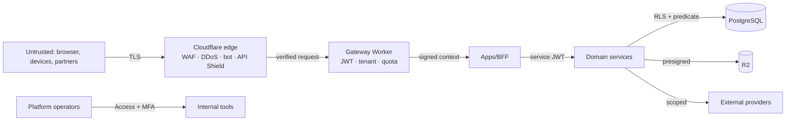
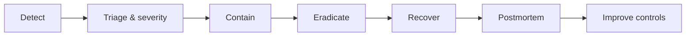

# Security Architecture

> **Status:** Accepted · **Owner:** Security · **Version:** 2.0
> **Baseline:** OWASP ASVS Level 3 for identity, payments, learner data and administration;
> Level 2 minimum everywhere. Zero trust between services. Cloudflare is the edge control plane,
> not a substitute for application security.

## 1. Security principles

1. **Assume breach.** Every request is authenticated, authorized and validated — including internal
   calls.
2. **Least privilege.** Users, services, tokens, database roles and network paths get the minimum.
3. **Defence in depth.** Edge → gateway → service → SQL predicate → RLS → storage policy. No single
   control is trusted alone.
4. **Secure by default.** Deny by default; private by default; encryption by default; no debug
   endpoints in production.
5. **Fail closed for security decisions.** If authorization or session validation is unavailable,
   deny. Fail open only for non-security availability features (e.g. recommendations).
6. **Minimize data.** Collect only what is needed; retain only as long as required; never log secrets
   or restricted PII.
7. **Verify, don't trust.** Validate all input; re-fetch critical state (payments, grades) from the
   authoritative source.
8. **Everything is auditable.** Privileged, financial, grading and health actions produce immutable
   evidence.
9. **Security is a release gate.** No feature ships with an open critical/high finding.
10. **Human control over consequential automation.** AI may recommend; humans approve decisions that
    affect learners, money or access.

## 2. Trust boundaries

| Boundary | Control |
|---|---|
| Internet → edge | TLS 1.3, WAF, DDoS, bot management, rate limits, API schema validation |
| Edge → gateway | Verified JWT/API key, tenant resolution, request size/time limits |
| Gateway → app | Signed context headers stripped/re-injected; session cookie |
| App → service | Service JWT (aud, tenant, scope, short TTL), service binding |
| Service → database | Per-service role, no `BYPASSRLS`, tenant context per transaction |
| Service → external | Egress allowlist, secrets from Secrets Store, timeouts, no PII over-sharing |
| Operator → platform | Cloudflare Access, MFA, break-glass, audit |

## 3. Edge protection (Cloudflare)

| Control | Configuration |
|---|---|
| **TLS** | 1.3 preferred, 1.2 minimum; HSTS preload; modern ciphers; automatic cert renewal |
| **WAF** | Cloudflare managed rules + custom rules for Athena paths; OWASP Top 10; block known bad user agents |
| **DDoS** | Always-on L3/4 and L7 protection; adaptive rules for attack signatures |
| **Bot Management** | Score-based challenges on login, application, payment and password reset |
| **Turnstile** | Public forms, admissions, login, password reset; invisible/managed mode |
| **API Shield** | OpenAPI schema validation, JWT validation, mTLS for partner APIs, sequence mitigation |
| **Rate limiting** | Per IP, per session, per tenant, per route; stricter for auth/payment/export |
| **Waiting Room** | Registration/results-day spikes; fair queue; bypass for staff/emergency |
| **Page Shield** | CSP monitoring, third-party script inventory, supply-chain alerts |
| **Request limits** | Body size, header size, timeout, upload size; reject early |
| **Geo/ASN rules** | Optional per tenant; never a sole security control |
| **Access** | Zero Trust for internal admin/support tooling, not customer portals |
| **Tunnel** | On-prem devices (biometrics, cameras) without exposing inbound ports |
| **Regional Services** | Data localization for regulated tenants where required |

Rules:

- WAF/API Shield rules are **versioned in Terraform**, reviewed, tested in staging, and rolled out
  gradually.
- A WAF bypass is never a fix for an application vulnerability.
- Rate limits are enforced at both edge and service; edge alone can be bypassed by direct Worker
  access if routes are misconfigured.
- Custom domains are verified before routing; unknown hosts fail closed.
- Error pages never reveal stack traces, SQL, tenant names or internal IDs.

## 4. Application security

| Risk | Control |
|---|---|
| Injection | Parameterized queries/Drizzle; no string SQL; input validation |
| XSS | Output encoding, CSP, no `v-html` with user content, sanitize rich text |
| CSRF | SameSite cookies + double-submit token + origin check |
| SSRF | Allowlisted egress; block private/link-local ranges; no user-supplied URLs fetched server-side |
| File upload | Type/size/magic-byte validation, virus scan, quarantine, no execution, random keys |
| IDOR | Authorization on every object; tenant + relationship checks; 404 for foreign IDs |
| Mass assignment | Explicit DTO schemas; never bind raw body to entities |
| Business logic abuse | Server-side invariants; idempotency; approval workflows; rate limits |
| Race conditions | Transactions, unique constraints, optimistic locking, DO locks |
| Replay | Nonce/timestamp for webhooks; idempotency keys; short token TTL |
| Enumeration | Uniform errors/timing for auth and lookup; rate limits |
| Open redirect | Allowlist redirect targets; no user-controlled `return_to` |
| Deserialization | JSON only; schema validation; no eval/unsafe YAML |
| Log injection | Structured logs; encode user data; never log raw headers |
| Prompt injection (AI) | Treat retrieved content as untrusted; constrain tools; validate output; human approval |

### Request size and complexity

- JSON body ≤ 1 MB (except document upload, which goes direct to R2).
- Array/batch size caps (e.g. 500 rows).
- Query depth/complexity limits; no unbounded GraphQL (none initially).
- Pagination required; exports asynchronous.
- Regex/input length caps to prevent ReDoS.

## 5. Identity and session security

See [Identity & access](identity-and-access.md) for the full model. Summary:

- OIDC Authorization Code + PKCE; SAML federation for enterprise.
- MFA: passkeys/WebAuthn preferred, TOTP fallback; mandatory for privileged roles.
- Browser session: opaque `HttpOnly` cookie; no tokens in JS.
- Short-lived access tokens for services; refresh rotation; revocation within 60 s.
- Step-up authentication for money, roles, transcripts, bulk export.
- SCIM provisioning/deprovisioning.
- Break-glass with ticket, MFA, time bound, audit.

## 6. Service-to-service security

- **Service bindings** are account-internal, but still authenticated: signed service JWT with
  `aud`, `tenant_id`, `scope`, `trace_id`, `exp ≤ 60 s`.
- Each service verifies signature (JWKS in Secrets Store/KV), audience, expiry and tenant.
- Gateway strips all inbound `x-athena-*`/`x-tenant-*` headers.
- No shared static secrets between services.
- External partners use mTLS (API Shield) or OAuth2 client credentials with scoped tokens.
- Egress from Workers is allowlisted through `integration-service`; no arbitrary outbound calls from
  domain services.
- A compromised service cannot read another tenant's data: tokens are tenant-scoped and RLS applies.
- Service identity is least privilege: each service has its own credentials and bindings.

## 7. Data protection

### 7.1 Encryption

| Layer | Mechanism |
|---|---|
| In transit | TLS 1.3; mTLS for partners; service bindings inside Cloudflare |
| At rest — database | Provider encryption (AES-256) |
| At rest — R2 | Server-side encryption; optional per-tenant keys |
| Field-level | AES-256-GCM for restricted fields, with key version |
| Backups | Encrypted; restore access restricted |
| Secrets | Cloudflare Secrets Store; never in code/images/logs |

### 7.2 Key management

- Per-tenant data encryption keys (DEKs), wrapped by a master key in Secrets Store.
- Key rotation yearly or on compromise; old versions retained for decryption, then retired.
- Keys are never logged or exported; access is limited to the service and audited.
- Regulated tenants may require external KMS/HSM; documented exception.
- Cryptographic primitives come from WebCrypto/audited libraries; no custom crypto.

### 7.3 Secrets

- Store in Cloudflare Secrets Store (or `wrangler secret` for service-local secrets).
- Separate secrets per environment; no production secrets in dev/staging.
- Rotation ≤ 90 days for high-risk (PSP, email, IdP); automated where supported.
- Least privilege: one secret per provider/service; no shared "master" tokens.
- Secret scanning in CI and pre-commit; immediate revocation on leak.

### 7.4 PII and logging

- Logs are structured JSON; PII fields are redacted or hashed.
- Never log: passwords, tokens, card data, full national IDs, bank accounts, health notes, message
  bodies.
- Trace IDs correlate without exposing payloads.
- Log retention 30–90 days; audit retention 7 years.
- Support tools show masked data by default; unmask requires permission and is audited.

## 8. Supply chain security

| Control | Implementation |
|---|---|
| Dependency pinning | Lockfile committed; exact versions; Renovate PRs |
| Vulnerability scanning | `pnpm audit`, OSV/Dependabot, Snyk/Grype; SLA by severity |
| SAST | CodeQL + Semgrep on every PR |
| Secret scanning | Gitleaks/TruffleHog pre-commit + CI |
| License compliance | Allowlist; review copyleft |
| SBOM | CycloneDX per deployable, stored with release |
| Build provenance | GitHub Actions OIDC, SLSA level 3 target; signed artifacts |
| Container/base images | Minimal, pinned digests (for tooling/containers) |
| IaC scanning | Checkov/tfsec/Conftest on Terraform and Wrangler config |
| Dependency confusion | Scoped registry, `@athena` namespace, lockfile |
| Compromised package response | Pin, revert, rotate secrets, incident process |

Workers have no container image, but the bundle is an artifact: hash it, sign/attest the build, and
deploy only from CI with a scoped Cloudflare API token.

## 9. Audit and monitoring

- `audit-service` records security, admin, financial, grading and health events.
- Events include actor, tenant, IP, user agent, target, before/after (redacted), trace ID.
- Append-only, hash-chained; hot 90 days in Postgres; WORM archive in R2 (object lock).
- SIEM export via Logpush (R2/HTTP endpoint); detections for:
  - repeated auth failures, MFA bypass attempts, impossible travel;
  - privilege changes, break-glass use, role escalation;
  - mass exports, unusual download volume;
  - payment/refund anomalies, duplicate webhooks;
  - WAF/API Shield blocks, bot spikes;
  - cross-tenant access attempts (must alert immediately).
- Alerts route to on-call security; P1 pages within 5 minutes.

## 10. Vulnerability management

| Severity | Remediation SLA |
|---|---|
| Critical | 7 days (or immediate mitigation) |
| High | 30 days |
| Medium | 90 days |
| Low | Next planned release |

- Penetration test before GA, annually, and after major auth/payment changes.
- Bug bounty program post-GA (scoped, safe harbour).
- DAST (ZAP) against staging on every release; API fuzz for auth/payment.
- Dependency and IaC scans on every PR; container scans for tooling.
- A finding is not "accepted" without a risk record, owner and expiry.

## 11. Incident response

| Severity | Examples | Response |
|---|---|---|
| **SEV-1** | Cross-tenant data exposure, payment compromise, full outage, ransomware | Page immediately; incident commander; exec/legal notified; regulator assessment |
| **SEV-2** | Auth outage, single-tenant breach, data loss | Page; mitigate within 1 h |
| **SEV-3** | Degraded feature, elevated errors | Ticket; fix within 1 business day |
| **SEV-4** | Minor bug, no security impact | Normal backlog |

- Runbooks for: credential leak, PSP compromise, WAF bypass, DDoS, ransomware, lost device,
  insider access, vendor breach.
- Breach notification: detect ≤ 24 h, assess ≤ 72 h, notify per GDPR/local law and contracts.
- Postmortems are blameless, published internally within 5 business days; action items tracked.
- Tabletop exercises twice a year; one involves a tenant and one a payment provider.

## 12. Cloudflare shared responsibility

Cloudflare secures the edge network, physical infrastructure and managed services (certifications
include SOC 2, ISO 27001, PCI DSS; verify current scope). Athena remains responsible for:

- Worker code, configuration, bindings, routes and secrets;
- WAF/API Shield rule correctness and coverage;
- tenant isolation, authorization and data handling;
- R2 bucket policies, presigned URL scope and lifecycle;
- Hyperdrive/Postgres security, backups and patching (provider-dependent);
- identity configuration (IdP, MFA, SCIM);
- logging, detection and incident response.

## 13. Security release gates

- [ ] Threat model updated for new data flows/assets.
- [ ] ASVS checklist completed for the feature.
- [ ] AuthN/AuthZ tests incl. negative and cross-tenant.
- [ ] Input validation and output encoding verified.
- [ ] No secrets/PII in logs, errors or analytics.
- [ ] SAST/DAST/dependency/IaC scans clean or risk-accepted.
- [ ] Rate limits and abuse cases covered.
- [ ] Audit events defined and emitted.
- [ ] Encryption classification applied to new fields.
- [ ] Runbook and rollback documented.
- [ ] Pen test / security review for high-risk changes (auth, payments, file upload, exports).
