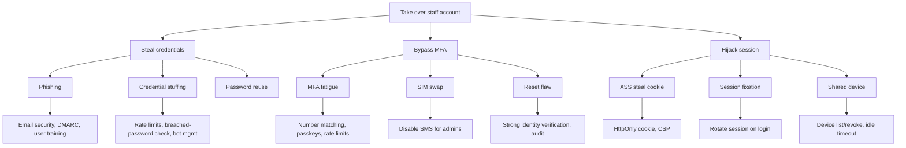
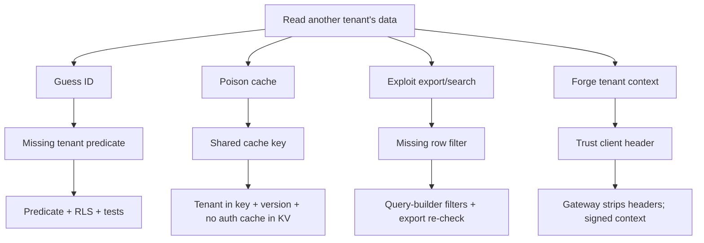
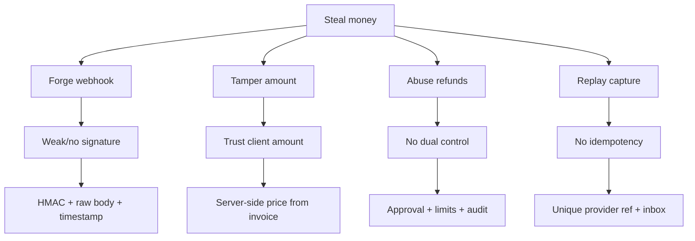

# Threat Model, Privacy & Compliance

> **Status:** Accepted · **Owner:** Security & Compliance · **Version:** 1.0
>
> This is a living threat model. It is reviewed at every architecture change, before GA, after every
> SEV-1/SEV-2 incident, and annually. It is not legal advice; counsel validates jurisdictional
> positions.

## 1. Method

- **STRIDE** for application and platform threats.
- **LINDDUN** for privacy threats (linking, identifying, non-repudiation, detecting, disclosure,
  unawareness, non-compliance).
- **Attack trees** for the highest-impact scenarios.
- **Abuse cases** for business logic (payments, grades, admissions).
- **Data-flow review** for every new integration, AI feature or export.

### Assets

| Asset | Impact if compromised |
|---|---|
| Learner/guardian PII | Safeguarding, identity theft, regulatory breach |
| Health/safeguarding records | Severe harm, legal liability |
| Grades/transcripts | Fraud, loss of trust, accreditation risk |
| Payment/ledger data | Financial loss, fraud, audit failure |
| Credentials/sessions | Account takeover, lateral movement |
| Audit trail | Loss of evidence, regulatory non-compliance |
| Availability during exams/results | Reputational and contractual damage |
| Tenant isolation | Existential (multi-tenant breach) |

### Actors

External attacker, malicious insider, compromised partner, curious student, careless staff,
automated bot, supply-chain attacker, AI prompt attacker.

## 2. STRIDE analysis

| Threat | Scenario | Primary controls |
|---|---|---|
| **Spoofing** | Credential stuffing, phishing, forged service JWT, forged PSP webhook | MFA/passkeys, rate limits, bot management, JWT signature/audience, webhook HMAC, Turnstile |
| **Tampering** | Client alters amount/grade/tenant, replay, SQL injection | Server-side invariants, Zod, parameterized SQL, idempotency, signatures, RLS |
| **Repudiation** | User denies approving a refund/grade change | Immutable audit, step-up, approvals, hash chain |
| **Information disclosure** | Cross-tenant read, export leak, public R2 object, verbose errors | Tenant predicates + RLS, authorization, presigned URLs, redaction, uniform errors |
| **Denial of service** | DDoS during results day, queue flooding, expensive queries | Cloudflare DDoS/WAF/Waiting Room, quotas, pagination, query budgets, circuit breakers |
| **Elevation of privilege** | Role confusion, IDOR, support impersonation, SSRF to metadata | Deny-by-default PDP, scope checks, break-glass, egress allowlist, no metadata service |
| **Privacy (LINDDUN)** | Re-identification, secondary use, over-retention, silent profiling | Purpose limitation, minimization, consent, retention jobs, DPIA, no ads |

## 3. Top risks and mitigations

| # | Risk | Likelihood | Impact | Mitigation | Owner |
|---|---|---|---|---|---|
| R1 | Cross-tenant data exposure | Medium | Critical | Explicit predicates + RLS + cache keying + cross-tenant tests + pen test | Architecture |
| R2 | Account takeover (staff/admin) | High | High | Passkeys/MFA, conditional access, rate limits, session revocation, anomaly alerts | Security |
| R3 | Payment fraud / forged webhook | Medium | High | Signature verification, raw body, replay window, PSP re-fetch, reconciliation, dual approval | Payments |
| R4 | Insider data exfiltration | Medium | High | Least privilege, export limits/watermarks, audit, DLP alerts, break-glass | Security |
| R5 | Supply-chain compromise | Medium | High | Pinned deps, lockfile, SCA, SBOM, signed builds, least-privilege CI tokens | Platform |
| R6 | Ransomware / DB compromise | Low | Critical | Multi-AZ, PITR, immutable backups, least privilege, no direct DB access, restore drills | Platform |
| R7 | DDoS during exams/results | High | Medium | Cloudflare DDoS/WAF, Waiting Room, autoscaling, load shedding | SRE |
| R8 | AI prompt injection / data leak | Medium | Medium | Treat content as untrusted, tool allowlist, PII redaction, human approval, AI Gateway | Product/Security |
| R9 | Misconfigured R2/public route | Medium | High | IaC review, bucket policies, no public buckets, presigned only, config scans | Platform |
| R10 | Duplicate event double-charges | Medium | High | Idempotency, inbox, unique PSP ref, reconciliation | Payments |
| R11 | Session revocation lag | Medium | Medium | Postgres authority + DO invalidation + short TTL; sensitive actions re-check | Identity |
| R12 | Regulatory non-compliance (child data) | Medium | High | DPIA, consent, retention, DPO, vendor DPAs, audits | Compliance |

## 4. Attack trees

### 4.1 Account takeover (staff/admin)

### 4.2 Cross-tenant access

### 4.3 Payment fraud

## 5. Abuse cases

| Abuse | Control |
|---|---|
| Teacher changes marks after publication | Immutability + amendment workflow + audit |
| Bursar waives fees for relatives | Conflict-of-interest check + approval + audit |
| Parent accesses another child's report | ReBAC + 404 + audit |
| Admissions officer sells applicant data | Export limits, DLP, audit, contractual controls |
| Student spams notifications | Rate limits, quotas, moderation |
| Tenant probes platform endpoints | API Shield schema, gateway allowlist, 404 |
| Attacker enumerates valid emails | Uniform responses/timing, rate limits, Turnstile |
| Insider downloads all learners | Volume limits, watermark, approval, alert |
| AI copilot leaks another learner | Tenant-scoped retrieval, authorization filters, redaction |

## 6. Privacy principles

| Principle | Implementation |
|---|---|
| Lawful basis | Recorded per purpose (contract, consent, legal obligation, legitimate interest) |
| Purpose limitation | Data catalog; no secondary use without review |
| Minimization | Collect only required fields; optional fields justified |
| Accuracy | User/institution correction workflows; audit |
| Storage limitation | Retention classes + automated deletion/anonymisation |
| Integrity/confidentiality | Encryption, access control, audit |
| Accountability | DPO, ROPA, DPIA, training, vendor management |
| Transparency | Privacy notices, consent text versioned, plain language |
| Children | Guardian consent where required, age-appropriate notices, no ads/profiling |

### Roles

- **Tenant = controller** for learner/staff data; Athena = **processor** (or joint controller in
  limited platform-analytics cases, assessed per contract).
- Athena uses **subprocessors** (Cloudflare, Postgres provider, IdP, PSP, email/SMS). A current list
  is published to customers; changes trigger notice.
- Data processing agreements (DPAs) flow down to subprocessors.

## 7. Children's data

| Control | Detail |
|---|---|
| Age-appropriate notices | Plain language, layered; learner-facing |
| Guardian consent | Where required by law; captured and versioned |
| School consent | Where the institution acts as controller and provides consent |
| No behavioural advertising | Prohibited platform-wide |
| No public profiles | Learner data not search-indexed or public |
| Messaging safeguards | Moderation, reporting, restricted contact |
| Minimal collection | No unnecessary location, biometrics or health data |
| Retention | Short for operational data; long only where required |
| AI | No automated decisions with legal/significant effect; human review |
| Access | Learner sees own data; guardian sees linked children only |

## 8. Data subject rights

| Right | Process | SLA |
|---|---|---|
| Access | Export bundle (data + documents + audit of access) | ≤ 30 days |
| Rectification | Request → institution approval → audit | ≤ 30 days |
| Erasure | Check legal/financial/safeguarding holds → delete/anonymise → certificate | ≤ 30 days |
| Portability | Machine-readable export (CSV/JSON + manifest) | ≤ 30 days |
| Restriction | Flag record; restrict processing | ≤ 30 days |
| Objection | Assess; stop non-essential processing | ≤ 30 days |
| Automated decisions | Human review path | ≤ 30 days |

- Requests are verified (identity + relationship) and logged.
- Tenant (controller) is notified; Athena assists as processor.
- Exceptions (legal obligation, safeguarding, financial records) are documented, not silent.
- Deletion propagates to search, caches, projections, backups per documented policy.

## 9. DPIA triggers

A DPIA is required for:

- New health/safeguarding data or biometrics.
- Large-scale monitoring (CCTV, GPS, keystroke).
- AI/automated decisioning affecting learners.
- New cross-border transfer or subprocessor.
- New integration exporting learner data.
- Significant change to retention or consent.

DPIA template: necessity/proportionality, data flows, risks, mitigations, residual risk, sign-off,
review date.

## 10. Compliance matrix

| Framework | Applicability | Control / evidence | Status |
|---|---|---|---|
| **GDPR / UK GDPR** | EU/UK learners/staff | DPA, ROPA, DPIA, DSAR, breach process, SCCs, DPO | In progress |
| **FERPA** (US) | US institutions | School official designation, legitimate interest, directory opt-out, parent rights | Design |
| **COPPA** (US, <13) | US children | Verifiable consent, minimization, no ads, retention | Design |
| **PCI DSS** | Card payments | SAQ A (hosted fields), no PAN, PSP attestation | Design |
| **SOC 2 Type I/II** | Enterprise customers | Controls, evidence, annual audit | Type I at GA |
| **ISO 27001** | Security management | ISMS, risk register, policies | Aligned; certify later |
| **ISO 27701** | Privacy | PIMS extension | Roadmap |
| **WCAG 2.2 AA** | All UI | Automated + manual audits | Gate |
| **Ghana DPA 2012 (Act 843)** | Ghana | Registration, consent, security, breach | Design |
| **Nigeria NDPA** | Nigeria | Lawful basis, DPO, transfer rules | Design |
| **Kenya DPA 2019** | Kenya | Registration, consent, breach | Design |
| **POPIA** (South Africa) | South Africa | Lawful processing, operator agreements | Design |
| **India DPDP 2023** | India | Consent, children's data, breach | Design |
| **Local education rules** | Per country | EMIS reporting, records retention | Per tenant |

> Jurisdiction profiles are configuration + legal review. The platform provides the controls; the
> tenant remains responsible for its lawful basis and statutory returns.

## 11. Breach response

| Phase | Action | Owner |
|---|---|---|
| Detect | SIEM/alert/anomaly; confirm scope | Security on-call |
| Assess | Data categories, tenants, volume, risk | DPO + Security |
| Contain | Revoke sessions/keys, block, isolate cell | Incident commander |
| Notify | Regulator ≤ 72 h where required; tenants without undue delay; individuals if high risk | Legal/DPO |
| Remediate | Fix root cause, rotate secrets, patch | Engineering |
| Document | Incident record, timeline, decisions | Compliance |
| Learn | Postmortem, control updates, tabletop | Leadership |

Breach register includes: date, discovery, data, subjects, cause, containment, notifications, lessons.

## 12. Vendor and subprocessor management

- Security questionnaire + certifications before onboarding.
- DPA with confidentiality, breach notice, subprocessor flow-down, audit rights, deletion.
- Annual review; continuous monitoring for critical vendors.
- Data residency and transfer mechanism documented.
- Exit plan: export, deletion, certificate.
- Critical vendors: Cloudflare, Postgres provider, IdP, PSP, email/SMS, AI provider.

## 13. AI privacy and safety

- AI features are opt-in per tenant; core workflows never depend on them.
- No training on tenant data without explicit contractual consent.
- Prompts/responses logged with PII redaction; retention short.
- Retrieval is tenant-scoped and authorization-filtered.
- Model output is advisory; human approval for grades, admissions, discipline, finance, access.
- Prompt injection: content treated as untrusted; tool allowlist; no direct data access.
- Bias/fairness review for any model influencing learner outcomes.
- Transparency: users know when they interact with AI; appeal path to a human.

## 14. Compliance evidence calendar

| Evidence | Frequency | Owner |
|---|---|---|
| Access review (privileged) | Quarterly | Security |
| Penetration test | Annual + major change | Security |
| DR restore test | Monthly (Tier 1) | SRE |
| Backup integrity | Weekly | SRE |
| Vendor review | Annual | Compliance |
| DPIA review | Per change/annual | DPO |
| Retention job report | Monthly | Data |
| Security training | Annual + onboarding | HR/Security |
| Incident tabletop | Semi-annual | Security |
| SOC 2 audit | Annual | Compliance |
| WAF/API Shield rule review | Quarterly | Security |
| Key rotation | Annual/on compromise | Security |

## 15. Residual risks accepted at planning baseline

| Risk | Acceptance | Review |
|---|---|---|
| Managed IdP outage blocks new logins | Existing sessions continue; break-glass admin | Quarterly |
| External Postgres regional dependency | Multi-AZ + PITR + DR cell | Quarterly |
| Cloudflare-specific lock-in | Ports/adapters; exit plan | Annual |
| AI provider data handling | DPA + redaction + opt-in | Per vendor |
| Jurisdictional interpretations | Local counsel per market | Per launch |

## 16. Review triggers

- New data category, integration, AI feature or subprocessor.
- New market/jurisdiction.
- Architecture change (new store, new trust boundary).
- Security incident or near miss.
- Regulatory change.
- Annual review regardless.
