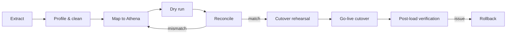

# SDLC Plan

> **Status:** Accepted · **Owner:** Delivery & Architecture · **Version:** 2.0
>
> An 18-month, phase-gated delivery plan for a production platform. Estimates assume a stable team of
> ~20 FTE and are ranges, not commitments. Each phase ends at a **gate** with evidence; a gate can be
> failed, and failing early is cheaper than failing in production.

## 1. Delivery model

- **Phase-gated, iterating inside phases.** Two-week sprints; every sprint produces a demonstrable,
  tested increment behind a flag.
- **Walking skeleton first.** Phase 2 proves the full path (edge → auth → service → database → queue
  → observability) before feature breadth.
- **Vertical slices.** Each slice includes UI, API, data, auth, tests, telemetry and docs.
- **Trunk-based development.** Short-lived branches (≤ 2 days), feature flags, continuous integration.
- **Docs-as-code.** Architecture, ADRs, OpenAPI and runbooks change in the same PR as code.
- **Security and accessibility are gates**, not phases.
- **No big-bang release.** Pilot → wave 1 → wave 2 with rollback and hypercare.

## 2. Timeline

```mermaid
gantt
  title Athena delivery plan (18 months)
  dateFormat  YYYY-MM-DD
  axisFormat  %b %y
  section Discovery
  Phase 0 Discovery & feasibility      :p0, 2027-01-04, 4w
  Phase 1 Architecture & planning      :p1, after p0, 6w
  section Build
  Phase 2 Foundation                   :p2, after p1, 10w
  Phase 3 Core MVP                     :p3, after p2, 18w
  Phase 4 Expansion                    :p4, after p3, 16w
  section Harden
  Phase 5 Hardening & compliance       :p5, after p4, 8w
  Phase 6 Pilot & UAT                  :p6, after p5, 8w
  section Launch
  Phase 7 GA & operate                 :p7, after p6, 8w
  Gates                                :milestone, g0, 2027-02-01, 0d
                                       :milestone, g1, 2027-03-15, 0d
                                       :milestone, g2, 2027-05-24, 0d
                                       :milestone, g3, 2027-09-27, 0d
                                       :milestone, g4, 2028-01-17, 0d
                                       :milestone, g5, 2028-03-13, 0d
                                       :milestone, g6, 2028-05-08, 0d
                                       :milestone, g7, 2028-07-03, 0d
```

| Phase | Duration | Primary outcome |
|---|---|---|
| 0 Discovery & feasibility | 4 weeks | Validated problem, scope, business case, risks |
| 1 Architecture & planning | 6 weeks | Signed-off architecture, data model, plan, threat model |
| 2 Foundation | 10 weeks | Walking skeleton: CI/CD, auth, tenancy, one vertical slice, observability |
| 3 Core MVP | 18 weeks | Admissions → enrolment → attendance → assessment → billing/payments |
| 4 Expansion | 16 weeks | Scheduling, HR/payroll, LMS, library, transport, hostel, reporting, integrations |
| 5 Hardening & compliance | 8 weeks | Pen test, load, DR, accessibility, SOC 2 readiness |
| 6 Pilot & UAT | 8 weeks | 3–5 pilot institutions live, migration rehearsed, hypercare |
| 7 GA & operate | 8 weeks + ongoing | Wave rollout, SLOs, cost optimisation, roadmap |

## 3. Phase 0 — Discovery & feasibility

**Goal:** Decide whether and how to build, with evidence.

| Workstream | Deliverables |
|---|---|
| Stakeholder discovery | Interviews with 10–15 institutions across levels; process maps; pain points |
| Market & competition | Segment analysis, build/buy/partner, differentiation |
| Regulatory scan | Data protection, child data, financial records, education reporting per market |
| Domain model draft | Institution types, academic structures, finance flows, roles |
| Technical spikes | Cloudflare Workers limits, Hyperdrive + RLS, Drizzle migrations, DO rate limiting, R2 upload |
| Business case | TAM/SAM/SOM, pricing hypothesis, cost model, 3-year forecast |
| Risk register | Top 15 risks with owners and mitigations |

**Gate G0 — Feasibility approved**
- [ ] Problem validated with ≥ 10 institutions.
- [ ] Target segments and launch market chosen.
- [ ] Regulatory constraints understood; DPIA screening done.
- [ ] Technical spikes pass (latency, RLS, queues, uploads).
- [ ] Business case and budget approved.
- [ ] Executive sponsor and product owner named.

## 4. Phase 1 — Architecture & planning

**Goal:** A buildable, secure, operable design.

| Workstream | Deliverables |
|---|---|
| Architecture | This documentation set, C4 views, service catalog, ADRs |
| Data | ERDs, conventions, core DDL, retention, residency |
| Security | Threat model, identity model, compliance matrix, IR plan |
| Delivery | Roadmap, RACI, estimates, environments, CI/CD design |
| Product | Requirements, acceptance criteria, prioritised backlog, designs |
| Operations | SLOs, observability, backup/DR, runbooks skeleton |
| Vendor | Postgres, IdP, PSP, email/SMS decisions; DPAs |

**Gate G1 — Architecture baseline**
- [ ] Architecture, data and security docs reviewed and accepted.
- [ ] ADRs for irreversible decisions accepted.
- [ ] Threat model covers top 10 risks.
- [ ] Load model signed off (1M DAU, 100k concurrent, 10k RPS).
- [ ] Postgres provider, IdP and PSP selected (or pilots scheduled).
- [ ] Cost model and team plan approved.
- [ ] Backlog sliced into vertical increments; Definition of Ready agreed.

## 5. Phase 2 — Foundation

**Goal:** A production-shaped skeleton that can carry features safely.

| Workstream | Deliverables |
|---|---|
| Monorepo | pnpm + Turborepo, packages, service template, generators |
| CI/CD | Lint, typecheck, unit, SAST, SCA, build, preview, deploy, rollback |
| Infrastructure | Cloudflare account, DNS, WAF, R2, Queues, Hyperdrive, Terraform |
| Identity | OIDC IdP, sessions, MFA, SCIM skeleton, authorization PDP |
| Tenancy | Tenant provisioning Workflow, cells, RLS, cross-tenant tests |
| Data | Postgres, Drizzle migrations, outbox/inbox, audit |
| Observability | OTel, Tail Workers, Logpush, dashboards, alerts, SLOs |
| Vertical slice | Login → tenant → institution → create user → audit → dashboard |
| Frontend | Design system, auth BFF, layout, i18n, a11y baseline |
| Docs | Runbooks, on-call, incident process, service README template |

**Gate G2 — Walking skeleton**
- [ ] One command boots local stack; preview environment per PR.
- [ ] Deploy to staging is automated, < 15 min, rollback < 5 min.
- [ ] Tenant provisioning works end-to-end and is idempotent.
- [ ] Cross-tenant tests pass; RLS verified.
- [ ] Auth/MFA/session revocation works; no tokens in browser storage.
- [ ] Audit events visible; trace spans across edge → service → DB.
- [ ] SLO dashboards and alerts exist for the skeleton.
- [ ] Security review of the skeleton passed.

## 6. Phase 3 — Core MVP

**Goal:** Run a real institution's core term without spreadsheets.

| Increment | Scope | Key services |
|---|---|---|
| 3.1 Academic setup | Institutions, years, terms, levels, programmes, courses, sections | academic, tenant |
| 3.2 Admissions | Intakes, forms, applications, documents, review, offers, conversion | admissions, document, notification |
| 3.3 Student & enrolment | Learners, guardians, relationships, enrolment, capacity | student, billing (fee assignment) |
| 3.4 Attendance | Daily/period registers, offline PWA, corrections, alerts | attendance, scheduling (basic) |
| 3.5 Assessment | Schemes, assessments, marks, moderation, report cards | assessment, document |
| 3.6 Billing & payments | Fee schedules, invoices, PSP, webhooks, reconciliation, ledger | billing, payments, ledger |
| 3.7 Portals | Admin, parent, student, teacher surfaces | apps |
| 3.8 Reporting | Core dashboards and exports | reporting |
| 3.9 Integrations | Email/SMS, webhooks, CSV import/export | notification, integration |

**Gate G3 — MVP pilot-ready**
- [ ] End-to-end: apply → offer → enrol → invoice → pay → attend → assess → report card.
- [ ] Payment reconciliation ≥ 99.5% in test; no double capture.
- [ ] Offline attendance sync exactly-once.
- [ ] Report card batch ≤ 5 min/500 learners.
- [ ] Accessibility: zero critical axe issues on core journeys.
- [ ] Performance: p95 targets met at 2× pilot load.
- [ ] Security: no open critical/high; pen-test scope agreed.
- [ ] 3 pilot institutions signed; migration plan drafted.

## 7. Phase 4 — Expansion

**Goal:** Cover the operational breadth a school group needs.

| Increment | Scope |
|---|---|
| 4.1 Scheduling | Periods, timetable generation, rooms, exams, substitutions |
| 4.2 HR & payroll | Staff, contracts, leave, payroll runs, statutory exports |
| 4.3 Ledger & procurement | Budgets, POs, vendor bills, assets, statements |
| 4.4 LMS | Modules, resources, assignments, submissions, quizzes, Stream |
| 4.5 Library | Catalogue, loans, reservations, fines |
| 4.6 Transport | Routes, vehicles, drivers, trips, guardian visibility |
| 4.7 Hostel | Rooms, beds, allocations, roll-call, exeat |
| 4.8 Health & wellbeing | Visits, medication, immunisation, consent |
| 4.9 Communication | Announcements, conversations, moderation, preferences |
| 4.10 Engagement | Behaviour, clubs, alumni, fundraising |
| 4.11 Integrations | Google/Microsoft, Moodle, accounting, EMIS, devices |
| 4.12 Analytics | Cross-institution dashboards, scheduled reports |

**Gate G4 — Feature complete**
- [ ] All GA capabilities meet their requirements and acceptance tests.
- [ ] Every service has SLO, runbook, capacity card.
- [ ] Data migration tooling supports the pilot institutions.
- [ ] Integration sandbox and partner docs live.
- [ ] No open critical/high security findings.
- [ ] Support model and knowledge base ready.

## 8. Phase 5 — Hardening & compliance

**Goal:** Prove the platform survives reality and audits.

| Workstream | Activities |
|---|---|
| Performance | Load test 50k concurrent, 10k RPS; soak 24 h; DB saturation; queue lag |
| Resilience | Chaos: DB failover, queue outage, DO hot key, region failover; game days |
| Security | External pen test, DAST, API fuzz, threat-model update, remediation |
| Privacy | DPIA, ROPA, DSAR rehearsal, retention jobs, subprocessor review |
| Accessibility | Manual audit (WCAG 2.2 AA), screen reader, keyboard, low vision |
| Compliance | SOC 2 Type I evidence, policies, vendor DPAs, training |
| Data | Restore drills, reconciliation, migration rehearsal, cutover runbook |
| Operations | On-call rotation, incident drills, status page, support playbooks |

**Gate G5 — Production readiness**
- [ ] Load/soak targets met with headroom.
- [ ] DR restore tested: RTO/RPO met; data reconciled.
- [ ] Pen test critical/high fixed; medium risk-accepted with dates.
- [ ] WCAG 2.2 AA audit passed on core journeys.
- [ ] SOC 2 Type I readiness; policies and evidence in place.
- [ ] Runbooks, dashboards, alerts and on-call proven by drills.
- [ ] Pilot migration dry run reconciled to the cent/learner.
- [ ] Rollback and incident communication tested.

<a id="phase-6-pilot-uat"></a>
## 9. Phase 6 — Pilot & UAT

**Goal:** Real institutions, real data, real term; controlled blast radius.

| Workstream | Activities |
|---|---|
| Pilot cohort | 3–5 institutions across levels; signed agreements; named champions |
| Migration | Extract, profile, map, clean, dry run, reconcile, cutover, rollback |
| UAT | Scripted journeys per persona; defect triage; sign-off |
| Training | Role-based training, quick guides, in-app help, office hours |
| Hypercare | Daily stand-up, dedicated support, on-call, fast fixes |
| Feedback | Usage analytics, NPS/CSAT, weekly review, backlog re-prioritisation |
| Readiness | Wave 1 onboarding checklist, data protection review, billing setup |

**Gate G6 — Pilot exit**
- [ ] Pilot institutions complete a full cycle (admissions → results/billing).
- [ ] Critical defects = 0; high defects have fixes or accepted workarounds.
- [ ] Data reconciled; no unexplained financial balances.
- [ ] Adoption thresholds met (staff weekly active ≥ 70%).
- [ ] Support ticket volume and CSAT within targets.
- [ ] Incident postmortems complete; actions closed.
- [ ] Wave 1 customers contracted and onboarded.

## 10. Phase 7 — GA & operate

**Goal:** Scale adoption without scaling risk.

| Workstream | Activities |
|---|---|
| Rollout | Waves by segment/region; capacity gates; rollback plan |
| Reliability | SLO reviews, error budgets, capacity planning, cost per learner |
| Security | Continuous scanning, annual pen test, bug bounty, access reviews |
| Product | Roadmap: marketplace, AI copilots, advanced analytics, deeper integrations |
| Customer | Onboarding playbooks, certification, community, support tiers |
| Compliance | SOC 2 Type II, ISO 27001, regional expansions, DPIA updates |
| Platform | Service consolidation/splitting based on evidence; debt reduction |

**Gate G7 — GA**
- [ ] Wave 1 live with SLOs met for 30 days.
- [ ] Support and onboarding scaled; runbooks current.
- [ ] Unit economics within plan; cost per learner tracked.
- [ ] Security/compliance posture current; no overdue critical/high.
- [ ] Public API/webhooks/developer portal live.
- [ ] Board/customer launch criteria met.

## 11. RACI

| Activity | Sponsor | Product | Architecture | Eng Lead | QA | Security | SRE | Compliance | CS |
|---|---|---|---|---|---|---|---|---|---|
| Business case | A | R | C | C | I | C | C | C | C |
| Requirements | I | A/R | C | C | C | C | I | C | C |
| Architecture/ADRs | I | C | A/R | C | I | C | C | I | I |
| Threat model | I | I | C | C | C | A/R | C | C | I |
| Delivery plan | A | R | C | R | C | C | C | I | C |
| Implementation | I | C | C | A/R | C | C | C | I | I |
| Testing | I | C | I | C | A/R | C | C | I | I |
| Security review | I | I | C | C | C | A/R | C | C | I |
| Deployment | I | I | C | R | C | C | A/R | I | I |
| Data migration | I | C | C | R | C | C | C | C | A |
| UAT | I | A | I | C | R | I | I | I | R |
| Go-live | A | R | C | R | C | C | R | C | R |
| Incident | I | I | C | R | I | C | A/R | C | C |
| Compliance audit | A | I | C | C | I | C | C | A/R | I |

`R` responsible, `A` accountable, `C` consulted, `I` informed.

## 12. Team composition (baseline)

| Role | FTE | Notes |
|---|---|---|
| Product manager | 2 | Core + platform |
| Product designer | 1.5 | Design system + research |
| Business analyst | 1 | Requirements, UAT, migration mapping |
| Architect / tech lead | 2 | Backend + platform |
| Full-stack engineers | 8 | TypeScript/Nuxt/Nitro |
| Data engineer | 1 | Schema, migrations, reporting |
| Platform/SRE | 2 | Cloudflare, CI/CD, observability, DR |
| QA engineer | 2 | Automation + manual UAT |
| Security engineer | 1 | AppSec, cloud, compliance support |
| Compliance/DPO | 0.5 | Privacy, audits, contracts |
| Customer success / training | 2 | Pilots, onboarding, support |
| Technical writer | 0.5 | Docs, help, API portal |
| **Total** | **~21** | Plus fractional legal/finance |

## 13. Ways of working

### 13.1 Branching and review

- Trunk-based; `main` always deployable.
- Branches ≤ 2 days; PRs ≤ 400 changed lines where practical.
- One approval required; two for security/finance/auth/schema changes.
- Required checks: typecheck, lint, unit, integration, contract, SAST, SCA, IaC, migration, a11y,
  preview deploy.
- No direct pushes to `main`; signed commits encouraged.
- Feature flags for incomplete work; flags have owners and expiry.

### 13.2 Definition of Ready

- [ ] Requirement ID and acceptance criteria.
- [ ] Design (if UI) and accessibility notes.
- [ ] Data model/API contract agreed.
- [ ] Security/privacy impact assessed.
- [ ] Test approach and fixtures identified.
- [ ] Observability and rollout plan.
- [ ] Dependencies and migration impact known.

### 13.3 Definition of Done

- [ ] Code reviewed; type-safe; no `any`/unsafe assertion.
- [ ] Unit/integration/contract tests pass; coverage threshold met.
- [ ] Cross-tenant and authorization tests pass.
- [ ] OpenAPI/event schema updated; compatibility checked.
- [ ] Migration tested (expand/contract); rollback documented.
- [ ] Telemetry: trace, metrics, logs (PII redacted).
- [ ] Security review for high-risk changes; no critical/high.
- [ ] Accessibility/i18n checked for UI.
- [ ] Docs, runbook, service.yaml updated.
- [ ] Feature flagged; rollout/rollback plan.
- [ ] Product acceptance; demo recorded.

### 13.4 Estimation and capacity

- Story points (Fibonacci) for relative size; cycle time for forecasting.
- 20% capacity reserved for bugs, security, debt and support.
- WIP limits per team; no more than 2 major initiatives in flight.
- Quarterly planning; weekly dependency review; daily stand-up.

### 13.5 Change control

- Scope changes assessed for impact on schedule, security, data and cost.
- Architecture changes require an ADR.
- Schema changes require a migration plan and data owner sign-off.
- Public API changes require versioning/deprecation plan.
- Emergency changes follow the incident process and are reviewed within 48 h.

## 14. Quality gates by phase

| Gate | Security | Data | Quality | Ops | Compliance |
|---|---|---|---|---|---|
| G1 | Threat model | ERD + conventions | Test strategy | SLO draft | DPIA screening |
| G2 | Auth review | RLS + migrations | CI + unit/integration | Dashboards/alerts | Data map |
| G3 | Pen-test scope | Reconciliation | E2E + a11y | Runbooks | DPIA core |
| G4 | No critical/high | Migration tooling | Contract + load | Capacity cards | Vendor DPAs |
| G5 | Pen test passed | Restore tested | Soak + chaos | DR drill | SOC 2 readiness |
| G6 | Incident drill | Migration reconciled | UAT sign-off | Hypercare | DSAR rehearsal |
| G7 | Continuous | Retention jobs | SLO 30 days | Cost review | Type II plan |

## 15. Data migration strategy



- Source adapters: CSV, Excel, legacy DB, OneRoster/Ed-Fi.
- Profiling: duplicates, missing guardians, orphan enrolments, fee balances.
- Mapping: institution-specific, versioned, reviewed by the customer.
- Reconciliation: learner count, enrolments, balances, invoices, marks.
- Cutover: freeze window, delta load, smoke tests, rollback checkpoint.
- No production migration without a signed reconciliation report.

## 16. Launch readiness checklist

- [ ] SLOs, alerts, dashboards, on-call.
- [ ] Backups + restore tested; DR plan.
- [ ] Security pen test closed; WAF/API Shield rules reviewed.
- [ ] Privacy notices, DPAs, subprocessor list, DSAR process.
- [ ] Accessibility audit passed.
- [ ] Support tiers, SLAs, escalation, status page.
- [ ] Billing/PSP live keys, reconciliation, refunds.
- [ ] Runbooks for top 10 incidents.
- [ ] Rollback and communication plan.
- [ ] Customer onboarding and training complete.
- [ ] Executive go/no-go.

## 17. Post-launch

- Hypercare (2–4 weeks per wave) with daily triage.
- SLO/error-budget review weekly; feature velocity adjusts to reliability.
- Monthly cost review (per tenant/learner/request).
- Quarterly access review, dependency review, DR test.
- Annual pen test, SOC 2, DPIA refresh, architecture review.
- Postmortems for all SEV-1/2; actions tracked to closure.
