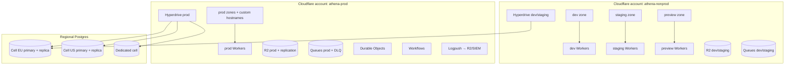

# CI/CD, Environments & Infrastructure

> **Status:** Accepted · **Owner:** Platform Engineering · **Version:** 2.0
>
> Everything is code: Workers, bindings, DNS, WAF, R2, Queues, Hyperdrive, Access and alerts.
> Production changes go through CI, are observable, and are reversible.

## 1. Environments

| Environment | Purpose | Data | Who | Lifetime |
|---|---|---|---|---|
| **Local** | Development | Synthetic + local Postgres/Miniflare | Engineers | Persistent |
| **Preview** | Per-PR review | Branch database + seeded tenant | PR author/reviewers | TTL 72 h |
| **Dev** | Integration | Synthetic | Engineering | Persistent |
| **Staging** | Production-like validation | Anonymised/synthetic, never prod PII | Engineering/QA/security | Persistent |
| **Production** | Customers | Real tenant data | Operated by platform | Persistent |
| **Sandbox** | Partner/developer | Synthetic tenant | Partners | Persistent |
| **Training** | Customer training | Synthetic | Customer success | Persistent |

Rules:

- Production is a **separate Cloudflare account** from non-production. Enterprise cells may have
  separate accounts for isolation/residency.
- No production data in non-production. Anonymisation is irreversible and tested.
- Preview environments get their own Worker names, database branch, R2 prefix and queues; they are
  destroyed automatically.
- Staging mirrors production configuration (WAF, Access, bindings) but at lower scale.
- A change is promoted through environments; no direct production edits.

## 2. Account and zone topology



- One **zone** per environment/brand; custom hostnames for tenants via Cloudflare for SaaS.
- Workers names are environment-suffixed (`athena-student-prod`).
- R2 buckets are environment- and region-specific; no cross-environment access.
- Queues and Workflows are environment-specific.
- Hyperdrive configs are per environment and cell.
- Terraform workspaces map 1:1 to accounts/environments.

## 3. Infrastructure as code

| Layer | Tool | Scope |
|---|---|---|
| Cloudflare account resources | Terraform/OpenTofu | DNS, zones, WAF, API Shield, Access, R2, Queues, Hyperdrive, Logpush, Waiting Room, Turnstile, custom hostnames |
| Worker code and bindings | Wrangler | Worker versions, routes, vars, secrets references, service bindings |
| Postgres | Provider IaC/CLI + Drizzle | Databases, roles, extensions, schemas, migrations |
| Observability | Terraform + config | Dashboards, alerts, SLOs, synthetics |
| CI/CD | GitHub Actions workflows | Pipelines, environments, approvals |

Rules:

- Terraform state is remote and locked; no concurrent applies. Use an S3-compatible backend with
  lockfile support, or HCP Terraform/OpenTofu state locking.
- Every PR runs `terraform plan`; production apply requires approval.
- No manual changes in the console. Drift detection runs daily and alerts.
- Modules are versioned; environments pin versions.
- Secrets are referenced, never stored in Terraform state (use Secrets Store IDs).
- Resource naming/tagging: `athena-<env>-<service>-<resource>`; tags: owner, cost centre, data class.

### Terraform module layout

```text
infra/terraform/
├── modules/
│   ├── worker/            # script/routes/bindings + version
│   ├── r2/                # bucket, lifecycle, CORS, event notification
│   ├── queue/             # queue + DLQ + consumer
│   ├── hyperdrive/        # config + connection secret ref
│   ├── dns-zone/          # zone, records, custom hostnames
│   ├── waf/               # managed + custom rules, rate limits
│   ├── access/            # apps, policies, service tokens
│   ├── observability/     # logpush, alerts, dashboards
│   └── postgres/          # provider resources, roles, backups
├── envs/
│   ├── dev/
│   ├── staging/
│   └── prod/
└── global/                # account-level settings
```

## 4. CI pipeline

```mermaid
flowchart LR
  PR[Pull request] --> L[Lint + typecheck]
  L --> U[Unit + contract]
  U --> S[SAST + SCA + secret scan]
  S --> B[Build Worker bundles]
  B --> I[Integration tests<br/>Workers pool + Postgres]
  I --> P[Preview deploy]
  P --> E[E2E + a11y + Lighthouse]
  E --> D[DAST against preview]
  D --> R[Review + approval]
  R --> M[Merge to main]
  M --> A[Artifact + SBOM + sign]
  A --> MS[Migrate staging]
  MS --> DS[Deploy staging]
  DS --> SM[Smoke + perf]
  SM --> AP[Prod approval]
  AP --> MP[Migrate prod]
  MP --> CP[Canary deploy]
  CP --> V[SLO verification]
  V --> F[Full rollout]
```



### Required checks

| Check | Tool | Blocking |
|---|---|---|
| Format/lint | Prettier, ESLint | Yes |
| Typecheck | `tsc --noEmit` per project | Yes |
| Unit | Vitest | Yes |
| Integration | `@cloudflare/vitest-pool-workers` + Postgres | Yes |
| Contract | Pact-style / OpenAPI diff | Yes |
| SAST | CodeQL + Semgrep | Yes |
| SCA/license | OSV/Dependabot + license check | Yes |
| Secret scan | Gitleaks | Yes |
| IaC scan | Checkov/tfsec/Conftest | Yes |
| Migration test | Empty + previous schema | Yes |
| Cross-tenant tests | Seeded two tenants | Yes |
| E2E | Playwright | Yes (critical) |
| Accessibility | axe | Yes (critical) |
| Performance budget | Lighthouse CI | Yes |
| DAST | ZAP baseline | Yes (no high) |
| Preview deploy | Wrangler | Yes |
| SBOM/sign | CycloneDX + cosign/attestation | Yes (release) |

### Caching

- Turborepo remote cache in R2 (S3-compatible) keyed by content hash + branch.
- pnpm store cache; Worker build cache per project.
- No cache of secrets or environment-specific build output across environments.

## 5. Deployment mechanics

### 5.1 Worker deployment

```bash
# Build and upload an immutable version
wrangler versions upload --config services/student/wrangler.jsonc

# Gradual rollout (e.g. 10% → 50% → 100%)
wrangler versions deploy <version-id>@10% --config services/student/wrangler.jsonc
```

- Deploy by version, not by overwriting blindly.
- Service bindings reference service names; version pinning where supported prevents surprise
  cross-version calls.
- Canary: 1% internal tenants → 10% → 50% → 100%, with SLO gates.
- Rollback: deploy the previous version (seconds), not a rebuild.
- A deploy is blocked if migrations are not backward-compatible.

### 5.2 Database migrations

Order per environment:

1. Backup/PITR checkpoint.
2. Run expand migration (backward compatible).
3. Deploy new Worker version.
4. Run backfill (Workflow/Job) if needed.
5. Verify.
6. Run contract migration in a later release.

Rules:

- Migration job uses the migrator role, not the runtime role.
- No destructive migration in the same release as the code that stops using the column.
- Long backfills run as Workflows with progress and throttling.
- A failed migration blocks the deploy; rollback is a new forward migration (never edit applied SQL).
- Production migration requires approval and a documented rollback.

### 5.3 Preview environments

- Branch database (Neon branch or ephemeral schema) + seeded tenant.
- Worker name `athena-<service>-pr-<number>`; route `pr-<number>.preview.athena.example`.
- R2 prefix `preview/pr-<number>/`; queues `...-pr-<number>`.
- External providers use sandbox credentials only.
- TTL cleanup after 72 h or PR close.
- No customer data; synthetic fixtures only.

## 6. Release management

| Type | Cadence | Approval | Rollback |
|---|---|---|---|
| Service deploy | On merge (affected service) | CI + code review | Previous version |
| Database migration | Before service deploy | Data owner + on-call | Forward migration |
| Public API change | Versioned | API guild | Deprecation window |
| Major release | Weekly/monthly train | Release manager | Version rollback + comms |
| Emergency fix | Immediate | Incident commander + peer | Immediate |

- Semantic versioning for packages; deploy tags for services.
- Changelog generated from Conventional Commits.
- Release notes for customers on public API/feature changes.
- Every deploy records: commit, artifact hash, SBOM, approver, migration IDs, version IDs.
- Change freeze during exams/results windows unless SEV-1.

## 7. Secrets and identity in CI

- GitHub Actions uses OIDC to Cloudflare where supported; otherwise a scoped API token stored as an
  environment secret.
- Tokens are least privilege: Workers Scripts:Edit only for deploy; R2/Queues/Terraform scoped
  separately.
- Production secrets are in Cloudflare Secrets Store, referenced by binding; never in GitHub.
- Environment protection rules require reviewer approval for production.
- No long-lived cloud keys on developer machines; use short-lived tokens/SSO.
- CI logs are scrubbed; secret scanning runs on every commit.

## 8. Observability in the pipeline

- Every deploy emits a marker/annotation to Grafana/Sentry.
- Canary analysis compares error rate, latency, saturation and business KPIs against baseline.
- Automatic rollback trigger: error rate > 2× baseline or p95 > SLO for 5 min.
- Post-deploy smoke: login, tenant context, one read, one write, queue round-trip, R2 signed URL.
- Synthetic checks run every minute per region.

## 9. Infrastructure inventory

| Capability | Cloudflare service | Notes |
|---|---|---|
| Compute | Workers | One per service/app; paid plan |
| Static/assets | Workers/Pages + Cache | Immutable assets; CDN |
| Database | Hyperdrive → PostgreSQL | Regional; provider per cell |
| Objects | R2 | Versioning; lifecycle; object lock for audit |
| Cache/config | KV | Versioned keys; TTL |
| Coordination | Durable Objects | Sharded; alarms |
| Async | Queues + DLQ | Batch consumers |
| Workflows | Workflows | Long-running jobs |
| Metrics | Analytics Engine | High-cardinality ops metrics |
| Logs | Workers Logs/Tail Workers, Logpush | To R2/SIEM |
| Search | Postgres FTS + Vectorize | No external search initially |
| AI | Workers AI, AI Gateway, Vectorize | Guardrails; opt-in |
| Images/video | Images, Stream | Signed/private where needed |
| Realtime | Realtime/Calls, DO WebSockets | Live classes/messaging |
| Email in | Email Routing/Workers | Support/admissions inboxes |
| Email/SMS out | External providers via integration-service | DPA required |
| Devices | Tunnel, Spectrum | On-prem devices without inbound ports |
| Access | Access, Gateway, WARP | Workforce only |
| Edge security | WAF, DDoS, Bot Mgmt, Turnstile, API Shield, Page Shield | Terraform-managed |
| Peak control | Waiting Room, Load Balancing | Results/registration |
| Custom domains | Cloudflare for SaaS (custom hostnames) | TLS automation |
| Residency | Regional Services / Data Localization | Where required |
| Feature flags | Flagship (where available) or KV/DO config | Server-side |

## 10. Capacity and scaling operations

| Layer | Signal | Action |
|---|---|---|
| Edge | Cache hit ratio, 5xx, WAF blocks | Tune cache/rules; scale Waiting Room |
| Gateway | RPS, 429s, latency | Adjust quotas; route; scale |
| Workers | CPU, errors, duration | Optimize code; split work; Workflows |
| Hyperdrive | Pool saturation, latency | Tune pool; add replicas; cell split |
| Postgres | QPS, locks, replication lag, disk | Index; partition; replica; shard cell |
| Queues | Backlog, age, DLQ | Increase consumers; batch; throttle producers |
| DO | Requests/s per object | Shard key; move work |
| R2 | Ops rate, storage | Lifecycle; multipart; cache |
| Workflows | Running/stuck | Inspect; retry; terminate with audit |

Capacity reviews monthly; load tests before each wave; cost per tenant/learner tracked.

## 11. Cost controls

- Cloudflare: Workers requests/CPU, DO duration, R2 storage/ops, Queues, Workflows, Hyperdrive,
  Logpush volume.
- Postgres: instance size, storage, replicas, backup retention.
- IdP/PSP/email/SMS: per-active-user and per-message costs.
- Budgets and alerts per environment; anomaly detection on spend.
- Log sampling and retention tuning; avoid logging payloads.
- Per-tenant quotas and fair scheduling prevent one tenant from dominating cost.
- Unit economics: cost per active learner, per 1,000 API calls, per payment.

## 12. Disaster recovery (infrastructure)

| Component | Backup | Restore | Test |
|---|---|---|---|
| Postgres | PITR 35 days + daily snapshots + monthly archive | New instance, replay to timestamp | Monthly Tier 1 |
| R2 | Versioning + cross-region replication for critical buckets | Copy/restore | Quarterly |
| Queues | DLQ + outbox replay | Replay from outbox | Quarterly |
| Workflows | Durable state | Resume/restart | Quarterly |
| Terraform | Git + state backups | Re-apply | Quarterly |
| Secrets | Secrets Store + escrowed recovery | Rotate/reissue | Semi-annual |
| DNS | Terraform | Re-apply/failover | Quarterly |

See [Observability, SRE & DR](observability-sre-dr.md) for RTO/RPO and runbooks.

## 13. Production readiness checklist

- [ ] Separate prod account/zone; least-privilege CI token.
- [ ] Terraform state locked; drift detection.
- [ ] All resources tagged and owned.
- [ ] WAF/API Shield/Access rules reviewed and versioned.
- [ ] R2 buckets private; lifecycle + object lock configured.
- [ ] Queues have DLQ and alarms.
- [ ] Hyperdrive pools sized; RLS verified.
- [ ] Secrets in Secrets Store; rotation plan.
- [ ] Backups/PITR enabled; restore tested.
- [ ] Dashboards, alerts, SLOs, synthetics live.
- [ ] Rollback and migration plan tested.
- [ ] Cost budgets and alerts.
- [ ] Runbooks and on-call published.
