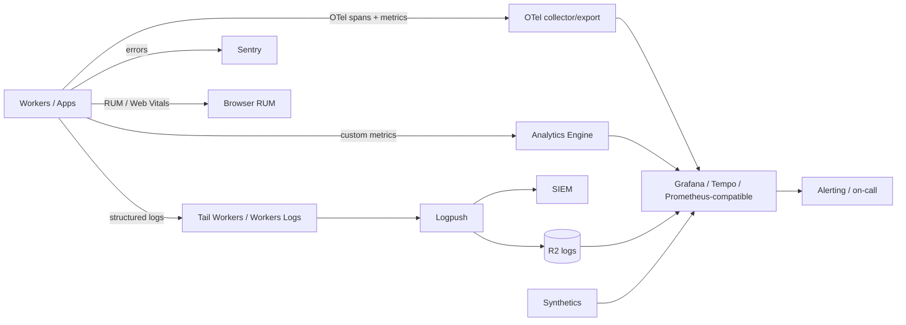
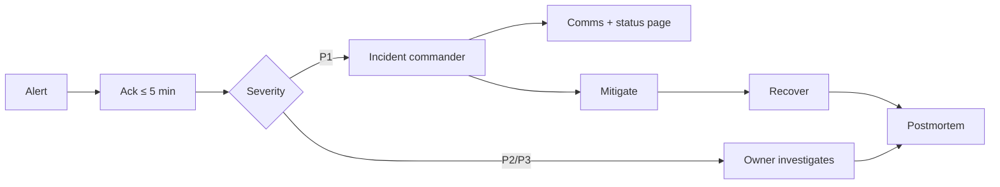
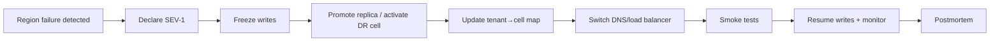

# Observability, SRE & Disaster Recovery

> **Status:** Accepted · **Owner:** SRE · **Version:** 2.0
>
> You cannot operate what you cannot see. Every request, event, job and deploy is traceable; every
> critical journey has an SLO; every failure has an owner and a runbook.

## 1. Telemetry architecture



| Signal | Source | Retention | Use |
|---|---|---|---|
| Traces | OpenTelemetry from Workers/apps | 7–14 days | Latency, dependency, errors |
| Metrics | OTel + Analytics Engine | 13 months | SLOs, capacity, cost |
| Logs | Workers Logs/Tail Workers/Logpush | 30 days hot, 90 days R2 | Debugging, security |
| Errors | Sentry | 90 days | Stack traces, release health |
| RUM | Browser/web vitals | 90 days | LCP, INP, CLS, JS errors |
| Synthetics | Cloudflare/global probes | 13 months | Availability from user locations |
| Audit | `audit-service` | 7 years | Compliance, investigations |
| Deploy markers | CI | 13 months | Correlate changes to incidents |

### Trace propagation

- W3C `traceparent` from edge → gateway → app → service → DB/queue.
- Queue messages carry `traceparent`; consumers continue the trace.
- Workflows/DO steps create spans with workflow/object IDs.
- Every API response includes `x-trace-id`; support can find the full trace.
- Sampling: 100% for errors and slow requests; 10% baseline; tail-based where possible.

### Log schema

```json
{
  "timestamp": "2026-11-10T09:14:22.318Z",
  "level": "info",
  "service": "student-service",
  "version": "2026.11.10-1",
  "env": "prod",
  "tenant_id": "0192...",
  "trace_id": "4bf92f3577b34da6",
  "span_id": "00f067aa0ba902b7",
  "route": "POST /internal/enrolments",
  "status": 201,
  "duration_ms": 84,
  "actor_id": "0192...",
  "error_code": null
}
```

Rules:

- JSON only; no free-form multi-line logs.
- Never log secrets, tokens, passwords, card data, full national IDs, bank accounts, health notes or
  message bodies.
- PII fields are hashed/redacted; tenant IDs are safe; user IDs are internal.
- Log levels: `debug` (dev only), `info`, `warn`, `error`, `fatal`.
- Include `service`, `version`, `env`, `tenant_id`, `trace_id`.
- Log sampling for high-volume info logs; errors always kept.

## 2. SLIs and SLOs

| Service / journey | SLI | SLO | Error budget (28d) |
|---|---|---|---|
| Gateway | Successful requests / total | 99.95% | 21.6 min |
| Gateway latency | p95 request duration | ≤ 300 ms | 5% over budget |
| Login | Successful logins / attempts (excl. user error) | 99.9% | 43.2 min |
| Identity | Session validation p95 | ≤ 100 ms | 5% |
| Student API | Availability | 99.95% | 21.6 min |
| Student API | Read p95 | ≤ 300 ms | 5% |
| Attendance batch | Availability | 99.95% | 21.6 min |
| Attendance batch | p95 | ≤ 500 ms | 5% |
| Payments webhook | Availability | 99.95% | 21.6 min |
| Payments webhook | p95 | ≤ 2 s | 5% |
| Ledger posting | Availability | 99.99% | 4.3 min |
| Ledger posting | p95 | ≤ 500 ms | 5% |
| Notification accept | Availability | 99.9% | 43.2 min |
| Notification delivery | p95 | ≤ 60 s | 5% |
| Reporting dashboard | Availability | 99.5% | 3.6 h |
| Reporting dashboard | p95 | ≤ 500 ms | 5% |
| Queue | Message age p95 | ≤ 60 s | 5% |
| Worker | CPU p95 | ≤ 50 ms | 5% |
| Frontend | LCP p75 (3G Fast) | ≤ 2.5 s | 5% |
| Frontend | INP p75 | ≤ 200 ms | 5% |
| Frontend | CLS p75 | ≤ 0.1 | 5% |

### Error budget policy

- Budget = allowed unreliability over 28 days.
- > 50% consumed: review trends; reduce risky changes.
- 100% consumed: **feature freeze** for that service until the budget recovers; only reliability,
  security and critical fixes ship.
- Fast burn (> 14.4× in 1 h) pages immediately; slow burn (> 6× in 6 h) pages/tickets.
- Exceptions require an executive + SRE approval with a remediation plan.
- SLOs are reviewed quarterly; new services define them before launch.

## 3. Dashboards

| Dashboard | Audience | Contents |
|---|---|---|
| Platform overview | Exec/on-call | Availability, SLO burn, active incidents, tenant impact |
| Service RED | Service owners | Rate, errors, duration, saturation, deploys |
| Tenant health | Support/CS | Per-tenant error rate, latency, queue lag, quota |
| Business | Product/finance | Enrolments, attendance, payments, reconciliation, report cards |
| Database | SRE/data | QPS, latency, locks, replication lag, pool saturation, disk |
| Queue/Workflow | SRE | Backlog, age, DLQ, workflow failures, retries |
| Security | Security | Auth failures, WAF blocks, exports, privilege changes, cross-tenant alerts |
| Frontend | Frontend | Core Web Vitals, JS errors, route performance |
| Cost | FinOps | Spend by service/tenant, unit cost, anomalies |

Dashboards are code (Terraform/JSON), versioned and reviewed.

## 4. Alerting

### Principles

- Alert on **symptoms** (user impact), not every cause.
- Every page links to a runbook and a dashboard.
- No alert without an owner; no owner → delete or fix.
- Deduplicate and group by service/tenant; include severity and impact.
- Suppress during known maintenance with an expiry.
- Page only for urgent, actionable issues; everything else is a ticket.

| Severity | Criteria | Response |
|---|---|---|
| **P1** | SEV-1/2, SLO fast burn, cross-tenant, payments down, auth down, data loss | Page immediately, IC, exec/legal as needed |
| **P2** | Significant degradation, queue lag > 15 min, single service down | Page/respond within 15 min |
| **P3** | Minor degradation, DLQ > 0, one tenant impacted | Ticket, next business day |
| **P4** | Informational, capacity trend | Backlog |

Alerts include: symptom, SLO impact, affected tenants, dashboard, runbook, recent deploys.

## 5. On-call and incident management



| Role | Responsibility |
|---|---|
| Incident commander | Coordinates, decides, owns timeline |
| Ops lead | Technical mitigation |
| Comms lead | Status page, customer updates, support |
| Scribe | Timeline, actions, decisions |
| Executive sponsor | Escalation, external comms (SEV-1) |

Rules:

- Ack ≤ 5 min for P1/P2; escalate after 10 min.
- Status page updated within 15 min (P1) / 30 min (P2).
- Customer comms in plain language; no speculation; next update time.
- Blameless postmortem within 5 business days; actions with owner/date.
- Incident review for every SEV-1/2; trends reviewed monthly.
- On-call rotation weekly; handover notes; compensation and fatigue policy.

## 6. Backup and disaster recovery

### 6.1 Objectives

| Tier | Data | RPO | RTO |
|---|---|---|---|
| 1 | Identity, student, billing, payments, ledger, assessment | ≤ 5 min | ≤ 1 h |
| 2 | Academic, admissions, attendance, audit | ≤ 15 min | ≤ 4 h |
| 3 | Notification, document metadata, reporting, search | ≤ 1 h | ≤ 8 h |
| Objects | R2 documents/media | ≈ 0 (versioning) | ≤ 1 h |
| Audit archive | WORM | ≈ 0 | ≤ 4 h |

### 6.2 Backup strategy

| Data | Backup | Retention | Restore |
|---|---|---|---|
| Postgres | PITR + daily snapshot + monthly archive | 35 days PITR; 12 months monthly | New instance + replay |
| R2 | Versioning + replication (critical buckets) | Per policy | Copy/restore |
| Audit | WORM object lock | 7 years | Read-only restore |
| Queues | Outbox + DLQ | 30 days | Replay |
| Workflows | Durable state | Provider retention | Resume/restart |
| IaC | Git + state backup | Indefinite | Re-apply |
| Secrets | Secrets Store + escrow | Rotation policy | Reissue |

### 6.3 Restore runbook

1. **Declare** incident; identify data loss window and affected tenants.
2. **Isolate** the target environment; stop writes (maintenance mode/feature flag).
3. **Provision** a new database instance at the target timestamp.
4. **Validate** schema version, row counts, checksums, tenant isolation.
5. **Reconcile** outbox/queues/sequences; replay events after the restore point.
6. **Verify** critical journeys (login, enrolment, payment, report card) on a canary tenant.
7. **Switch** Hyperdrive connection string/cell map; monitor.
8. **Communicate** to affected tenants; record RPO/RTO achieved.
9. **Postmortem** and update runbooks.

No restore directly over production without a validated copy. Restore access is break-glass and
audited.

### 6.4 Region/cell failover



- Replica promotion is tested; RPO measured.
- Tenant→cell map update is atomic and cached with a version.
- DNS TTLs are low enough for failover; health checks are regional.
- Data residency is preserved; failover to another region only if the contract allows.

### 6.5 Testing

| Test | Frequency | Evidence |
|---|---|---|
| PITR restore | Monthly (Tier 1) | Restore report, RTO/RPO |
| Full cell failover | Quarterly | Game-day report |
| R2 restore | Quarterly | Checksum + access test |
| Queue/outbox replay | Quarterly | No duplicates/loss |
| Secret rotation | Semi-annual | Rotation log |
| Chaos (DB/queue/DO) | Monthly | Findings + fixes |

## 7. Chaos engineering

Scenarios:

- Database primary failover; replica lag; connection pool exhaustion.
- Queue pause, duplicate delivery, poison message, DLQ flood.
- DO hot key, eviction, alarm failure.
- KV stale/missing; cache stampede.
- PSP timeout, duplicate webhook, signature failure.
- IdP outage; session validation failure.
- R2 5xx; signed URL expiry.
- Region/AZ impairment.
- WAF false positive blocking legitimate traffic.

Rules:

- Run in staging first; production with a small tenant and a kill switch.
- Define steady-state hypothesis and abort conditions.
- Never during exams/results/finance close without approval.
- Record findings; fix or accept with owner.

## 8. Capacity and performance

| Area | Metric | Trigger |
|---|---|---|
| Workers | CPU p95, errors, duration | > 70% of limit or SLO burn |
| Hyperdrive | Pool saturation, wait time | > 70% sustained |
| Postgres | CPU, IOPS, connections, locks, replica lag | > 70% for 15 min |
| Queues | Backlog, age, DLQ | Age > 60 s or backlog growth |
| DO | Req/s per object, storage | > 100 req/s or hot key |
| R2 | 5xx, ops rate | Error budget burn |
| Cost | Spend vs budget | > 80% forecast |
| Tenant | Quota usage | > 80% |

Load tests: 50k concurrent, 10k RPS, 24 h soak; run before each rollout wave and after major
changes.

## 9. Runbook index

| Runbook | When |
|---|---|
| `db-primary-down` | Postgres primary unavailable |
| `hyperdrive-saturation` | Pool exhausted / latency |
| `queue-backlog` | Consumer lag / backlog |
| `dlq-replay` | Poison messages |
| `auth-outage` | Identity/session failures |
| `idp-outage` | OIDC/SAML provider down |
| `psp-webhook-failure` | Payments not reconciling |
| `payment-reconciliation` | Unmatched/settlement issues |
| `r2-unavailable` | Documents failing |
| `waf-false-positive` | Legitimate traffic blocked |
| `ddos` | Attack / traffic spike |
| `certificate-failure` | TLS/custom hostname |
| `tenant-provisioning-stuck` | Workflow failure |
| `workflow-stuck` | Long-running job |
| `cross-tenant-alert` | Isolation alarm |
| `data-breach` | Suspected breach |
| `region-failover` | Cell/region down |

Each runbook: symptoms, impact, diagnosis, mitigation, escalation, verification, post-incident.

## 10. Observability data governance

- Logs/traces are **not** the audit trail; audit is separate and immutable.
- Retention: traces 7–14 days, logs 30/90 days, metrics 13 months, audit 7 years.
- Access to logs is role-based; production PII is redacted at source.
- Support can query by tenant/trace without seeing payloads.
- SIEM retention and legal hold are separate.
- Observability cost is reviewed monthly; sample/aggregate high-volume signals.

## 11. SLO review and reporting

- Weekly: burn rate, incidents, capacity, top errors.
- Monthly: SLO attainment, error budget, cost, on-call load, alert quality.
- Quarterly: SLO targets, dependencies, DR test, chaos findings.
- Board/customer: availability, incidents, security, roadmap impact.
- A service without an SLO is not production-ready.
