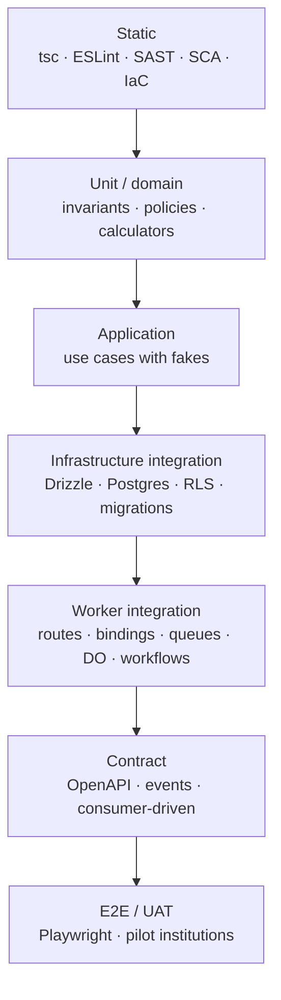

# Test Strategy

> **Status:** Accepted · **Owner:** QA & Engineering · **Version:** 2.0
>
> Tests are evidence for release gates. They cover behaviour, tenancy, security, accessibility,
> performance, resilience and data migration — not just lines of code.

## 1. Test pyramid (adapted for Workers)



| Level | Tool | Scope | Speed |
|---|---|---|---|
| Static | `tsc`, ESLint, Semgrep, CodeQL, tfsec/Checkov | Types, lint, security, IaC | Seconds |
| Unit | Vitest | Domain entities, value objects, policies, money/grading math | ms |
| Application | Vitest + fakes | Use cases, orchestration, error paths | ms |
| Infrastructure | Vitest + Postgres (Docker/Neon branch) | Repositories, constraints, RLS, migrations | Seconds |
| Worker | `@cloudflare/vitest-pool-workers` / Miniflare | Routes, bindings, service bindings, queues, DO, workflows | Seconds |
| Contract | OpenAPI diff, Pact-style, JSON Schema | API and event compatibility | Seconds |
| E2E | Playwright | Critical journeys per persona | Minutes |
| Accessibility | axe-core + manual | WCAG 2.2 AA | Minutes |
| Performance | k6, Lighthouse CI | Latency, throughput, web vitals | Minutes |
| Security | ZAP, API fuzz, dependency/IaC scans | OWASP, authz, input | Minutes |
| Resilience | Chaos scripts | DB/queue/DO/provider failures | Scheduled |
| Migration | Reconciliation scripts | Legacy data → Athena | Per migration |
| UAT | Scripted + exploratory | Real institution workflows | Pilot |

## 2. What must be tested for every service

| Area | Minimum |
|---|---|
| Domain invariants | Unit tests for every rule (money, capacity, dates, grades) |
| Authorization | 401/403/404 for every route; relationship/scope matrix |
| Tenant isolation | Two tenants; foreign IDs; list/search/export; cache keys |
| Input validation | Valid, missing, malformed, oversized, injection strings |
| Idempotency | Duplicate request/event returns one effect |
| Concurrency | Optimistic lock conflict; race on capacity/sequence |
| Transactions | Rollback on failure; no partial writes |
| Events | Published via outbox; schema valid; consumer idempotent |
| Failure paths | Timeout, dependency 5xx, circuit breaker, DLQ |
| Observability | Trace/metric/log emitted; PII redacted |
| Migrations | Empty + previous schema; expand/contract |
| Performance | Hot endpoint p95 within budget under seed load |
| Accessibility | If UI: axe + keyboard + screen reader smoke |

## 3. Test environments and data

| Environment | Data | Use |
|---|---|---|
| Local | Synthetic, seeded | Unit/integration/worker tests |
| Preview (per PR) | Branch DB + seeded tenants | E2E, a11y, visual, DAST |
| Staging | Anonymised/synthetic, production-like volume | Load, chaos, UAT, migration rehearsal |
| Production | Real | Synthetics, canary, read-only smoke |

Rules:

- No production PII in tests. Anonymisation is irreversible and verified.
- Factories create valid aggregates; tests do not hand-craft inconsistent rows.
- Two tenants (A/B) are seeded for every isolation test.
- Test data is deterministic (fixed UUIDs, clock injection) for reproducibility.
- Cleanup is automatic; preview environments expire.

## 4. Unit and application tests

- Domain pure functions: no I/O, no mocks; fast.
- Use cases with in-memory fakes for ports.
- Clock and ID generation injected; no `Date.now()` in domain logic.
- Property-based tests for money, date ranges and grading (fast-check).
- Golden tests for GPA/weighted totals with published test vectors.
- Error paths are first-class: not found, conflict, forbidden, invalid state.

```ts
// example: grading golden test
it('computes weighted total and GPA', () => {
  const result = computeTermResult({
    scheme: gpa4Scheme,
    courses: [
      { credits: 3, score: 85 }, // A = 4.0
      { credits: 4, score: 72 }, // B = 3.0
    ],
  });
  expect(result.gpa).toBe('3.43');
  expect(result.totalCredits).toBe(7);
});
```

## 5. Infrastructure tests

- Run against real PostgreSQL (Docker locally, Neon branch in CI); never mock SQL.
- Verify constraints, indexes, cascades, exclusion constraints and triggers.
- Verify RLS with two tenants and a role without `BYPASSRLS`.
- Verify migrations from empty and from the previous release.
- Verify `SET LOCAL` tenant context; missing context fails.
- Verify money precision and timezone behavior.
- Verify partition creation and retention jobs.

## 6. Worker integration tests

Use `@cloudflare/vitest-pool-workers` so code runs in the real Workers runtime.

| Binding | Test |
|---|---|
| Service binding | Call target Worker; verify JWT/audience/tenant; timeout |
| KV | Cache hit/miss, TTL, versioned keys, stale behavior |
| R2 | Upload/download, presigned URL, metadata, scan event |
| Queue | Publish, consume, retry, DLQ, duplicate |
| Durable Object | Concurrency, alarm, eviction/rehydrate, hot-key behavior |
| Workflow | Step retry, compensation, resume, status |
| Hyperdrive/Postgres | Transaction, RLS, pool behavior |

Rules:

- No mocking of Cloudflare bindings unless the behaviour is impossible to simulate; Miniflare is
  preferred.
- Assert the exact HTTP status/body/headers, including error codes and trace ID.
- Test service binding calls with a forged audience/tenant → rejected.

## 7. Contract tests

### API

- OpenAPI spec generated in CI; `oasdiff` detects breaking changes.
- Provider tests validate responses against the spec.
- Consumer tests (BFF/SDK) run against a mock generated from the spec.
- Every public endpoint has examples; examples are validated.

### Events

- JSON Schema/Zod contract per event version.
- Producer test asserts payload validates.
- Consumer test asserts it tolerates unknown fields and rejects bad tenant.
- Compatibility check: additive fields allowed; removals/retypes require a new major.
- Replay fixtures for historical events.

## 8. End-to-end journeys

Critical journeys (must pass before every release):

1. Login with MFA → tenant selection → dashboard.
2. Public application → submit → offer → accept → convert to student.
3. Enrol learner → assign fees → issue invoice → pay online → receipt.
4. Teacher takes attendance online and offline → sync → guardian alert.
5. Teacher enters marks → moderation → publish → guardian sees report card.
6. Registrar issues transcript → verification QR works.
7. Finance records payment → allocates → ledger balanced → reconciliation.
8. Admin invites staff → role assigned → access limited correctly.
9. Guardian links child → sees only that child.
10. Export report → watermark/expiry/audit.
11. Tenant switch → data isolation.
12. Session revoke → immediate logout.

Each journey runs on desktop and a mobile viewport, in the primary locale and one RTL locale.

## 9. Accessibility testing

| Check | Tool | Gate |
|---|---|---|
| Automated | axe-core on every page/component | Zero critical/serious |
| Keyboard | Manual per journey | All actions reachable |
| Screen reader | NVDA/VoiceOver smoke | Core journeys announced correctly |
| Contrast | Token audit | WCAG AA |
| Zoom/reflow | 200%/400% | No loss of content |
| Reduced motion | Manual | No essential motion |
| Forms | Manual | Labels, errors, instructions |
| Tables | Manual | Headers, captions, sorting |

Accessibility is tested in CI (axe) and manually before each gate; a failure blocks release for
learner/guardian surfaces.

## 10. Performance testing

### Web

- Lighthouse CI budgets: LCP ≤ 2.5 s, INP ≤ 200 ms, CLS ≤ 0.1 on 3G Fast/mid-tier Android.
- Bundle budgets per route; no regression > 10%.
- Test on low-end device profile and slow network.

### API/load (k6)

| Scenario | Target |
|---|---|
| Baseline | 1k RPS, 30 min, p95 within SLO |
| Peak | 10k RPS, 15 min, error < 0.1% |
| Burst | 30k RPS, 5 min, graceful 429/503, no cascade |
| Soak | 5k RPS, 24 h, no memory/connection leak |
| Attendance burst | 50k records/min, exactly-once |
| Payment webhook | 500/s, no duplicate capture |
| Report cards | 10k learners, ≤ 5 min/500, queue lag bounded |
| DB saturation | Pool < 70%, replica lag < 5 s |

Load tests run in staging with production-like data volume; results are stored with release
evidence.

## 11. Security testing

| Test | Frequency | Gate |
|---|---|---|
| SAST (CodeQL/Semgrep) | Every PR | No new high |
| SCA/dependency | Every PR | No critical/high |
| Secret scan | Every commit | Zero |
| IaC scan | Every PR | No high |
| DAST (ZAP) | Every release/preview | No high |
| API fuzz (auth/payment) | Weekly | No crash/bypass |
| Authorization matrix | Every PR | 100% routes |
| Cross-tenant suite | Every PR | Zero leaks |
| Penetration test | Pre-GA + annual | Critical/high fixed |
| Threat model review | Per feature | Signed off |
| Dependency confusion | Quarterly | Scoped registry |
| Cloudflare config review | Quarterly | WAF/API Shield/Access correct |

## 12. Resilience and chaos

| Scenario | Expected |
|---|---|
| DB primary down | Writes fail fast; reads serve cache/replica; alert; failover |
| Hyperdrive pool exhausted | 503/backpressure; no cascade |
| Queue down | Outbox retains; retries; no data loss |
| Poison message | DLQ; other messages continue |
| DO hot key | Shard/fallback; no global outage |
| KV stale | Authority revalidates; no auth bypass |
| PSP timeout | Payment pending; no double charge |
| IdP down | Existing sessions continue; login degraded |
| R2 down | Documents unavailable; metadata intact |
| Region failure | Failover within RTO/RPO |

Run monthly in staging; quarterly in production with a canary tenant and kill switch.

## 13. Data migration testing

For each source system:

1. Extract a representative sample + full volume.
2. Profile: duplicates, missing guardians, orphan enrolments, negative balances.
3. Map fields; document transformations and defaults.
4. Dry run into staging; reconcile counts and amounts.
5. Reconcile: learners, enrolments, invoices, payments, balances, marks.
6. Rehearse cutover and rollback.
7. Sign-off by the customer and data owner.
8. Post-load verification on production with checksums.

No migration is "done" until the reconciliation report is signed and archived.

## 14. UAT

- Scripted journeys per persona (registrar, teacher, bursar, guardian, learner, principal).
- Realistic data volumes; pilot institution's own data where possible.
- Defect severity: blocker/major/minor; exit criteria = zero blockers, majors fixed or accepted.
- UAT sign-off by the institution and product owner.
- Feedback triaged into backlog; no silent scope creep.

## 15. Coverage and quality metrics

| Metric | Target |
|---|---|
| Line coverage (overall) | ≥ 80% |
| Coverage on money/auth/grading | ≥ 90% |
| Mutation score (core modules) | ≥ 70% (stretch) |
| Flaky test rate | < 1% |
| Test suite duration (PR) | ≤ 15 min |
| Escaped defects (per release) | Trending down |
| Critical journeys passing | 100% |
| Cross-tenant tests | 100% |
| Accessibility critical issues | 0 |

Coverage is a guide, not a goal; missing invariant tests are defects regardless of coverage.

## 16. Flaky tests

- Quarantine immediately with an owner and ticket; do not silently retry forever.
- Fix within 5 business days or delete/replace.
- Root causes: time, randomness, shared state, network, async waits.
- CI reports flake rate per test; top offenders reviewed weekly.

## 17. Test traceability

- Test names include requirement IDs (`FR-PAY-003 ...`).
- CI publishes requirement → test → result per release.
- A `MUST` requirement without a passing test blocks release (waiver required).
- Test evidence (reports, load results, pen test) stored with the release record.

## 18. Release test gates

- [ ] Static, unit, application, integration, worker tests pass.
- [ ] Contract compatibility passes.
- [ ] Cross-tenant and authorization matrix pass.
- [ ] Critical E2E journeys pass on desktop + mobile.
- [ ] Accessibility critical issues = 0.
- [ ] Performance budgets met.
- [ ] DAST/SAST/SCA/IaC clean or risk-accepted.
- [ ] Migration tested and reconciled (if applicable).
- [ ] Resilience scenarios for changed dependencies pass.
- [ ] UAT sign-off (for release/pilot).
