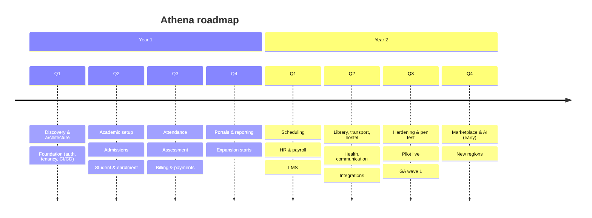

# Roadmap, Risks & Cost Model

> **Status:** Accepted · **Owner:** Product & Finance · **Version:** 1.0
>
> Ranges are planning estimates, not commitments. They assume the ~21 FTE team in the
> [SDLC plan](../06-sdlc/sdlc-plan.md), a single launch region, and the Cloudflare-native
> architecture. Re-forecast at every gate.

## 1. Delivery waves

| Wave | Scope | Exit |
|---|---|---|
| **W0 Foundation** | Monorepo, CI/CD, identity, tenancy, audit, design system | Walking skeleton |
| **W1 Core** | Academic, admissions, student, attendance, assessment, billing/payments, portals | Pilot-ready |
| **W2 Operations** | Scheduling, HR/payroll, LMS, library, transport, hostel, health, comms, integrations | Feature complete |
| **W3 Hardening** | Pen test, load, DR, accessibility, SOC 2 readiness | Production-ready |
| **W4 Pilot** | 3–5 institutions, migration, UAT, hypercare | Pilot exit |
| **W5 GA** | Wave 1 rollout, support scale, cost optimisation | GA |
| **W6 Expand** | Marketplace, AI copilots, advanced analytics, new regions | Growth |

## 2. Milestones

| Milestone | Target | Evidence |
|---|---|---|
| M0 Business case approved | Month 1 | Signed charter, budget |
| M1 Architecture baseline | Month 2.5 | Docs, ADRs, threat model, load model |
| M2 Walking skeleton | Month 4.5 | Deployed auth/tenant/audit slice |
| M3 Core MVP | Month 9 | End-to-end term workflow in staging |
| M4 Feature complete | Month 12.5 | All GA capabilities |
| M5 Production readiness | Month 14.5 | Pen test, load, DR, a11y, SOC 2 readiness |
| M6 Pilot live | Month 16.5 | 3–5 institutions in production |
| M7 GA | Month 18 | Wave 1 live, SLOs met 30 days |

## 3. Risk register

Probability (P) and impact (I): H/M/L. Score = P×I.

| # | Risk | P | I | Score | Mitigation | Owner |
|---|---|---|---|---|---|---|
| R1 | Scope explosion ("every school task") | H | H | 9 | Phase gates, MoSCoW, configurable core, explicit non-goals, change control | Product |
| R2 | Data migration quality (legacy data) | H | H | 9 | Profiling, mapping, dry runs, reconciliation, customer sign-off, rollback | Delivery/Data |
| R3 | Low staff adoption | M | H | 6 | Teacher-first UX, offline, training, champions, adoption KPIs | Product/CS |
| R4 | Security breach / cross-tenant leak | M | H | 6 | RLS + predicates + tests, pen test, bug bounty, audit, incident drills | Security |
| R5 | Cloudflare/Postgres limits at scale | M | H | 6 | Load model, cells, replicas, caching, load tests, capacity reviews | Architecture/SRE |
| R6 | Payment provider gaps (local rails) | H | M | 6 | Multiple PSP adapters, bank transfer, manual reconciliation, phased markets | Payments |
| R7 | Regulatory change / multi-country | M | H | 6 | Jurisdiction profiles, legal review, configurable retention, DPIA | Compliance |
| R8 | Key-person dependency | M | H | 6 | Pairing, docs, ADRs, on-call rotation, bus factor reviews | Eng Lead |
| R9 | Vendor outage (IdP/Postgres/PSP) | M | H | 6 | Redundancy, break-glass, status page, DR, SLA review | SRE |
| R10 | Cost overrun (infra/vendors) | M | M | 4 | Budgets, unit cost, quotas, reserved capacity, monthly review | Finance |
| R11 | Performance during results/exams | H | M | 6 | Waiting Room, load tests, queue buffering, read replicas, freeze windows | SRE |
| R12 | Accessibility non-compliance | M | M | 4 | Design system, axe CI, manual audits, gate | Frontend |
| R13 | AI feature harm/bias | L | H | 3 | Opt-in, human approval, redaction, evaluation, kill switch | Product/Security |
| R14 | Talent ramp-up | M | M | 4 | Golden path, templates, pairing, docs, onboarding | Eng Lead |
| R15 | Support load at launch | H | M | 6 | Tiered support, knowledge base, in-app help, hypercare, CS hiring | CS |
| R16 | Competitor/incumbent lock-in | M | M | 4 | Open API, import/export, migration tooling, pricing | Product |
| R17 | Funding/budget cut | L | H | 3 | Phased gates, MVP value early, cost discipline | Sponsor |
| R18 | Cloudflare feature changes/limits | M | M | 4 | Abstraction, limits monitoring, exit plan, multi-provider readiness | Architecture |

### Top 5 risk actions (next 90 days)

1. Sign the load model and capacity test plan (R5).
2. Run two legacy-data profiling exercises with prospective pilots (R2).
3. Complete threat model + cross-tenant test harness (R4).
4. Secure PSP sandbox agreements and test local rails (R6).
5. Establish adoption baseline and teacher design partners (R3).

## 4. Cost model

### 4.1 Build (18 months)

| Category | Assumption | Estimate (USD) |
|---|---|---|
| Personnel | ~21 FTE, blended $70k–$110k/year, 18 months | $2.2M – $3.5M |
| Contractors/specialists | Security, accessibility, legal, design | $150k – $350k |
| Cloudflare | Workers, DO, R2, Queues, Workflows, Hyperdrive, Logpush | $3k – $12k/month (build), $15k – $50k/month at scale |
| PostgreSQL | Managed, multi-AZ, replicas, backups | $500 – $3k/month per cell |
| Identity | Managed IdP per MAU | $0.02 – $0.10/MAU/month (volume-dependent) |
| Email/SMS | Transactional + bulk | $500 – $5k/month |
| Payments | PSP fees | 1.5% – 3.5% per transaction (pass-through) |
| Tooling | GitHub, observability, Sentry, design, CI | $1k – $5k/month |
| Compliance | Pen test, SOC 2, legal, DPO | $80k – $200k/year |
| Contingency | 15% | — |

**Indicative build total:** **$2.8M – $4.5M** over 18 months (excluding payment pass-through).

### 4.2 Run rate (post-GA, first year)

| Category | Estimate (USD/year) |
|---|---|
| Personnel (support, SRE, eng, CS) | $1.8M – $2.8M |
| Cloudflare + Postgres + vendors | $300k – $900k |
| Compliance/audit/legal | $150k – $300k |
| Sales & marketing | $300k – $1M |
| **Total** | **$2.5M – $5M** |

### 4.3 Unit economics (targets)

| Metric | Target |
|---|---|
| Price per learner/year | $6 – $30 (segment-dependent) |
| Gross margin | ≥ 75% |
| Cost to serve per active learner/month | ≤ $0.25 |
| CAC payback | ≤ 18 months |
| Net revenue retention | ≥ 110% |
| Implementation fee | $2k – $25k (size-dependent) |
| Support tier | Included + premium |

> Pricing is a hypothesis; validate in Phase 0 with willingness-to-pay interviews.

## 5. KPIs

### Delivery

| KPI | Target |
|---|---|
| Deploy frequency | ≥ 1/day per active service |
| Lead time for change | ≤ 1 day |
| Change failure rate | < 15% |
| MTTR | < 30 min (P1) |
| Escaped defects | Trending down |
| Requirement traceability | 100% of `MUST` |

### Product & adoption

| KPI | Target (12 months post-GA) |
|---|---|
| Weekly active staff / licensed | ≥ 70% |
| Guardian 30-day active | ≥ 55% |
| Time to first attendance | ≤ 10 min |
| Report card cycle | ≤ 1 day |
| Invoice-to-cash | ≤ 14 days median |
| NPS (staff) | ≥ 30 |
| CSAT (guardian) | ≥ 4.2/5 |
| Support tickets / 100 learners | ≤ 3/month |

### Reliability & security

| KPI | Target |
|---|---|
| Core availability | 99.9% |
| Payment capture availability | 99.95% |
| p95 read latency | ≤ 300 ms |
| Reconciliation rate | ≥ 99.5% |
| Critical/high vulns > SLA | 0 |
| Cross-tenant incidents | 0 |
| Restore test success | 100% |
| Accessibility critical issues | 0 |

### Finance

| KPI | Target |
|---|---|
| ARR | Per plan |
| Gross margin | ≥ 75% |
| Cost per learner/month | ≤ $0.25 |
| CAC payback | ≤ 18 months |
| NRR | ≥ 110% |
| Cloud spend vs budget | ±10% |

## 6. Assumptions

- One launch region and one currency at pilot; multi-region in Year 2.
- English first, with i18n infrastructure from day one; second language at pilot.
- 3–5 pilot institutions with committed data and champions.
- Managed Postgres and managed IdP approved; no on-prem in v1.
- Payment providers available in the launch market; bank transfer fallback.
- Team can hire ~21 FTE in the first quarter; otherwise timeline extends.
- Cloudflare limits remain within design assumptions; verified in Phase 2.
- Legal counsel available for DPAs, privacy notices and jurisdiction review.

## 7. Dependencies

| Dependency | Needed by | Owner |
|---|---|---|
| Cloudflare enterprise/paid plan + quotas | Phase 2 | Platform |
| Postgres provider contract + region | Phase 2 | Platform |
| IdP contract + SAML/SCIM | Phase 2 | Security |
| PSP sandbox + live merchant account | Phase 3 | Finance |
| Email/SMS provider + sender domains | Phase 3 | Platform |
| Pilot institution agreements + data | Phase 3 | CS |
| Pen test vendor | Phase 5 | Security |
| SOC 2 auditor | Phase 5 | Compliance |
| Legal/DPO | Phase 1 | Compliance |

## 8. Go/no-go criteria by gate

| Gate | No-go if… |
|---|---|
| G0 | No validated demand, no budget, regulatory blocker |
| G1 | Unresolved architectural risk (tenancy, DB, identity), no load model |
| G2 | Cross-tenant test failure, no rollback, no observability |
| G3 | Payment reconciliation < 99%, offline attendance not exactly-once, critical a11y |
| G4 | Open critical/high security, no migration tooling, no runbooks |
| G5 | Pen test critical/high open, DR restore fails, load target missed |
| G6 | Pilot critical defects, unreconciled data, adoption below threshold |
| G7 | SLOs not met for 30 days, support not scaled, compliance gaps |

## 9. Post-GA roadmap

| Theme | Initiatives |
|---|---|
| **Extensibility** | Marketplace, Workers for Platforms, partner certification, custom fields v2 |
| **AI** | Timetable assistant, intervention recommendations, draft communications, document Q&A — human-approved, tenant-scoped |
| **Analytics** | Cross-institution benchmarking, predictive risk, finance forecasting |
| **Mobile** | Native app for teachers/guardians, offline-first, push |
| **Integrations** | Deeper SIS/LMS/accounting/EMIS connectors, OneRoster/Ed-Fi, LTI |
| **Global** | Multi-currency consolidation, more languages, regional cells, local statutory packs |
| **Compliance** | SOC 2 Type II, ISO 27001/27701, regional certifications |
| **Scale** | Cell sharding automation, read-model platform, cost per tenant optimisation |
| **Higher ed** | Research/grants, credit transfer, dual awards, alumni advancement |
| **Early years** | Daily diary, ratios, developmental observations, parent engagement |

## 10. Review cadence

- Weekly: delivery, incidents, SLOs, adoption.
- Monthly: cost, capacity, risk register, security findings.
- Quarterly: roadmap, pricing, compliance, architecture, DR test.
- Gate reviews: formal, evidence-based, go/no-go.
