# Documentation Navigation Map

> **Status:** Accepted · **Owner:** Architecture Guild · **Version:** 1.0
>
> Start at [docs/README.md](README.md) if you are new. This page is the **map**: it tells you which
> document to read, in which order, for your role, your phase and your question.

## 1. The whole picture first

- **[Full context diagram](01-architecture/full-context.md)** — actors, edge, services, data,
  external systems and controls in one view.
- **[System architecture](01-architecture/system-architecture.md)** — C4 views, runtime flows,
  failure modes and capacity.
- **[Service catalog](01-architecture/service-catalog.md)** — who owns what, and how services depend
  on each other.

## 2. Documentation map

```mermaid
flowchart TB
  ROOT["docs/README.md<br/>start here"]
  ROOT --> CTX["01 · Full context<br/>actors · edge · services · data"]
  ROOT --> PROD["00 · Product"]
  ROOT --> ARCH["01 · Architecture"]
  ROOT --> DOM["02 · Domain"]
  ROOT --> DATA["03 · Data"]
  ROOT --> SEC["04 · Security"]
  ROOT --> API["05 · API"]
  ROOT --> SDLC["06 · SDLC"]
  ROOT --> DEV["07 · DevOps"]
  ROOT --> TEST["08 · Quality"]
  ROOT --> ROAD["09 · Roadmap"]
  ROOT --> ADR["ADRs<br/>decisions"]

  PROD --> P1["Vision & scope"]
  PROD --> P2[Requirements]
  PROD --> P3[Glossary]

  ARCH --> A1[System architecture]
  ARCH --> A2[Service catalog]
  ARCH --> A3["Monorepo & tooling"]
  ARCH --> A4["Integration & events"]
  ARCH --> A5[Multi-tenancy]
  ARCH --> A6[Extensibility]
  ARCH --> A7[Frontend]
  ARCH --> A8[Cloudflare review]

  DOM --> D1[Domain model]
  DOM --> D2["Academics & assessment"]
  DOM --> D3[Finance]
  DOM --> D4["Operations & engagement"]

  DATA --> DA1[Data architecture]
  DATA --> DA2[DB conventions]
  DATA --> DA3[Schema: core]
  DATA --> DA4["Schema: finance & assessment"]
  DATA --> DA5[Schema: operations]

  SEC --> S1[Security architecture]
  SEC --> S2["Identity & access"]
  SEC --> S3[Threat model · privacy · compliance]

  API --> API1["API & event contracts"]

  SDLC --> SD1[SDLC plan]

  DEV --> DV1[CI/CD · environments · infra]
  DEV --> DV2[Observability · SRE · DR]

  TEST --> T1[Test strategy]

  ROAD --> R1[Roadmap · risks · cost]

  ADR --> AD1[ADR index]
```

## 3. Choose your path

### By role

| Role | Read in this order |
|---|---|
| **Executive / sponsor** | [Vision & scope](00-product/vision-and-scope.md) → [Roadmap, risks & cost](09-roadmap/roadmap-risks-cost.md) → [SDLC gates](06-sdlc/sdlc-plan.md#2-timeline) → [Threat model & compliance](04-security/threat-model-privacy-compliance.md#10-compliance-matrix) |
| **Product / business analyst** | [Vision & scope](00-product/vision-and-scope.md) → [Requirements](00-product/requirements.md) → [Glossary](00-product/glossary.md) → [Domain model](02-domain/domain-model.md) → [Academics](02-domain/academics-and-assessment.md) → [Finance](02-domain/finance.md) → [Operations](02-domain/operations-and-engagement.md) |
| **New engineer** | [Full context](01-architecture/full-context.md) → [System architecture](01-architecture/system-architecture.md) → [Monorepo & tooling](01-architecture/monorepo-and-tooling.md) → [DB conventions](03-data/database-conventions.md) → [Service catalog](01-architecture/service-catalog.md) → [API & events](05-api/api-and-event-contracts.md) → [Test strategy](08-quality/test-strategy.md) |
| **Backend service owner** | [Service catalog](01-architecture/service-catalog.md) → [Domain model](02-domain/domain-model.md) → your schema ([core](03-data/schema-core.md), [finance](03-data/schema-finance-assessment.md), [operations](03-data/schema-operations.md)) → [Integration & events](01-architecture/integration-and-events.md) → [Multi-tenancy](01-architecture/multi-tenancy.md) → [Identity & access](04-security/identity-and-access.md) |
| **Frontend engineer** | [Frontend architecture](01-architecture/frontend-architecture.md) → [API & events](05-api/api-and-event-contracts.md) → [Identity & access](04-security/identity-and-access.md) → [Test strategy](08-quality/test-strategy.md) → [Accessibility gates](08-quality/test-strategy.md#9-accessibility-testing) |
| **Security / AppSec** | [Security architecture](04-security/security-architecture.md) → [Identity & access](04-security/identity-and-access.md) → [Threat model & compliance](04-security/threat-model-privacy-compliance.md) → [Multi-tenancy](01-architecture/multi-tenancy.md) → [API contracts](05-api/api-and-event-contracts.md) → [CI/CD controls](07-devops/cicd-environments-infrastructure.md) |
| **SRE / platform** | [CI/CD & infrastructure](07-devops/cicd-environments-infrastructure.md) → [Observability, SRE & DR](07-devops/observability-sre-dr.md) → [System architecture](01-architecture/system-architecture.md) → [Multi-tenancy](01-architecture/multi-tenancy.md) → [Test strategy](08-quality/test-strategy.md) |
| **Data / analytics** | [Data architecture](03-data/data-architecture.md) → [DB conventions](03-data/database-conventions.md) → [Core schema](03-data/schema-core.md) → [Finance & assessment schema](03-data/schema-finance-assessment.md) → [Operations schema](03-data/schema-operations.md) → [Domain model](02-domain/domain-model.md) |
| **Compliance / auditor** | [Threat model, privacy & compliance](04-security/threat-model-privacy-compliance.md) → [Security architecture](04-security/security-architecture.md) → [Audit requirements](00-product/requirements.md#216-audit-aud) → [Data retention](03-data/data-architecture.md#6-data-lifecycle) |
| **Integrator / partner** | [API & event contracts](05-api/api-and-event-contracts.md) → [Extensibility](01-architecture/extensibility.md) → [Service catalog](01-architecture/service-catalog.md) → [Security](04-security/security-architecture.md) |
| **Customer success / training** | [Vision & scope](00-product/vision-and-scope.md) → [Requirements](00-product/requirements.md) → [SDLC pilot & UAT](06-sdlc/sdlc-plan.md#phase-6-pilot-uat) → [Roadmap](09-roadmap/roadmap-risks-cost.md) → [Operations](02-domain/operations-and-engagement.md) |

### By SDLC phase

| Phase | Primary reading |
|---|---|
| **0 Discovery** | [Vision](00-product/vision-and-scope.md), [Roadmap & risks](09-roadmap/roadmap-risks-cost.md), [Compliance matrix](04-security/threat-model-privacy-compliance.md#10-compliance-matrix) |
| **1 Architecture** | [Full context](01-architecture/full-context.md), [System architecture](01-architecture/system-architecture.md), [Service catalog](01-architecture/service-catalog.md), [Data architecture](03-data/data-architecture.md), [Security architecture](04-security/security-architecture.md) |
| **2 Foundation** | [Monorepo](01-architecture/monorepo-and-tooling.md), [Multi-tenancy](01-architecture/multi-tenancy.md), [Identity](04-security/identity-and-access.md), [CI/CD](07-devops/cicd-environments-infrastructure.md), [Observability](07-devops/observability-sre-dr.md) |
| **3 Core MVP** | [Domain model](02-domain/domain-model.md), [Academics](02-domain/academics-and-assessment.md), [Finance](02-domain/finance.md), [Core schema](03-data/schema-core.md), [Finance schema](03-data/schema-finance-assessment.md), [API](05-api/api-and-event-contracts.md) |
| **4 Expansion** | [Operations & engagement](02-domain/operations-and-engagement.md), [Operations schema](03-data/schema-operations.md), [Extensibility](01-architecture/extensibility.md), [Frontend](01-architecture/frontend-architecture.md) |
| **5 Hardening** | [Security architecture](04-security/security-architecture.md), [Threat model](04-security/threat-model-privacy-compliance.md), [Test strategy](08-quality/test-strategy.md), [Observability & DR](07-devops/observability-sre-dr.md) |
| **6 Pilot & UAT** | [SDLC phase 6](06-sdlc/sdlc-plan.md#phase-6-pilot-uat), [Test strategy UAT](08-quality/test-strategy.md#14-uat), [Data migration](06-sdlc/sdlc-plan.md#15-data-migration-strategy) |
| **7 GA & operate** | [Observability & DR](07-devops/observability-sre-dr.md), [Roadmap](09-roadmap/roadmap-risks-cost.md), [Security](04-security/security-architecture.md), [Compliance](04-security/threat-model-privacy-compliance.md) |

## 4. Fast lookup — “I need to know…”

| Question | Document |
|---|---|
| What are we building, and for whom? | [Vision & scope](00-product/vision-and-scope.md) |
| What must the system do? | [Requirements](00-product/requirements.md) |
| What does this term mean? | [Glossary](00-product/glossary.md) |
| How does everything fit together? | [Full context](01-architecture/full-context.md) |
| Which service owns this capability? | [Service catalog](01-architecture/service-catalog.md) |
| How do services talk to each other? | [Integration & events](01-architecture/integration-and-events.md) |
| What are the tables and constraints? | [Core](03-data/schema-core.md) · [Finance](03-data/schema-finance-assessment.md) · [Operations](03-data/schema-operations.md) |
| How is tenant data isolated? | [Multi-tenancy](01-architecture/multi-tenancy.md) |
| How do users log in and get permissions? | [Identity & access](04-security/identity-and-access.md) |
| How is the platform secured? | [Security architecture](04-security/security-architecture.md) |
| What are the threats and privacy rules? | [Threat model & compliance](04-security/threat-model-privacy-compliance.md) |
| How do we test it? | [Test strategy](08-quality/test-strategy.md) |
| How do we deploy and roll back? | [CI/CD & infrastructure](07-devops/cicd-environments-infrastructure.md) |
| How do we monitor and recover? | [Observability, SRE & DR](07-devops/observability-sre-dr.md) |
| When do we ship, and what gates? | [SDLC plan](06-sdlc/sdlc-plan.md) |
| What does it cost and what can go wrong? | [Roadmap, risks & cost](09-roadmap/roadmap-risks-cost.md) |
| Why was this decision made? | [ADR index](adr/README.md) |
| How do partners extend it? | [Extensibility](01-architecture/extensibility.md) |
| How do I call the API / subscribe to events? | [API & event contracts](05-api/api-and-event-contracts.md) |
| How does the frontend work? | [Frontend architecture](01-architecture/frontend-architecture.md) |

## 5. Complete document index

### Product (`00-product`)

| Document | Purpose |
|---|---|
| [Vision & scope](00-product/vision-and-scope.md) | Problem, vision, personas, institution types, capability map, success measures |
| [Requirements](00-product/requirements.md) | Functional and non-functional requirements with IDs and acceptance criteria |
| [Glossary](00-product/glossary.md) | Ubiquitous language for domain and platform terms |

### Architecture (`01-architecture`)

| Document | Purpose |
|---|---|
| [Full context](01-architecture/full-context.md) | One-page context map of actors, edge, services, data, external systems |
| [Cloudflare review](01-architecture/cloudflare-platform-review.md) | Review of the supplied plan, corrections, Cloudflare responsibility map |
| [System architecture](01-architecture/system-architecture.md) | Principles, C4 views, flows, failure modes, capacity, cells |
| [Service catalog](01-architecture/service-catalog.md) | Bounded contexts, ownership, APIs, events, SLOs, phases |
| [Monorepo & tooling](01-architecture/monorepo-and-tooling.md) | Repo layout, strict TS, layering, boundaries, build, generators |
| [Integration & events](01-architecture/integration-and-events.md) | Service calls, outbox/inbox, Queues, Workflows, DO, webhooks |
| [Multi-tenancy](01-architecture/multi-tenancy.md) | Isolation modes, RLS, Hyperdrive, provisioning, residency, quotas |
| [Extensibility](01-architecture/extensibility.md) | Config, custom fields, workflows, webhooks, Workers for Platforms |
| [Frontend architecture](01-architecture/frontend-architecture.md) | Nuxt apps, BFF, session, design system, a11y, offline |

### Domain (`02-domain`)

| Document | Purpose |
|---|---|
| [Domain model](02-domain/domain-model.md) | Contexts, aggregates, invariants, ERDs, lifecycles |
| [Academics & assessment](02-domain/academics-and-assessment.md) | Academic structures, grading, GPA, transcripts, progression |
| [Finance](02-domain/finance.md) | Billing, payments, ledger, reconciliation, payroll, procurement |
| [Operations & engagement](02-domain/operations-and-engagement.md) | Attendance, timetable, library, transport, hostel, inventory, health, LMS, comms |

### Data (`03-data`)

| Document | Purpose |
|---|---|
| [Data architecture](03-data/data-architecture.md) | Stores, ownership, cells, classification, retention, DR, analytics |
| [DB conventions](03-data/database-conventions.md) | Naming, keys, types, RLS, indexes, migrations, query rules |
| [Core schema](03-data/schema-core.md) | DDL: tenancy, identity, authorization, academic, admissions, student |
| [Finance & assessment schema](03-data/schema-finance-assessment.md) | DDL: billing, payments, ledger, assessment, report cards, transcripts |
| [Operations schema](03-data/schema-operations.md) | DDL: attendance, scheduling, library, transport, hostel, inventory, health, LMS, comms |

### Security (`04-security`)

| Document | Purpose |
|---|---|
| [Security architecture](04-security/security-architecture.md) | Edge, app, service, data, supply chain, audit, incident response |
| [Identity & access](04-security/identity-and-access.md) | OIDC/SAML, sessions, MFA, RBAC/ABAC/ReBAC, break-glass |
| [Threat model, privacy & compliance](04-security/threat-model-privacy-compliance.md) | STRIDE, attack trees, top risks, privacy, compliance matrix |

### API (`05-api`)

| Document | Purpose |
|---|---|
| [API & event contracts](05-api/api-and-event-contracts.md) | REST standards, errors, pagination, idempotency, webhooks, events |

### Delivery (`06-sdlc` … `09-roadmap`)

| Document | Purpose |
|---|---|
| [SDLC plan](06-sdlc/sdlc-plan.md) | Phases, gates, RACI, quality gates, data migration, launch checklist |
| [CI/CD, environments & infrastructure](07-devops/cicd-environments-infrastructure.md) | Environments, Terraform/Wrangler, pipeline, rollback, cost |
| [Observability, SRE & DR](07-devops/observability-sre-dr.md) | SLIs/SLOs, telemetry, alerting, on-call, backup, failover |
| [Test strategy](08-quality/test-strategy.md) | Pyramid, Workers tests, contracts, E2E, a11y, load, security, UAT |
| [Roadmap, risks & cost](09-roadmap/roadmap-risks-cost.md) | Waves, milestones, risk register, cost model, KPIs |

### Decisions (`adr`)

| Document | Purpose |
|---|---|
| [ADR index](adr/README.md) | Process, template and all decisions |
| [0001](adr/0001-microservices-in-a-monorepo.md) | Microservices in a monorepo |
| [0002](adr/0002-cloudflare-workers-and-nitro.md) | Cloudflare Workers + Nitro |
| [0003](adr/0003-postgres-hyperdrive-and-rls.md) | PostgreSQL + Hyperdrive + RLS |
| [0004](adr/0004-queues-workflows-durable-objects.md) | Queues, Workflows, Durable Objects |
| [0005](adr/0005-managed-identity-and-cedar.md) | Managed identity + Cedar/ReBAC |
| [0006](adr/0006-nuxt-bff-frontend.md) | Nuxt BFF frontend |
| [0007](adr/0007-wrangler-terraform-and-gitops.md) | Wrangler + Terraform + GitOps |
| [0008](adr/0008-rest-openapi-and-event-contracts.md) | REST/OpenAPI + event contracts |
| [0009](adr/0009-phased-service-delivery.md) | Phased service delivery |
| [0010](adr/0010-no-d1-for-core-data.md) | No D1 for core data |
| [0011](adr/0011-strict-typescript-policy.md) | Strict TypeScript policy |

## 6. Conventions for using the map

- **Start broad, then narrow:** context → architecture → your domain → schema/API.
- **Follow requirement IDs:** every `MUST` has tests and release evidence.
- **Check the ADR before changing a cross-cutting decision.**
- **A document without an owner is a defect** — see [governance](README.md#2-document-governance).
- **Docs change with code:** if a PR changes behaviour, it updates the map, contract or runbook.
