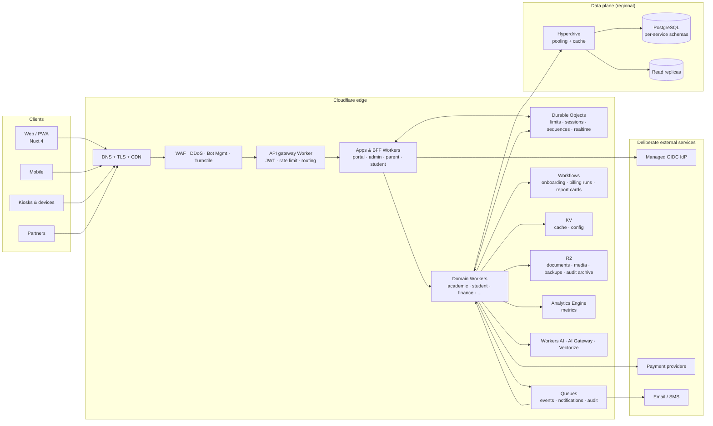

# Athena School Management Platform — Documentation

> **Status:** Planning baseline v1.1 (Cloudflare-native) · **Owner:** Architecture Guild · **Last reviewed:** 2026-11-10
>
> This directory is the **single source of truth** for Athena. Code follows these documents; when code
> and docs disagree, the disagreement is a defect resolved by an ADR or a documentation change in the
> same pull request.

Athena is a multi-tenant, API-first, event-driven school management platform for every education
level — creche/nursery, primary, secondary, TVET, college and university — delivered as
independently deployable **Cloudflare Workers** in one pnpm/Turborepo monorepo.

> **Architecture baseline:** Cloudflare edge compute and data services, PostgreSQL via Hyperdrive,
> Nuxt 4 frontends, Nitro service Workers, Drizzle ORM, strict TypeScript.
> The supplied single-app implementation plan has been reviewed, corrected and folded into
> [Cloudflare platform review](01-architecture/cloudflare-platform-review.md).

---

## 1. How to use this documentation

> **New here?** Use the **[navigation map](NAVIGATION.md)** — it gives reading paths by role, SDLC
> phase and question. For the one-page big picture, see the **[full context diagram](01-architecture/full-context.md)**.

| If you are… | Start here | Then read |
|---|---|---|
| Executive / sponsor | [Vision & scope](00-product/vision-and-scope.md) | [Roadmap, risks & cost](09-roadmap/roadmap-risks-cost.md) |
| Product / business analyst | [Vision & scope](00-product/vision-and-scope.md) | [Requirements](00-product/requirements.md), [Glossary](00-product/glossary.md) |
| New engineer | [System architecture](01-architecture/system-architecture.md) | [Monorepo & tooling](01-architecture/monorepo-and-tooling.md), [Database conventions](03-data/database-conventions.md) |
| Service owner | [Service catalog](01-architecture/service-catalog.md) | [Domain model](02-domain/domain-model.md), your bounded context |
| Security / compliance | [Security architecture](04-security/security-architecture.md) | [Identity & access](04-security/identity-and-access.md), [Threat model & privacy](04-security/threat-model-privacy-compliance.md) |
| Platform / SRE | [Cloudflare CI/CD & infrastructure](07-devops/cicd-environments-infrastructure.md) | [Observability, SRE & DR](07-devops/observability-sre-dr.md) |
| QA | [Test strategy](08-quality/test-strategy.md) | [Requirements](00-product/requirements.md), [API contracts](05-api/api-and-event-contracts.md) |
| Integrator | [API & event contracts](05-api/api-and-event-contracts.md) | [Extensibility](01-architecture/extensibility.md) |

### Document map

```
docs/
├── README.md                                  ← you are here
├── NAVIGATION.md                              map by role, phase and question
├── 00-product/
│   ├── vision-and-scope.md                    vision, personas, capability map
│   ├── requirements.md                        functional + non-functional requirements
│   └── glossary.md                            ubiquitous language
├── 01-architecture/
│   ├── full-context.md                        one-page context: actors, edge, services, data
│   ├── cloudflare-platform-review.md          review of the supplied plan + service responsibility map
│   ├── system-architecture.md                 principles, C4 views, request/event flows, failure modes
│   ├── service-catalog.md                     Workers, bounded contexts, ownership, bindings, SLOs
│   ├── monorepo-and-tooling.md                repo layout, strict TS, layering, boundaries, build
│   ├── integration-and-events.md              Queues, Workflows, DO, outbox, sagas, contracts
│   ├── multi-tenancy.md                       RLS, Hyperdrive, cells, residency, provisioning, quotas
│   ├── extensibility.md                       Workers for Platforms, plugins, webhooks, marketplace
│   └── frontend-architecture.md               Nuxt apps, BFF, design system, a11y, i18n, offline
├── 02-domain/
│   ├── domain-model.md                        contexts, aggregates, invariants, ERDs
│   ├── academics-and-assessment.md            structures across levels, grading, transcripts
│   ├── finance.md                             billing, payments, ledger, payroll, procurement
│   └── operations-and-engagement.md           attendance, timetable, library, transport, hostel, LMS, comms
├── 03-data/
│   ├── data-architecture.md                   stores, ownership, CDC, analytics, retention, DR
│   ├── database-conventions.md                naming, keys, RLS, audit, migrations, performance
│   ├── schema-core.md                         DDL: tenancy, identity, academic, student, admissions
│   ├── schema-finance-assessment.md           DDL: billing, payments, ledger, assessment
│   └── schema-operations.md                   DDL: attendance, scheduling, library, transport, hostel, inventory, health, LMS, comms, engagement, reporting
├── 04-security/
│   ├── security-architecture.md               edge security, crypto, secrets, supply chain, audit
│   ├── identity-and-access.md                 OIDC/SAML, sessions, MFA, RBAC/ABAC/ReBAC
│   └── threat-model-privacy-compliance.md     STRIDE, attack trees, privacy, compliance matrix
├── 05-api/
│   └── api-and-event-contracts.md             REST standards, errors, pagination, versioning, events
├── 06-sdlc/
│   └── sdlc-plan.md                           phases, gates, deliverables, RACI, DoD
├── 07-devops/
│   ├── cicd-environments-infrastructure.md    environments, Wrangler/Terraform, previews, rollback
│   └── observability-sre-dr.md                SLIs/SLOs, Tail Workers, Logpush, on-call, backup, DR
├── 08-quality/
│   └── test-strategy.md                       Workers tests, contracts, load, security, UAT
├── 09-roadmap/
│   └── roadmap-risks-cost.md                  delivery waves, risk register, cost model, KPIs
└── adr/
    ├── README.md                              ADR process + index
    ├── 0001-microservices-in-a-monorepo.md
    ├── 0002-cloudflare-workers-and-nitro.md
    ├── 0003-postgres-hyperdrive-and-rls.md
    ├── 0004-queues-workflows-durable-objects.md
    ├── 0005-managed-identity-and-cedar.md
    ├── 0006-nuxt-bff-frontend.md
    ├── 0007-wrangler-terraform-and-gitops.md
    ├── 0008-rest-openapi-and-event-contracts.md
    ├── 0009-phased-service-delivery.md
    ├── 0010-no-d1-for-core-data.md
    └── 0011-strict-typescript-policy.md
```

---

## 2. Document governance

| Rule | Detail |
|---|---|
| **One owner** | Every document has an owner in its header. Owners review on the cadence below. |
| **Versioned with code** | Docs live in the monorepo and change through pull requests. |
| **Decision records** | Irreversible or cross-cutting decisions require an ADR (`docs/adr`). ADRs are immutable once accepted; supersede with a new ADR. |
| **Traceability** | Requirements use `FR-<DOMAIN>-###` / `NFR-<AREA>-###`. Tests, tickets and code reference those IDs. |
| **Definition of done** | Every feature updates affected docs, threat model, runbooks and API contracts. |
| **Review cadence** | Product & requirements quarterly; architecture and security semi-annually; runbooks after every incident. |
| **No secrets or production data** | Examples use synthetic identifiers. Never commit credentials, customer PII or production dumps. |
| **Diagram-as-code** | Mermaid only, embedded in the document that explains it. No binary diagram files. |

### Status legend

`Draft` → `In review` → `Accepted` → `Superseded` / `Retired`. A document with no status line is
`Accepted` as part of this baseline.

---

## 3. Architecture in one page



**Non-negotiables**

1. **Tenant isolation in depth** — token claim → gateway → service → SQL predicate → Postgres RLS → R2 prefix/KMS context. Never rely on one layer.
2. **Every write is auditable** — who, what, when, from where, before/after, trace ID. Audit is queued and archived to R2 with object lock.
3. **Every call has timeout, retry and circuit-breaker semantics**; every Queue consumer is idempotent.
4. **No shared tables across services**; integration via service bindings, Queues/Workflows, never cross-service SQL joins.
5. **Everything is configuration** — calendars, levels, grading, fees, workflows and branding are data.
6. **Security, privacy and accessibility are release gates.**
7. **Build for failure** — a failed notification, reporting or AI dependency must never block enrolment, attendance or payment capture.
8. **Cloudflare is the platform, not the whole stack** — PostgreSQL, identity and money movement are deliberate, reviewed exceptions (see §5).

---

## 4. Target repository vs today

| Area | Today | Target |
|---|---|---|
| Frontend | Single Nuxt 4 app (`app/`) | `apps/portal`, `apps/admin`, `apps/student`, `apps/parent`, shared UI |
| Backend | Nuxt server routes only | `services/*` — independently deployed Nitro Workers |
| Data | None | PostgreSQL per service schema, Hyperdrive, R2, KV, DO |
| Auth | None | Managed OIDC + BFF sessions, Cedar/ReBAC authorization |
| Messaging | None | Cloudflare Queues + Workflows + DO |
| Delivery | `nuxt build` | Turborepo + Wrangler + Terraform + GitHub Actions |
| Tenancy | None | Shared-schema RLS by default; dedicated cells for enterprise |

The current Nuxt app is a prototype, migrated into `apps/portal` in **Phase 2**.

---

## 5. Deliberate exceptions to "Cloudflare for everything"

Cloudflare is the compute, edge, storage and messaging platform. Three things should **not** be
forced onto it:

| Capability | Decision | Why |
|---|---|---|
| **Relational database** | PostgreSQL (Neon/RDS/Cloud SQL) behind **Hyperdrive** | Cloudflare has no managed Postgres. D1 (SQLite) cannot safely carry multi-service financial ledgers, complex reporting and 1M-DAU write patterns. Hyperdrive is Cloudflare's supported bridge; the DB is the one regional dependency. |
| **Customer identity** | Managed OIDC IdP (Clerk/Auth0/Entra External ID), abstracted behind `identity-service` | Authentication is a security-critical commodity. Cloudflare Access is for workforce/zero-trust, not millions of parents and learners. Building credential storage + MFA + federation is unjustified risk. |
| **Money movement & messaging** | Licensed PSPs and email/SMS providers | Cloudflare is not a payment processor or SMS aggregator. Adapters isolate vendors; no card data touches Athena. |

Everything else — CDN, WAF, DDoS, bot management, Turnstile, Workers, DO, KV, R2, Queues, Workflows,
Hyperdrive, Analytics Engine, Logpush, Images, Stream, AI Gateway, Vectorize, Waiting Room, API
Shield, Access, Tunnel, Load Balancing, DNS — is Cloudflare-native. See the responsibility map in
[Cloudflare platform review](01-architecture/cloudflare-platform-review.md).

---

## 6. Quick reference

| Item | Standard |
|---|---|
| Edge runtime | Cloudflare Workers (paid), compatibility date pinned per service |
| Service framework | Nitro (Cloudflare module preset) + Zod + OpenAPI 3.1 |
| Frontend | Nuxt 4, Vue 3, Nuxt UI, Tailwind, Pinia, Vue I18n |
| Database | PostgreSQL 17 via Hyperdrive, Drizzle ORM, Drizzle Kit migrations |
| Data services | R2 (objects), KV (cache/config), Durable Objects (coordination), Queues (async), Workflows (durable) |
| Analytics | Analytics Engine + Logpush → R2/SIEM; Postgres read models |
| Identity | Managed OIDC (Clerk/Auth0), Cloudflare Access for workforce, Cedar + ReBAC for authorization |
| API | REST/JSON + OpenAPI 3.1; service bindings internally; Queues for async |
| Security | WAF, API Shield, Turnstile, mTLS, Secrets Store, R2 object lock, OWASP ASVS L3 |
| IaC / deploy | Wrangler (Workers) + Terraform (account resources) + GitHub Actions |
| Identifiers | UUIDv7, `snake_case` SQL, ISO-8601 UTC |
| Money | `numeric(19,4)` + ISO-4217; integer minor units at PSP boundaries |
| Repo | pnpm workspaces + Turborepo, Changesets, Conventional Commits |
| Type safety | `strict`, no `any`, no unsafe assertions; Zod at boundaries, inferred types |

---

## 7. Open decisions

| ID | Decision | Owner | Needed by |
|---|---|---|---|
| OD-01 | Postgres provider (Neon vs RDS vs Cloud SQL) and region/cell topology | CTO | Phase 1 |
| OD-02 | Managed IdP (Clerk vs Auth0 vs Entra External ID) | Security/CTO | Phase 2 |
| OD-03 | Payment providers per launch market (Stripe + local rails) | Product/Finance | Phase 3 |
| OD-04 | Whether payroll is built in-house or via a payroll partner in the first release | Product | Phase 4 |
| OD-05 | Search: Postgres FTS + Vectorize/AI Search vs external OpenSearch | Architecture | Phase 4 |
| OD-06 | Tenant data export format (CSV bundle vs OneRoster/Ed-Fi) | Architecture/Integrations | Phase 5 |
| OD-07 | Whether to use D1 for any edge-local relational data (default: no) | Architecture | Phase 2 |
| OD-08 | Workers for Platforms for customer extensions vs webhooks only | Architecture | Phase 6 |
